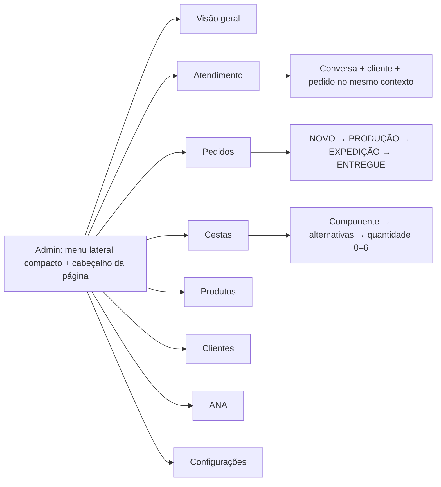
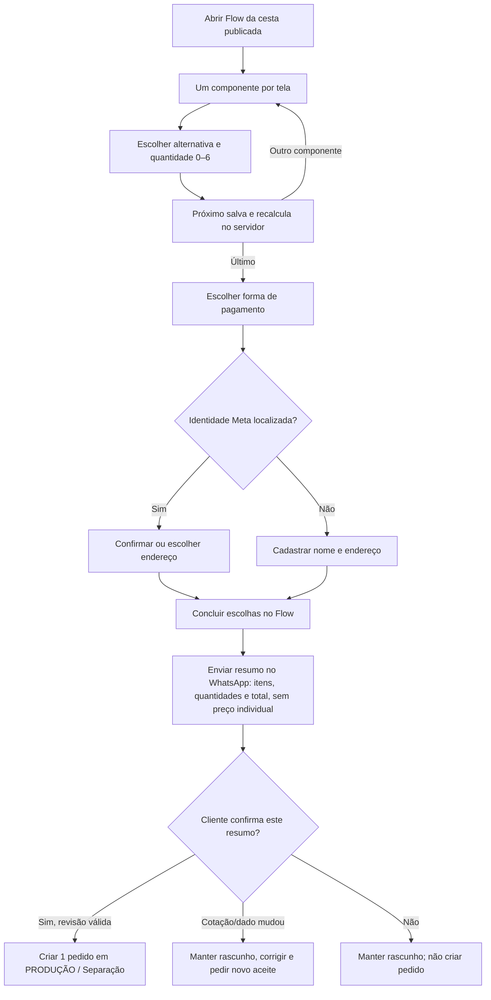
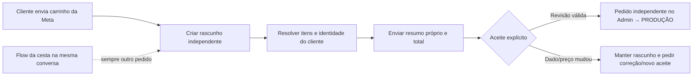

# Caderno técnico complementar — fluxos, clientes, catálogo e pedidos

## Mapa Supabase/GitHub revisado (snapshot 26/10/2026)

- Backend canônico do Admin novo: `Dona Antônia`, Supabase `ssbesxgaijknwsjbsbcz`, região `sa-east-1`, PostgreSQL 17.6 no inventário. O projeto `wvpzudjujtmyspluwhvx` não aparece mais na listagem de 27/10; `Dona Antônia V2` (`hjudhofluihkxykwekir`) e `AME MAIS` (`awcclxehwzvvgajgpnmf`) são projetos distintos e não são destino do Admin.
- GitHub histórico: `osvaldosereia/SUCEDOAN12`, ref pós-limpeza `e324e3c095f90be6cbda8dcdd3a89b3cecab7463`, último Vitrine Admin histórico `12e2a09f733b89c8cf61450f065856d50bfa9cde`. Consultar para contratos, nomes de tabelas/gateways e riscos; implementar frontend e módulos novos do zero.
- O mapa registrou 265 tabelas de aplicação, 46 views públicas, 152 Edge Functions, 1.266 migrations, 1.928 produtos (388 ativos), 574 clientes, 260 pedidos e 17 buckets, todos como fotografia operacional de 26/10. Não usar esses números como estado atual. O banco original não pode ser limpo nem receber uma baseline adivinhada; inventariar triggers, workers e dependências antes de novas configurações globais.
- No snapshot de 26/10, a configuração Bling estava ativa para o hub de produtos/estoque/clientes/pedidos/webhooks, mas registrava `fiscal_enabled=false`. Esse flag histórico não substitui a rechecagem dos controles atuais de emissão humana/automática; veja a seção de 27/10 antes de decidir o que o gateway pode executar. Não alterar flags nem acionar canário sem staging.
- Existem duas contas Meta já mapeadas (`dona-antonia-0975` e `dona-antonia-1018`), cada uma com `phone_number_id` e `waba_id` próprios. Nunca presumir catálogo ou chave Flow compartilhados entre elas. O mapa lista somente nomes de secrets; nenhum valor foi lido, copiado ou documentado. Acessar credenciais apenas no servidor e somente quando houver gate explícito de staging.
- O projeto original também contém recursos AME MAIS. Excluir do escopo qualquer tabela, função, integração, arquivo ou bucket `ame-mais`, inclusive o bucket com esse prefixo.
- A listagem atual ainda informa PostgreSQL 17.6.1.166; o aviso oficial de 25/09/2026 trata do upgrade 17.6 → 17.11 e pede verificações condicionais de `ltree`, `pgcrypto`, `btree_gist` e operadores customizados. Incluir essa leitura no baseline/staging antes de rollout: [Supabase PostgreSQL 17.11](https://supabase.com/changelog/postgres-15-19-17-11-breaking-changes).

**Documento associado:** [Pesquisa e plano profissional — Admin WhatsApp da Sucedoan](pesquisa-e-plano.md)
**Implementação:** [Plano de execução por tarefas](plano-execucao.md)
**Data de referência:** 26/10/2026
**Escopo:** pesquisa, especificação e decisões para implementação greenfield. Nenhum código antigo foi reaproveitado; a base de interface já começou na branch documentada.

> **Correção de backend — 27/10/2026:** seguir `MAPA_DONA_ANTONIA_SUPABASE_E_GITHUB_2026-10-26.md`. O projeto canônico é o Supabase original `ssbesxgaijknwsjbsbcz`. `wvpzudjujtmyspluwhvx` (“Dona Antônia - NOVO”) foi excluído pelo Dashboard após confirmação explícita; a listagem posterior confirmou que o original, Dona Antônia V2 e AME MAIS continuam intactos. O original é o único destino do Admin. Esta decisão substitui qualquer trecho abaixo que identifique o projeto “NOVO” como destino.

O mapa é referência de infraestrutura e conexão, não uma fonte para copiar segredos: nenhum token, senha, `service_role`, chave privada ou valor do Vault entra no Git, na interface ou neste caderno. Interface e lógica do Admin continuam novas. O app usa os gateways existentes do projeto original após revisar cada contrato; não lê tabelas sem grants, não cria catálogo, bucket ou gateway duplicado e não copia código antigo.

Este caderno detalha os contratos que devem orientar a implementação. Cada intenção de compra cria seu próprio pedido canônico: uma cesta iniciada pelo Flow e cada carrinho enviado pelo Catálogo Meta nunca se misturam, mesmo na mesma conversa ou sem intervalo entre eles. Cada pedido tem resumo, aceite, registro no Admin e documento fiscal próprios.

## 1. O que o histórico do GitHub acrescenta

Foi consultada a documentação histórica do repositório [osvaldosereia/SUCEDOAN12](https://github.com/osvaldosereia/SUCEDOAN12), em especial a branch [admin-v3-chat-center-20260912](https://github.com/osvaldosereia/SUCEDOAN12/tree/admin-v3-chat-center-20260912). O conteúdo abaixo foi usado para recuperar decisões e requisitos, não para reutilizar código, esquema de banco, migrações ou funções antigas.

| Documento histórico                                                                                                                                                                                | Informação útil                                                                                                                                                | Tratamento recomendado                                                                                                                                                                                         |
| -------------------------------------------------------------------------------------------------------------------------------------------------------------------------------------------------- | -------------------------------------------------------------------------------------------------------------------------------------------------------------- | -------------------------------------------------------------------------------------------------------------------------------------------------------------------------------------------------------------- |
| [Decisão Admin Inteligência Simples MVP V1](https://github.com/osvaldosereia/SUCEDOAN12/blob/admin-v3-chat-center-20260912/docs/DECISAO-ADMIN-INTELIGENCIA-SIMPLES-MVP-V1.md)                      | ANA em linguagem cotidiana, três áreas; salvar rascunho e publicar explicitamente; preço, catálogo e estoque vêm do banco                                      | Preservar simplicidade/publicação explícita; esconder JSON, prompts técnicos e parâmetros                                                                                                                      |
| [WhatsApp Cestas Implementação](https://github.com/osvaldosereia/SUCEDOAN12/blob/admin-v3-chat-center-20260912/docs/WHATSAPP-CESTAS-IMPLEMENTACAO-20260908.md)                                     | Existiam nove modelos de cesta e opção de trocar/adicionar produtos                                                                                            | Tratar nove como inventário histórico a conferir; não presumir modelos, produtos ou preços atuais                                                                                                              |
| [Decisão WhatsApp Flow V2 Produção](https://github.com/osvaldosereia/SUCEDOAN12/blob/admin-v3-chat-center-20260912/docs/DECISAO-WHATSAPP-FLOW-V2-PRODUCAO-2026-09-09.md)                           | Flow V2 ID 1539877778181619 registrado como PUBLISHED em 09/09/2026; Flow V1 ID 1538860004926321 coexistiu; até 27 escolhas (16 alimentos, 11 higiene/limpeza) | IDs/publicação/JSON são candidatos para inspecionar na Meta, não garantias de ativos atuais nem material para copiar                                                                                           |
| [Análise de WhatsApp Flows para comércio conversacional](https://github.com/osvaldosereia/SUCEDOAN12/blob/admin-v3-chat-center-20260912/docs/ANALISE-WHATSAPP-FLOWS-COMERCIO-CONVERSACIONAL-V1.md) | Flow para escolhas estruturadas; ANA para intenção; preço determinístico no servidor; valores submetidos são não confiáveis                                    | Preservar separação entre conversa e cálculo; avaliar telas por categoria para reduzir abandono                                                                                                                |
| [Estratégia de cadastro e vitrine](https://github.com/osvaldosereia/SUCEDOAN12/blob/admin-v3-chat-center-20260912/docs/WHATSAPP-ATENDENTE-ESTRATEGIA-CADASTRO-VITRINE-20260909.md)                 | Modelo antigo associava pelo telefone; nome de perfil não é necessariamente nome da pessoa; resumo e total antes da confirmação                                | Preservar separação de nome de perfil e nome confirmado e o resumo antes do aceite; o telefone como chave obrigatória foi superado pelo lançamento gradual de usernames/BSUID e pela privacidade oficial atual |
| [MVP confirma antes do Bling](https://github.com/osvaldosereia/SUCEDOAN12/blob/admin-v3-chat-center-20260912/docs/DECISAO-MVP-WHATSAPP-CONFIRMA-ANTES-BLING-V1.md)                                 | Confirmação explícita antes de criar pedido definitivo; Bling assíncrono e falha não apaga pedido                                                              | Preservar; sincronização ERP é estado separado                                                                                                                                                                 |
| [Decisão fiscal de entrega, pagamento e NF-e](https://github.com/osvaldosereia/SUCEDOAN12/blob/admin-v3-chat-center-20260912/docs/DECISAO-FISCAL-ENTREGA-PAGAMENTO-NFE-V1.md)                      | Decisão antiga exigia entrega e pagamento antes da NF-e                                                                                                        | Conflita com a instrução atual de iniciar Bling na EXPEDIÇÃO. Sincronizar a venda nessa etapa; validar a política de emissão/envio com contador antes de ativar                                                |
| [WhatsApp Bridge V3](https://github.com/osvaldosereia/SUCEDOAN12/blob/admin-v3-chat-center-20260912/docs/WHATSAPP-BRIDGE-V3.md)                                                                    | Arquitetura antiga usava transporte intermediário                                                                                                              | Não copiar cenários/dependências; recomendação atual é Meta Cloud API direta, pois ambos os números já usam a API oficial                                                                                      |
| [Arquitetura Dona Antonia V2](https://github.com/osvaldosereia/SUCEDOAN12/blob/admin-v3-chat-center-20260912/docs/ARQUITETURA-DONA-ANTONIA-V2.md)                                                  | Supabase operacional, Bling ERP; regra fiscal antiga para composição da cesta                                                                                  | Usar só como hipótese para confirmar com contador e mapeamento atual                                                                                                                                           |

### O que não carregar como regra atual

Valores e controles históricos são datados: cidades atendidas, taxa/gratuidade de entrega, horário de corte, pagamentos, disponibilidade de produtos, ativação da ANA, status/IDs de Flow, cenários e integração Bling. Consultar conta e operação atuais. Se segredo foi exposto em commit, não recuperar para produção; rotacionar no provedor.

### Inventário de migração, sem importar código

Na Fase 0, preparar relatório de leitura: nove cestas históricas para confirmação; componentes, quantidades e alternativas; identificadores Meta dos produtos; SKUs/IDs Bling; dois números e phone_number_id; WABA, templates, Flow publicado, permissões e conexões atuais. Classificar cada dado como **confirmado**, **validar** ou **obsoleto**. Só dados confirmados entram no novo cadastro.

## 2. Conversa, rascunho e sessão Flow são objetos diferentes

Separá-los resolve quando a mesma pessoa fala com dois números, compra mais de uma vez ou abandona uma personalização.

| Objeto              | Duração/identidade                                                                 | Responsabilidade                                                                                                                |
| ------------------- | ---------------------------------------------------------------------------------- | ------------------------------------------------------------------------------------------------------------------------------- |
| Cliente             | Duradouro; cadastro interno com nome potencialmente desconhecido                   | Cadastro compartilhado quando a identidade for comprovadamente vinculada; não usar nome ou telefone como única chave automática |
| Identidade WhatsApp | Identificador do remetente que a Meta fornece, escopado por portfolio/WABA e canal | Endereçar respostas e correlacionar eventos; telefone E.164 é um contato opcional quando fornecido/verificado                   |
| Conversa            | Longa; identidade remetente + número comercial                                     | Histórico, fila, atendente, modo ANA/humano e janela Meta do canal                                                              |
| Rascunho de pedido  | Um por intenção de compra; cliente e conversa                                      | Guarda produtos de uma origem, pagamento, endereço e total ainda sem aceite                                                     |
| Sessão Flow         | Curta/descartável; token aleatório vinculado ao rascunho                           | Transporta escolhas; não é pedido oficial nem fonte de preço                                                                    |
| Lote de catálogo    | Imutável; deduplicado pelo ID da mensagem Meta                                     | Registra o carrinho enviado e sua origem                                                                                        |
| Pedido confirmado   | Duradouro; ID interno                                                              | Pedido operacional, auditoria e sincronização ERP                                                                               |

Regras:

1. A conversa é indexada pelo identificador de remetente recebido da Meta e pelo phone_number_id; E.164 é opcional e nunca substitui esse identificador.
2. O WhatsApp está liberando usernames de forma gradual e informa que a pessoa pode manter o telefone privado ao iniciar contato com empresa. Portanto, customers.full_name não deve ser requisito para criar um lead; a tela mostra “Contato WhatsApp” até o nome ser confirmado.
3. Guardar nome de perfil fornecido pela plataforma separado de nome confirmado pelo cliente. Não substituir automaticamente nome confirmado.
4. Vincular dois identificadores ou conversas à mesma ficha apenas quando a Meta entregar vínculo verificável ou o cliente/atendente confirmar. Não unir por nome, foto, telefone ausente ou semelhança.
5. Antes de pedido/entrega/contato no Bling que exija telefone, solicitar o compartilhamento do contato; guardar origem e verificação. Não bloquear o início da conversa por ausência de telefone.
6. Cada compra tem rascunho próprio. Uma conversa pode ter mais de um rascunho aberto se a pessoa iniciar um Flow e também enviar um carrinho do Catálogo.
7. Não existe janela temporal para decidir se Flow e Catálogo pertencem ao mesmo pedido: são sempre pedidos separados. Rascunhos de compra não expiram automaticamente; podem ser cancelados pela pessoa/equipe, e preço/estoque são atualizados antes de confirmar.
8. O rascunho comercial não expira por inatividade. Se a sessão técnica do Flow não puder ser retomada pelo cliente/WhatsApp, reenviar um Flow com token novo ligado ao mesmo rascunho; isso nunca junta pedidos nem altera venda aceita. A janela Meta para mensagens é independente.
9. Token Flow opaco, imprevisível e sem dados pessoais/preço. O servidor guarda associação e estado. Invalidar o token ao concluir, cancelar ou emitir uma retomada substituta; não aplicar TTL comercial automático ao rascunho. Token reutilizado ou de outro número não altera pedido.
10. Completar Flow, enviar carrinho, visualizar mensagem ou ficar em silêncio não confirma compra. Só a ação explícita Confirmar pedido cria a venda; aceite válido congela um pedido completo e o envia diretamente para PRODUÇÃO — Separação. Se uma validação falhar, manter o rascunho e pedir correção/novo aceite; não criar um pedido incompleto em NOVO.

## 3. Jornada do cliente: do “oi” ao pedido

1. **Entrada:** webhook identifica phone_number_id, identificador real do remetente (wa_id/BSUID ou o tipo vigente), ID Meta, horário e tipo. Persistir o evento antes de responder.
2. **Cliente:** procurar primeiro pelo vínculo de identidade WhatsApp e criar lead sem nome/telefone quando necessário. Telefone E.164, se recebido, é contato auxiliar e sua origem/validação deve ser registrada. Endereço precisa ser selecionado/confirmado para cada pedido.
3. **Conversa:** recuperar conversa por identidade de remetente + número comercial; cliente é vínculo opcional até ser identificado. Inbox deixa claro por qual número a pessoa escreveu. Deduplicar webhook por ID Meta.
4. **Intenção:** ANA/humano identifica cesta, avulso, consulta ou pedido por pessoa. Preço/estoque vêm das ferramentas do Admin.
5. **Rascunho:** abrir um rascunho independente para cada compra: cesta via Flow ou carrinho via Catálogo.
6. **Cesta no Flow:** enviar CTA com token ligado ao próprio rascunho. O Flow recolhe componentes, pagamento e dados de entrega; o servidor valida escolha, estoque e preço.
7. **Cliente/endereço:** depois da escolha de pagamento, procurar cliente pelo identificador WhatsApp. Se encontrado, pedir confirmação/seleção de endereço salvo; se não, recolher nome/endereço e cadastrar.
8. **Resumo/aceite:** enviar produtos e quantidades, endereço, pagamento e total geral, sem preço individual de cada produto. Cada intenção de compra recebe seu próprio resumo e aceite.
9. **Pedido do Catálogo:** cada carrinho Meta cria uma compra separada da cesta, mesmo que chegue logo depois ou enquanto o Flow estiver aberto. Nunca anexar carrinho a cesta nem editar venda aceita.
10. **Confirmação/separação:** antes do aceite, coletar dados obrigatórios e validar preço/estoque. O aceite válido cria um pedido Admin independente e o encaminha diretamente para PRODUÇÃO — Separação. Dado ausente ou cotação alterada mantém o rascunho e exige correção/novo aceite. NOVO é usado para pedido manual ou retido por ação operacional da equipe, sem representar um pedido WhatsApp confirmado incompleto.
11. **Pós-venda:** respeitar a janela de atendimento Meta; fora dela usar template aprovado e consentimento aplicável. Falha de envio não reabre nem duplica pedido.

## 4. Telas e contrato do WhatsApp Flow

**Decisão revisada pela solicitação mais recente:** cada etapa visível do Flow trata de um componente/slot da cesta, como ARROZ, FEIJÃO ou ÓLEO. A tela mostra as alternativas de produto daquele componente, depois a quantidade de 0 a 6 e, por fim, o botão Próximo. A experiência não agrupa vários componentes na mesma tela.

1. Início direto no primeiro componente da cesta; a mensagem que acompanha o Flow explica a tarefa, portanto não se gasta uma tela com introdução.
2. Uma tela por componente: alternativas permitidas, valor comercial para a cesta, quantidade e total atualizado.
3. Próximo salva e valida a escolha no servidor e abre o componente seguinte; voltar recupera a escolha já salva.
4. Após o último componente, uma tela de forma de pagamento carrega as opções habilitadas pelo Admin.
5. Em seguida, o servidor procura o cliente pela identidade WhatsApp; a tela correspondente confirma um endereço salvo ou cadastra nome/endereço se não encontrar cliente/endereço.
6. A última tela do Flow revisa produtos/opções/quantidades, pagamento, endereço e total. Concluir escolhas devolve a submissão, mas não confirma a compra.
7. Um carrinho do Catálogo Meta é sempre um pedido separado da cesta do Flow, mesmo se chegar imediatamente ou enquanto o Flow estiver aberto. Cada um tem seu próprio rascunho, total e aceite.
8. Para cada pedido, a conversa recebe um resumo independente com produtos/quantidades, endereço, forma de pagamento e total geral, sem preços individuais. Só o aceite explícito cria aquela venda no Admin e a encaminha à Separação.

O Flow é dinâmico porque produto, preço, estoque, versão da cesta e total devem ser lidos/calculados pelo servidor a cada Próximo. Para manter uma tela simples por componente sem gerar dezenas de telas JSON duplicadas, a implementação principal poderá reutilizar uma tela técnica ITEM com conteúdo e título dinâmicos, avançando para si até o último componente. A publicação precisa validar esse padrão no Flow Validator e num número interno. Se a Meta rejeitar o retorno à mesma tela como avanço, o publicador do Admin deve gerar automaticamente uma tela JSON por componente, ainda com a mesma experiência que o cliente pediu. Essa é uma contingência técnica predeterminada; não muda o desenho comercial.

O Flow continua focado em um componente por tela até terminar os itens. Pagamento vem depois dos componentes; em seguida, o servidor procura a identidade exata no cadastro. Se encontrar cliente, o Flow pede confirmação/seleção de um endereço salvo; se não encontrar cliente ou endereço, recolhe nome e endereço e grava o cadastro. O endereço usado é sempre explicitamente confirmado e copiado como snapshot; não inferir endereço pela linha WhatsApp.

### Validação técnica

A conclusão chega no webhook comum como `interactive.nfm_reply`; `response_json` é JSON serializado. Se o spike confirmar que `flow_token` é devolvido em todas as linhas, usá-lo como correlator após validar remetente, número, WABA, token, versão e estado do rascunho. Aplicar schema estrito e rejeitar campos inválidos. Buscar dados atuais e recalcular no servidor. O uso do token no evento final permanece gate de prova, não uma suposição baseada no commit legado.

**Decisão de imagem, com limite de evidência explícito:** todas as alternativas precisam mostrar a foto do produto; é requisito do proprietário e desenho pretendido. A URL oficial [Meta Flow JSON Components](https://developers.facebook.com/docs/whatsapp/flows/reference/components) é a fonte de contrato por componente/versão, mas respondeu HTTP 429 nesta revisão. Anotações anteriores registram suporte a imagem Base64, `alt-text` e `data-source` dinâmico, com detalhes dependentes da versão; não transformar a versão mínima nem números de tamanho anotados em constante até reconfirmar a página oficial e obter sucesso no Flow Validator das duas WABAs. A miniatura interna de até 25 KB é uma meta de desempenho do projeto. Imagem por alternativa é o caminho de implementação sujeito à validação; se a Meta não aceitar, bloquear a publicação comercial até resolver, sem retirar a foto.

**Contrato de entrada para cada origem:** Flow concluído chega como `interactive.type = nfm_reply`; o servidor analisa `response_json` e, depois do spike confirmar o eco do token, localiza o rascunho por hash do `flow_token` aleatório emitido por ele, conferindo remetente + `phone_number_id` + WABA + versão da cesta. Se o evento não devolver o token, a programação do checkout para até especificar e provar outra correlação. O webhook de carrinho chega como `messages[].type = order`; cria rascunho separado e resolve os itens pelo catálogo e `product_retailer_id`. Ambos ligam a intenção à mesma ficha de cliente/conversa quando a identidade estiver comprovada, mas nenhum evento transfere nem mistura os itens da outra origem. Cada webhook tem deduplicação própria por ID Meta e ambos convergem para o mesmo serviço interno de revisão e confirmação.

O Data Exchange dinâmico é obrigatório para a cesta porque cada Próximo precisa ler alternativas/preços/estoque vigentes, salvar a seleção e calcular o total atualizado no servidor. Não oferecer como opção de desenho um Flow estático que possa exibir valor desatualizado.

- Separar endpoint Data Exchange do webhook normal e suportar ping, init, data_exchange e back conforme protocolo da versão usada.
- Publicar chave pública conforme Meta; manter privada somente nos segredos do servidor. Confirmar a configuração para cada phone_number_id.
- Não registrar payload pessoal descriptografado em logs.
- Verificar status, json_version, data_api_version, erros de validação e saúde do Flow antes de enviar. Versionar mudanças do Flow publicado.

Se o Flow dinâmico não estiver saudável, suspender o envio e usar a jornada alternativa guiada no chat com a mesma regra de preço; nunca degradar silenciosamente para um Flow estático com preço antigo.

## 5. Pedidos independentes: Flow da cesta e Catálogo Meta

**Decisão atual que substitui a proposta anterior de unir cesta e carrinho:** cesta feita pelo Flow e carrinho enviado pelo Catálogo são sempre pedidos separados. A separação não depende de minutos/horas, do estado da conversa nem de `context.id`. Mesmo se a pessoa enviar um carrinho logo depois de concluir o Flow, o Admin cria outro rascunho, pede outra confirmação e registra outra venda. Isso simplifica a operação e permite uma nota fiscal por pedido.

Cada compra tem `order_draft_id`, revisão de cotação, forma de pagamento, endereço, aceite, número de pedido e estado Bling próprios. Os dois pedidos aparecem na mesma ficha/conversa do cliente, quando a identidade estiver comprovada, como cartões distintos. Nunca editar/adicionar itens a uma venda já confirmada.

### Pedido de cesta pelo Flow

1. Criar rascunho exclusivo para a cesta e vincular a sessão Flow apenas a esse rascunho.
2. Flow percorre componentes um por vez; no fim coleta pagamento, procura cliente/endereço e solicita dados ausentes.
3. Depois da submissão, revalidar preços/estoque e enviar resumo próprio: lista de produtos/opções e quantidades, endereço de entrega, forma de pagamento e total geral. Não mostrar preços individuais dos produtos.
4. O botão Confirmar pedido aceita somente essa revisão. Em transação idempotente, salvar aceite, congelar snapshot e criar a venda Admin.
5. O aceite válido cria pedido diretamente em PRODUÇÃO — Separação. Se algum dado/preço/estoque não passar, não confirmar nem criar pedido; corrigir o rascunho e emitir novo resumo. O Bling ainda é chamado quando sair de PRODUÇÃO para EXPEDIÇÃO.

### Pedido pelo Catálogo nativo

1. Cada mensagem recebida como carrinho `messages[].type = order` cria uma intenção de pedido própria; deduplicar retries pelo ID original Meta. Um evento Meta distinto é outro pedido, não atualização do anterior.
2. Resolver cadastro pela identidade de remetente/escopo; nunca agrupar cesta e carrinho. Se houver um cliente e endereço confirmado, mostrar para confirmar. Se não houver cliente/endereço, recolher nome e endereço no chat/Flow de checkout e cadastrar.
3. Interpretar o payload documentado pela Meta: `order.catalog_id` e cada `order.product_items[]` trazem `product_retailer_id`, `quantity`, `item_price` e `currency`; guardar `messages[].id`, remetente, `phone_number_id`, `entry[].id` (WABA) e `context` quando presentes. A amostra oficial serializa quantidade e preço como texto; o normalizador deve aceitar somente os tipos/formatos definidos e validados para a Graph API ativa, converter quantidade a inteiro válido e dinheiro a centavos sem ponto flutuante. Resolver o par catálogo + retailer ID para um produto/SKU interno. `item_price` é o preço observado no carrinho recebido, não preço final autorizado: comparar moeda, preço, disponibilidade e vínculo com o cadastro vigente no Admin; recalcular no servidor e exigir novo resumo/aceite se houver divergência.
4. Recolher forma de pagamento e endereço para esse pedido. É permitido pré-preencher a última opção confirmada para conveniência, mas o resumo precisa mostrar o método/endereço e pedir aceite outra vez.
5. Enviar resumo independente com produto e quantidade, endereço, pagamento e total geral, sem preço individual por linha. Só a confirmação desse resumo cria o segundo pedido.
6. Quando ocorrer a transição PRODUÇÃO → EXPEDIÇÃO, enviar cada pedido separadamente ao Bling com referência externa própria; cada um tem processo fiscal e NF-e independentes.

### Sem limite de tempo para a separação

- Nunca há janela temporal de associação: carrinho Meta e cesta Flow permanecem separados tanto se chegarem juntos como com dias de diferença.
- Rascunhos não são eliminados automaticamente por inatividade; ficam como pendentes até confirmação ou cancelamento explícito. A lista do Admin oferece retomar, cancelar e revisar.
- Antes de confirmar, o servidor busca preço, estoque, frete e endereço atuais. Se algo mudou, cria nova revisão e pede novo aceite; não depende de uma validade temporal escondida.
- O rascunho comercial não vence com o relógio. Se o cliente precisar retomar e a sessão técnica original não estiver utilizável, reemitir o Flow com token novo para o mesmo rascunho e recalcular preço/estoque; nunca juntar com outro pedido.
- A janela de 24 horas da Meta continua valendo para mensagens livres. Se fechada, usar template aprovado ou aguardar novo contato; isso não cancela o rascunho.

### Dados técnicos e idempotência

- Guardar `phone_number_id`, WABA, identidade do remetente, ID da mensagem de carrinho, `context.id` se presente, `catalog_id`, IDs retailer/quantidades/preços observados e `order_draft_id` para rastrear a origem e impedir duplicação. A chave de deduplicação da entrada é o ID Meta da mensagem com escopo do número; `context.id` serve para auditoria e contexto, nunca para associar carrinho à cesta Flow.
- `context.id` identifica a mensagem a que o cliente respondeu; serve como evidência de contexto e auditoria, nunca como instrução para unir dois pedidos.
- Um retry com o mesmo ID Meta é processado uma vez. Uma nova mensagem de carrinho, com ID Meta diferente, inicia outro rascunho, mesmo com itens iguais.
- Cada pedido tem quote revision, payment_method, address_snapshot, total, confirmação e chave de idempotência próprias. Constraints impedem promover duas vezes o mesmo rascunho.
- Se o cliente envia carrinho enquanto o Flow está aberto, manter as duas compras separadas no Admin. Nenhuma resposta tardia de Flow pode alterar o rascunho do carrinho, e vice-versa.

### Mensagem de confirmação de cada pedido

**Confira seu pedido**

• Arroz Tio Alvino × 1
• Feijão × 2
• Óleo de soja × 2

**Entrega:** endereço confirmado, com referência resumida
**Pagamento:** forma escolhida
**Taxa de entrega:** mostrar apenas se houver cobrança; informar antes do total
**Total do pedido: R$ …**

“Confirme para encaminharmos este pedido para separação. Um carrinho do Catálogo enviado depois será tratado como outro pedido.”

Botão principal: **Confirmar pedido**. Para editar, a pessoa responde “ALTERAR” ou pede atendimento; uma edição gera nova revisão e invalida o botão anterior. Cada pedido tem sua própria mensagem, aceite e número.
## 6. Cadastro do cliente no Admin

### Campos e comportamento

| Campo               | Regra                                                                                                                                       |
| ------------------- | ------------------------------------------------------------------------------------------------------------------------------------------- |
| Identidade WhatsApp | ID de remetente recebido da Meta, tipo, portfolio/WABA, phone_number_id, origem e primeiro/último evento; único dentro do escopo confirmado |
| Telefone WhatsApp   | Opcional; E.164 apenas se compartilhado/recebido e verificado; origem e data de verificação guardadas                                       |
| Nome de perfil Meta | Informativo e não verificado; não substitui nome confirmado                                                                                 |
| Nome do cliente     | Pode ser nulo no primeiro contato; editar/confirmar durante atendimento; UI usa “Contato WhatsApp” enquanto desconhecido                    |
| Endereços           | Vários por cliente; apelido, logradouro, número, complemento, bairro, cidade, referência                                                    |
| Conversas           | Uma por identidade de remetente e número comercial; cadastro global só quando houver vínculo comprovado                                     |
| Consentimentos      | Origem, finalidade, versão do texto, data e opt-out                                                                                         |
| Bling               | ID externo opcional, última sincronização e erro legível                                                                                    |
| Histórico           | Pedidos e conversas com permissões; notas internas não visíveis ao cliente                                                                  |

### Criação, busca e duplicidade

- Buscar primeiro pelo identificador do remetente e pelo escopo do canal. Telefone é chave auxiliar de correspondência somente quando presente e verificado.
- Se novo, criar identidade/conversa mínima sem exigir nome nem telefone; pedir telefone e nome apenas quando a operação do pedido/entrega exigir.
- Mesmo telefone vindo por dois canais só permite ficha comum depois de vínculo verificado. Mostrar o número comercial de origem e atendente em cada conversa.
- Permitir correção/mesclagem de duplicata com trilha de auditoria; não fundir por nome automaticamente.
- Endereço recebido no Flow passa pela mesma validação de chat. Nunca sobrescrever endereço confirmado sem mostrar qual será usado.
- Como a Meta já requer suporte a BSUID para integrações diretas, manter `user_id`/BSUID como identidade de plataforma mesmo sem telefone e responder por esse identificador quando a Graph API ativa permitir. Pedir telefone compartilhado somente quando a logística, cliente ou etapa Bling realmente precisar dele; homologar campos e envio por cada WABA.
- Ação “Novo pedido” cria rascunho, nunca uma venda confirmada.

Detalhe do cliente com abas **Resumo**, **Conversas**, **Pedidos** e **Endereços**. No atendimento, contexto lateral mostra contato, endereço escolhido, últimos pedidos e rascunho. Notas internas precisam ser visualmente distintas das mensagens enviadas.

## 7. Estados e transições do pedido

### Estados de negócio

RASCUNHO → PRODUÇÃO (Separação) → EXPEDIÇÃO → ENTREGUE
PEDIDO MANUAL/RETIDO → NOVO → PRODUÇÃO (Separação)

CANCELADO é estado terminal com motivo, autor e horário. Rascunhos ficam na conversa/pendências, fora do quadro principal.

| Transição                                             | Efeito no Admin                                                                                 | Efeito externo                                                                     |
| ----------------------------------------------------- | ----------------------------------------------------------------------------------------------- | ---------------------------------------------------------------------------------- |
| Criar/editar rascunho                                 | Validar itens, origem, recalcular total                                                         | Nenhum Bling                                                                       |
| Confirmar pedido WhatsApp → PRODUÇÃO / Separação      | Só aceitar revisão completa e atual; transação congela snapshot, grava aceite e reserva estoque | Sem envio ao Bling nessa etapa                                                     |
| Preço/estoque/dado obrigatório mudou antes de aceitar | Não cria pedido; mantém rascunho, invalida botão e envia correção/novo resumo para aceite       | Nenhum envio ao Bling                                                              |
| Pedido criado manualmente/retido → NOVO               | Guardar origem, responsável e motivo; ainda não liberado para separação                         | Sem envio ao Bling                                                                 |
| NOVO → PRODUÇÃO / Separação                           | A equipe resolve pendência operacional e libera a separação; registrar ator/motivo              | Sem emissão automática                                                             |
| PRODUÇÃO → EXPEDIÇÃO                                  | Gravar transição e outbox única                                                                 | Criar/localizar contato e pedido de venda Bling; NF segue política fiscal aprovada |
| EXPEDIÇÃO → ENTREGUE                                  | Guardar confirmação e ator                                                                      | Atualizar Bling se o mapeamento da conta estiver validado                          |
| Cancelar                                              | Exigir motivo e auditar                                                                         | Tratar cancelamento externo conforme fase e política contábil                      |

“Separação” é a primeira atividade dentro do estado PRODUÇÃO, visível como subtítulo/fila. A confirmação válida do cliente cria o pedido e inicia essa etapa. NOVO fica para pedido manual ou retenção operacional explícita antes da separação; não deve mascarar dado de checkout ausente nem aceite inválido. Não permitir pular estados sem permissão e justificativa. Usar transação/controle de concorrência para duas pessoas não sobrescreverem a mesma mudança.

Manter status auxiliares separados: bling_order_status, invoice_status, payment_status, message_status, integration_status. Exemplos de linguagem do painel: “Aguardando envio”, “Enviado ao Bling”, “Precisa revisar”, “NF-e autorizada”, “Rejeitada”. Estar em EXPEDIÇÃO não prova autorização fiscal.

## 8. Contratos internos e idempotência

Entidades conceituais (nomes finais devem respeitar o schema atual confirmado do Supabase):

- customers(full_name opcional, dados confirmados e consentimentos); customer_contacts(phone/email opcionais com origem/verificação)
- customer_whatsapp_identities(customer_id, provider, business_scope, sender_id, sender_id_type, first_seen_at, last_seen_at)
- whatsapp_lines(phone_number_id único, waba_id, display_number, active)
- conversations(identity_id, line_id, customer_id opcional, status, assigned_to, automation_mode), única por identidade de remetente + linha
- messages(provider_message_id UNIQUE, conversation_id, direction, type, payload_redacted, sent_at, status)
- order_drafts(conversation_id, customer_id opcional, source=flow_basket|meta_catalog, source_message_id, status, basket_version, payment_method_snapshot, delivery_address_snapshot); vários rascunhos podem coexistir e não há expiração automática comercial
- flow_sessions(flow_token_hash UNIQUE, draft_id, flow_version, line_id, issued_at, consumed_at, revoked_at); sem `expires_at` comercial; ao retomar, emitir token novo e revogar o anterior
- catalog_batches(provider_message_id UNIQUE, draft_id, catalog_id, context_wamid, received_at, payload_snapshot)
- catalog_batch_items(batch_id, product_id, quantity, observed_price, canonical_price)
- orders(order_number UNIQUE, source, customer_id, conversation_id, line_id, operational_status, payment_method_snapshot, delivery_address_snapshot, confirmed_at, total_snapshot, payment_status, fiscal_status, ...)
- order_items(order_id, product_id obrigatório, description_snapshot, sku_snapshot, quantity, unit_price_snapshot, line_total); cada produto físico escolhido na cesta vira linha do pedido. Não criar uma linha virtual da cesta que duplique estoque/total. Se o Bling exigir preço por linha, refletir regra de alocação do ajuste interno conforme aprovação contábil.
- order_status_history(order_id, from_status, to_status, actor_id, reason, created_at)
- integração outbox = `app_private.outbox_jobs` existente, adaptada com chave única, referência de conta, claim lease, backoff, estado de reconciliação e erro seguro; não duplicar tabela
- integração inbox = `app_private.webhook_inbox` existente, adaptada com escopo de conta, tipo/timestamp e `dedupe_key` canônica; não assumir que WAMID sozinho identifica status distintos

### Operação atômica

Função transacional do servidor para aplicar lote de catálogo: verificar evento não processado; conferir que rascunho pertence à conversa e está aberto; validar mapeamento/produto; inserir lote; recompor linhas e total; auditar; devolver resumo. Confirmação também congela itens/preços e grava evento na outbox na mesma transação. Chamadas de rede ficam fora da transação.

Webhooks podem ser entregues mais de uma vez. Validar assinatura, normalizar cada mensagem/status, persistir o evento e sua `dedupe_key`, responder rápido e processar com retry seguro. Uma mesma mensagem Meta pode produzir status distintos (sent, delivered, read); diferenciar cada avanço por estado/timestamp. Não usar trigger SQL para chamar Meta/Bling.

## 9. Precificação do combo e do extra interno

**Regra de preço definida para cesta configurável:** cada alternativa permitida tem um valor comercial por unidade dentro da versão da cesta. A cesta não pré-seleciona produto nem quantidade; cada tela apresenta o slot e a cliente escolhe alternativa e quantidade. Quantidade 0 retira aquele slot; quantidades positivas usam o preço da alternativa na versão. O preço avulso do produto não altera uma cesta publicada. O total é calculado novamente no servidor a cada etapa e usa o adicional interno uma única vez.

Fórmula operacional em centavos:

**subtotal da cesta = extra interno da cesta + soma de (quantidade escolhida × valor comercial da alternativa escolhida no slot)**

**total do pedido de cesta = subtotal da cesta + entrega informada − desconto autorizado**

**total do pedido do Catálogo = soma de (preço atual de cada avulso × quantidade) + entrega informada − desconto autorizado**

- O extra interno é parâmetro de formação do preço e aparece uma única vez dentro do total da cesta; não é apresentado como linha misteriosa ou cobrança separada. O cliente sempre vê o total final antes do aceite.
- Valor comercial do componente na cesta não é o custo de compra nem precisa coincidir com o preço avulso do catálogo. O Admin mantém campos separados para preço de venda, custo interno e valor comercial da cesta.
- Cada alternativa mostra o nome e o valor aplicável; o Flow recalcula o total a cada avanço. Exemplo visual: “Arroz Tio Alvino — R$ 22,90 por unidade na cesta”. Quando o total muda, o Flow mostra o novo total em atualização dinâmica.
- Quantidade aceita em todo slot: inteiros 0, 1, 2, 3, 4, 5 e 6. 0 significa Retirar. Quantidade acima de 0 exige uma alternativa. A validação de conclusão exige pelo menos um slot positivo; o cliente não consegue confirmar uma cesta vazia.
- O servidor recalcula tudo em centavos usando preço/regra ativa e snapshot de versão; não aceita total, preço ou delta enviados como autoridade pelo Flow.
- Cada carrinho Meta tem pedido próprio com preços de venda vigentes do Admin, comparados aos preços observados no evento. Divergência exige novo resumo e aceite; avulsos nunca são somados ao pedido de cesta.
- Qualquer taxa de entrega/desconto externo deve ser informada antes do aceite; custo, margem, fornecedor, extra interno e fórmula não aparecem para ANA/cliente.
- Alteração depois do orçamento gera nova revisão e invalida confirmação anterior. Pedido confirmado guarda preço, componente, quantidade, alternativa e regra usados.

## 10. Bling: sincronização e faturamento

**Atualização de evidência:** a inspeção read-only identificou o gateway remoto `admin-products-live-v1` v189 no Supabase canônico `ssbesxgaijknwsjbsbcz`. A implementação local deve reutilizar as ações específicas desse gateway; não criar OAuth/worker duplicado. Contrato observado, limites oficiais atuais, regras do proprietário e gates pendentes estão em [bling-integracao-evidencias.md](bling-integracao-evidencias.md). A nota é a referência detalhada para esta integração e não autoriza escrita remota.

API v3 aceita pedido de venda com várias linhas. Criar uma venda Bling por pedido Admin confirmado: uma venda para a cesta e uma venda distinta para cada carrinho do Catálogo. Nunca misturar cesta e carrinho na mesma venda externa. A emissão fiscal é independente por pedido, seguindo a política aprovada pelo contador.

Base atual: https://api.bling.com.br/Api/v3. OAuth Authorization Code é concluído no servidor, com state contra CSRF; Client Secret e refresh token ficam fora do frontend. A autenticação por token opaco foi descontinuada: solicitar JWT com o cabeçalho enable-jwt: 1 no POST de autorização/renovação e mantê-lo em todas as chamadas autenticadas. Guardar expires_in retornado para renovar access token. O authorization code tem janela de um minuto e o refresh token documentado dura 30 dias. Confirmar a versão e os escopos do aplicativo conectado antes de programar.

O limite publicado é compartilhado pela conta: até 3 requisições/segundo e 120 mil/dia, com outras validações de IP. A implementação deve centralizar chamadas Bling num limitador por conta, serializar refresh OAuth e iniciar com teto conservador de 2 requisições/segundo; respeitar `Retry-After` em 429 e manter métricas de uso. A documentação também exige app de visibilidade pública e processo de homologação, com etapa de testes de 30 dias. Iniciar a confirmação desse processo em paralelo à construção local; isso não bloqueia telas nem mocks, mas pode determinar quando a integração autenticada poderá ser homologada.

### Mapeamentos necessários

- Produto interno ↔ SKU estável ↔ product_retailer_id Meta ↔ ID produto Bling.
- Cliente Admin ↔ contato Bling; persistir ID após localizar/criar, sem duplicar por pequenas variações de nome.
- Pedido Admin ↔ referência externa/numeroLoja e ID de venda Bling. Não assumir que numeroLoja sozinho ofereça idempotência até provar.
- Componentes da cesta ↔ linhas fiscais ou kit conforme contador. Se valor comercial difere da soma dos itens fiscais, aprovar distribuição de preço, desconto ou outras despesas e impactos tributários.
- Endereço, frete, pagamento e natureza de operação só entram com valores validados.

### Sequência de integração

1. PRODUÇÃO → EXPEDIÇÃO cria evento dispatch_requested único para o pedido.
2. Worker consulta/reconcilia operação anterior antes de repetir chamada sem resposta.
3. Localiza/cria contato e envia uma venda com todos os itens do snapshot confirmado.
4. Persiste ID externo e resultado seguro; retry respeita limite de API e usa espera crescente.
5. Criar NF-e, enviar à SEFAZ e confirmar situação são operações separadas. Marcar autorizada só após retorno inequívoco.
6. Validar assinatura X-Bling-Signature-256, deduplicar eventId; tratar ordem variável e processar assincronamente. Persistir o evento e responder 2xx em até 5 segundos. O Bling tenta novamente por até três dias e pode desabilitar o webhook após falhas; monitorar a ativação do webhook e avisar o operador se cair.
7. Antes de atualizar pedido sincronizado, buscar objeto completo, pois PUT substitui o pedido; preservar campos. Após iniciar NF-e há restrições.
8. Erro Bling deixa pedido em seu estado operacional e pendência recuperável; retry não cria segunda venda.

**Limite operacional:** aplicar orçamento compartilhado por conta (teto inicial recomendado de 2 req/s, abaixo do limite oficial de 3 req/s) para todas as funções, retries, reconciliações e rotinas de suporte. O limite diário documentado é 120 mil requisições; é capacidade, não meta de consumo. Monitorar 429 e validar eventuais bloqueios por IP sem aumentar concorrência automaticamente.

### Divergência fiscal registrada

Instrução atual: ao sair de PRODUÇÃO, vai para EXPEDIÇÃO e inicia envio ao Bling para emitir nota. Decisão histórica dizia aguardar entrega e pagamento. Para não gravar silenciosamente uma política tributária possivelmente incorreta:

- Na EXPEDIÇÃO, sincronizar o pedido de venda e preparar a fila fiscal.
- A geração/envio da NF-e usa invoice_policy explícita. Até validação do contador e teste da conta, manter emissão real desativada; registrar se a política final permite emitir na expedição ou exige condições adicionais.
- Admin distingue “Pedido enviado ao Bling” de “NF-e autorizada”.
- Isso é uma decisão de homologação controlada, e não escolha improvisada por cada operador.

## 11. Telas do Admin com simplicidade

### Atendimento

- Duas filas identificáveis e filtro por número; número de destino/origem visível no chat.
- Lista com busca por nome, identidade/telefone quando disponível, última mensagem, responsável e status.
- Ação primária **Assumir atendimento** pausa ANA naquela conversa; outra ação clara devolve para ANA.
- Contexto lateral: cliente, endereço escolhido, últimos pedidos e rascunho ativo.
- Notas internas distintas; botão de envio deixa claro quando mensagem vai ao cliente.

### Clientes

Busca por nome, identidade WhatsApp e telefone quando disponível; ficha com endereços, conversas e pedidos vinculados com segurança. Criar manualmente para exceções; prevenir duplicatas pelo ID de remetente escopado e tratar telefone como correspondência auxiliar verificada.

### Cestas

Nome, resumo e estado; versão draft/publicada/retirada; slots com nome/ordem, alternativas de produto e preço comercial por unidade na cesta; adicional interno editável apenas por ação autorizada. Prévia espelha uma tela por slot com foto, preço, quantidade 0–6 e Próximo. Salvar rascunho e publicar versão validada. Criar versão nova duplicando a publicada; nunca editar pedido ou sessão antigos.

### Produtos

Nome, SKU, preço, foto, disponibilidade, mapeamentos Meta/Bling e estado de sincronização em linguagem simples. Produto não deve ser oferecido quando preço/ID estiver inconsistente.

### Pedidos

Quadro com quatro estados operacionais. Detalhe de cada pedido mostra cliente, origem única (Flow/cesta ou Catálogo), itens, pagamento, entrega, total, aceite e histórico. Ao ir para EXPEDIÇÃO, informar envio da venda correspondente ao Bling e situação fiscal. Mostrar “Ver motivo” e retry autorizado.

### ANA

Três blocos simples: **O que a IA deve saber**, **Como deve atender**, **Regras importantes**. Publicação explícita, suspensão por conversa e por número, simulador que não altera pedido real.

## 12. Homologação obrigatória antes do lançamento

| Cenário                                                                          | Resultado esperado                                                                       |
| -------------------------------------------------------------------------------- | ---------------------------------------------------------------------------------------- |
| A mesma identidade comprovada escreve nos dois números                           | Conversas independentes por canal; cliente compartilhado somente pelo vínculo confirmado |
| Webhook Meta repetido                                                            | Uma mensagem e um único efeito comercial                                                 |
| Flow válido                                                                      | Escolhas associadas ao rascunho correto e total recalculado                              |
| Token Flow expirado ou de outro número                                           | Pedido não muda; cliente reinicia ou chama atendente                                     |
| Quantidade adulterada acima do limite                                            | Rejeitada com orientação; cálculo não usa valor adulterado                               |
| Flow terminou, cliente não aceitou resumo                                        | Continua rascunho; não entra como NOVO                                                   |
| Carrinho após Flow, antes ou depois de confirmar                                 | Abre rascunho separado; jamais entra na cesta                                            |
| Carrinho chega enquanto o Flow está aberto                                       | Dois rascunhos independentes; a resposta de um não altera o outro                        |
| Novo carrinho depois de pedido confirmado                                        | Segundo pedido, resumo, aceite e documento fiscal independentes                          |
| Produto referido, sem carrinho order                                             | Interesse registrado; item não vira compra                                               |
| Carrinho sem context.id                                                          | Criar rascunho próprio pela identidade/linha do evento; não procurar cesta               |
| Retry do mesmo carrinho com mesmo ID de mensagem                                 | Uma mensagem processada uma vez                                                          |
| Novo carrinho com ID de mensagem diferente                                       | Novo rascunho e venda separada, mesmo com itens iguais                                   |
| Botão de confirmação clicado duas vezes/reenvio de webhook                       | Um único pedido; segunda ação retorna o pedido já criado                                 |
| Cliente altera itens após receber a revisão                                      | Revisão antiga invalidada; novo total e novo aceite exigidos                             |
| Produto, preço, estoque, endereço ou taxa mudou enquanto o rascunho estava salvo | Recalcular e enviar nova revisão antes do aceite; não há expiração automática por tempo  |
| Preço mudou desde o catálogo                                                     | Novo total e novo aceite                                                                 |
| Carrinho após pedido confirmado                                                  | Não altera pedido silenciosamente                                                        |
| Dois operadores editam ao mesmo tempo                                            | Uma transição vence; outra recebe estado atualizado                                      |
| EXPEDIÇÃO acionada duas vezes                                                    | Uma tarefa outbox e uma venda Bling                                                      |
| Timeout ao criar venda                                                           | Reconcilia no Bling antes de repetir                                                     |
| Bling rejeita venda/NF-e                                                         | Pedido continua visível, com erro acionável                                              |
| NF criada, ainda sem autorização                                                 | Não aparece como autorizada                                                              |
| Humano assumiu conversa                                                          | ANA não responde em paralelo                                                             |
| Cliente pede para parar                                                          | Opt-out gravado; interromper proatividade aplicável                                      |

## 13. Decisões profissionais para acelerar a implementação

| Decisão                   | Padrão recomendado                                                                                      |
| ------------------------- | ------------------------------------------------------------------------------------------------------- |
| Cadastro nos dois números | Identidade do remetente + número do canal; cadastro de cliente unificado somente por vínculo comprovado |
| Compra em construção      | Um rascunho por intenção de compra; sem expiração automática                                            |
| Flow + catálogo           | Sempre pedidos separados; não unir mesmo com evento/contexto correlacionável                            |
| Carrinho repetido         | Cada ID de mensagem distinto abre um novo rascunho; retry com mesmo ID é deduplicado                    |
| Confirmação               | Um aceite explícito por resumo/pedido                                                                   |
| Preço                     | Combo com preço-base próprio; avulsos por preço vigente; snapshot imutável                              |
| Margem/extra interno      | Incorporar uma vez; não revelar custo nem cobrar taxa surpresa                                          |
| Disponibilidade           | Conferir ao preparar e antes de aceitar                                                                 |
| Pedido Bling              | Uma venda por pedido Admin; cesta e carrinho Meta nunca se misturam                                     |
| Gatilho Bling             | Expedição inicia sincronização da venda; NF separada com política aprovada                              |
| Falhas                    | Recuperáveis, sem duplicar pedido                                                                       |
| Histórico                 | Requisitos e metadados não secretos; descartar código antigo                                            |

## 14. Snapshot do projeto “NOVO” — fora do destino atual

Os dados abaixo descrevem o projeto “Dona Antônia - NOVO” quando foi inspecionado. Mantêm valor histórico para a decisão de cancelamento, mas não definem o backend do sistema.

| Propriedade                | Estado observado em 26/10/2026                                                                                               |
| -------------------------- | ---------------------------------------------------------------------------------------------------------------------------- |
| Project ref                | wvpzudjujtmyspluwhvx                                                                                                         |
| URL da API                 | https://wvpzudjujtmyspluwhvx.supabase.co                                                                                     |
| Região / plano             | São Paulo (sa-east-1) / Pro                                                                                                  |
| Estado / banco             | ACTIVE_HEALTHY / PostgreSQL 17.11                                                                                            |
| Migrações                  | Duas: `initial_dona_antonia_clean_schema`, `stage_legacy_product_images_for_safe_copy`                                       |
| Edge Functions             | Nenhuma                                                                                                                      |
| Tabelas                    | 14 `public` + 5 `app_private` = 19; todas com RLS habilitado                                                                 |
| Dados de negócio           | 1.928 produtos, 574 clientes, 578 contatos e 336 endereços; nenhum registro pessoal foi aberto                               |
| Produtos/fotos             | Todos os produtos estão inativos/`needs_review`; 0 `product_images`, 0 buckets e 1.798 imports de foto pendentes             |
| Atendimento/pedidos/equipe | 0 pedidos, cestas e perfis staff; Auth tem 0 usuários                                                                        |
| Policies/grants            | Duas policies de SELECT apenas para catálogo aprovado; API roles sem GRANT nas tabelas. RLS dos demais objetos é fail-closed |
| Integrações                | 2 Meta + 1 Bling; todas desligadas, escrita externa desligada e `secret_reference` nula                                      |

**Complemento histórico verificado em 26/10/2026:** o schema interno `app_private` contém `integration_accounts`, `webhook_inbox`, `outbox_jobs`, `migration_xref` e `image_import_queue`. As três entradas de `integration_accounts` são metadados seguros: duas Meta e uma Bling; nenhuma tem `secret_reference`, todas estão `enabled=false` e `external_writes_enabled=false`. Os dois metadados Meta apontam para WABAs diferentes e não têm `catalog_id` nem `flow_id` registrados. Não foram lidos valores de token/chave. Estes achados pertencem ao projeto que saiu do escopo; não usar suas tabelas, fila ou flags como configuração de produção.

O mapa identifica as contas Meta ativas do Supabase original: `phone_number_id=1218939807961094` pertence à WABA `840102181903253`; `phone_number_id=945659128620084` pertence à WABA `1497253794754816`. São WABAs distintas; preservar essa separação.

Os nomes de variáveis vistos em configurações e funções são **referências, não valores**. O projeto novo tinha aliases como `META_WHATSAPP_ACCESS_TOKEN`, `META_WHATSAPP_APP_SECRET` e `META_WHATSAPP_VERIFY_TOKEN`; isso não comprova os nomes ativos no runtime original. A aplicação usa as Edge Functions do projeto original, não cria novos secrets nem presume que token ou chave sirva às duas WABAs.

Os nomes Bling `bling_api_client_id_v1`, `bling_api_client_secret_v1` e `bling_api_refresh_token_v1` são referências registradas no Vault/runtime original. O conector não lê seus valores; usar o gateway existente e seu lock OAuth, sem criar outro renovador.

Uma consulta somente leitura aos **nomes** em `vault.secrets` do projeto “NOVO” não encontrou entradas; nenhum valor foi descriptografado. Esse resultado pertence ao projeto experimental e não descreve o Vault nem os Edge Function Secrets do Supabase original.

Extensões disponíveis no projeto incluem `pg_cron` e `pg_net`, ainda não instaladas; o Vault (`supabase_vault`) já está instalado. Decisão de execução: Cron/pg_net chama o worker uma vez por minuto; somente `app_private.outbox_jobs` é fila durável, e a chamada HTTP é um sinal recuperável sem payload de cliente. O endpoint valida um segredo dedicado de despacho guardado no Vault e nos Edge Function Secrets; não enviar `service_role` pelo Cron nem colocá-lo no histórico SQL. As páginas oficiais classificam Cron como Beta e pg_net como Beta; documentar saúde, manter a outbox durável e permitir recuperação manual se o scheduler parar.

O advisor de segurança apontou RLS habilitado sem policies em 12 tabelas `public` e nas 5 tabelas `app_private` (17 findings `INFO`); isso mantém a negação por padrão, mas impede o painel autenticado de operar até uma migração criar policies e GRANTs mínimos. `products` e `product_images` têm policies de leitura para o catálogo aprovado. O advisor de performance reportou 14 índices sem uso: o projeto ainda não tem workload do Admin, portanto não remover índices sem medir a carga real. Também registrou uma configuração informativa de conexões Auth (limite absoluto de 10).

Checagem somente leitura de privilégios confirma que `anon` e `authenticated` atualmente não têm SELECT/INSERT/UPDATE nas tabelas `public` consultadas; só `service_role` tem esses privilégios. Em `app_private`, apenas `service_role` tem USAGE e os acessos consultados. Portanto, policy de leitura existente em catálogo não equivale a endpoint acessível. A primeira migração do Admin deve conceder somente os privilégios necessários às tabelas expostas e acompanhar cada GRANT com policy correta; schemas internos continuam fora do Data API.

O GitHub confirmou que a `main` do repositório público `osvaldosereia/SUCEDOAN12` está vazia no commit `e324e3c095f90be6cbda8dcdd3a89b3cecab7463` (“Remove todos os arquivos”), e sem proteção de branch. A implementação greenfield começou na branch `codex/whatsapp-admin-greenfield-20261026`; não incorpora código histórico. PR draft #1422 existe em outra branch e foi deixada intocada.

Não é o projeto “Dona Antônia” antigo, nem “Dona Antônia V2”, nem “AME MAIS”. A URL e o ref acima são identificadores do projeto, não chaves secretas. O estado saudável é o observado pela conexão Supabase, não uma inferência do texto “Verificando...” que aparecia na captura.

### Aderência por tabela existente

> **Anexo experimental:** a matriz e as constraints desta subseção foram desenhadas para o schema do projeto “NOVO” (`wvpz…`) e agora ficam arquivadas como referência. Não criar nem alterar essas tabelas/colunas no Supabase original por causa desta matriz. O desenho funcional permanece; cada tela usa o contrato de gateway existente no projeto canônico. Só propor DDL depois de provar que nenhum gateway/tabela atual atende ao requisito.

| Tabela existente       | Uso previsto                                                                        | Mudança aditiva necessária                                                                                                                                                                                                                                                |
| ---------------------- | ----------------------------------------------------------------------------------- | ------------------------------------------------------------------------------------------------------------------------------------------------------------------------------------------------------------------------------------------------------------------------- |
| products               | Cadastro interno de SKU, venda, custo, estoque, vínculo Bling e publicação          | Reutilizar; custos permanecem exclusivamente internos. Tratar cada produto/variação vendável com preço e disponibilidade próprios.                                                                                                                                        |
| product_images         | Fotos originais e verificadas                                                       | Reutilizar `storage_path`; acrescentar `flow_thumbnail_path` pré-gerado e exigir `alt_text` + miniatura quando verificada para Flow.                                                                                                                                      |
| product_identifiers    | GTIN, SKU, código fornecedor/embalagem                                              | Reutilizar para resolução de IDs externos, sem pressupor que SKU, retailer ID e ID Bling sejam iguais.                                                                                                                                                                    |
| basket_templates       | Nome/código do modelo antigo                                                        | Reutilizar como identidade do modelo; `price_cents` fixo é legado e não forma o total das novas cestas.                                                                                                                                                                   |
| basket_items           | Composição fixa antiga                                                              | Preservar no preflight, sem usar como slot novo. Criar `basket_template_versions`, `basket_components` e `basket_component_options` com preço comercial por alternativa e versão imutável. Converter dados antigos somente após inspecionar e confirmar as linhas atuais. |
| customers              | Cadastro que pode começar incompleto                                                | Reutilizar; permitir nome nulo no lead inicial, removendo NOT NULL com migração revisada. A restrição de nome não vazio deve continuar para valores preenchidos.                                                                                                          |
| customer_contacts      | E-mail e telefone verificado/compartilhado                                          | Reutilizar para contato, nunca armazenar BSUID/wa_id como telefone.                                                                                                                                                                                                       |
| customer_addresses     | Endereços reutilizáveis e escolhidos por pedido                                     | Reutilizar; o endereço escolhido deve ser copiado para snapshot do pedido para não mudar vendas antigas.                                                                                                                                                                  |
| staff_profiles         | Estrutura de papéis owner, admin, catalog_manager e fulfillment, ainda sem usuários | Reutilizar os quatro papéis no MVP; owner/admin cobrem atendimento, catalog_manager gerencia catálogo/cestas e fulfillment opera pedidos/expedição. Atender com `admin`; deixar novo papel support para decisão posterior baseada na operação real.                       |
| orders                 | Pedido canônico e valores                                                           | Reutilizar; atualizar estados e fórmula financeira após preflight de linhas/constraints.                                                                                                                                                                                  |
| order_items            | Snapshot de linhas e valores; hoje product_id é obrigatório                         | Manter `product_id` obrigatório: cada produto físico escolhido no Flow/Catálogo é uma linha com descrição/SKU/quantidade/preço snapshot. Não criar uma linha virtual de cesta que duplique total/estoque; guardar versão da cesta e componentes no snapshot do pedido.    |
| inventory_reservations | Reserva de produto/quantidade                                                       | Reutilizar para quantidades reais dos componentes; não reservar enquanto o rascunho está aberto sem limite de tempo; reservar atomicamente no aceite válido que entra em PRODUÇÃO e liberar ao cancelar antes da separação física.                                        |
| external_entity_links  | Mapeamento local ↔ Meta/Bling                                                       | Reutilizar; acrescentar account_scope se a chave externa puder colidir entre contas/linhas.                                                                                                                                                                               |
| audit_events           | Trilha administrativa                                                               | Reutilizar; nunca guardar token, endereço completo em log de erro ou payload pessoal sem necessidade.                                                                                                                                                                     |

### Constraints e migrações que precisam ser planejadas

- customers exige full_name hoje; alterar para opcional e mostrar “Contato WhatsApp” até confirmar o nome.
- customer_contacts.kind aceita apenas phone/email. A migration local criou `customer_whatsapp_identities` com portfólio empresarial, sender ID e tipo, WABA/phone_number_id de origem, vínculo opcional/provado com customer, timestamps e método de vínculo; não mistura ID de plataforma com telefone.
- orders está vazia e limita status a draft, placed, confirmed, preparing, delivered e cancelled. Revalidar contagem antes da migração; rascunho comercial fica em `order_drafts`, e `orders.status` passa a `new`, `production`, `shipping`, `delivered` ou `cancelled`. A UI traduz para NOVO, PRODUÇÃO, EXPEDIÇÃO, ENTREGUE e ação CANCELAR com motivo. Pagamento e estado fiscal ficam em colunas independentes.
- A checagem atual exige total_cents = subtotal_cents + delivery_cents. Formalizar total = subtotal - desconto + entrega + outras cobranças explicitamente informadas; adicionar campos/constraints de desconto somente se o fluxo comercial usar desconto. A margem/extra interno é incorporado uma vez no preço da cesta, sem campo público separado.
- order_items.product_id é obrigatório; preservar isso e criar uma linha por produto físico selecionado, com valor comercial alocado da cesta e snapshot. O ajuste interno da cesta não vira linha/fee visível; eventual alocação entre itens para o Bling depende de aprovação contábil antes da emissão real.
- Todas as tabelas têm RLS, mas existem somente duas políticas SELECT públicas do catálogo aprovado. Criar policies por papel e grants explícitos para painel e funções; authenticated por si só não libera operação administrativa. Não adicionar política genérica de escrita.
- O projeto não tem funções públicas nem Edge Functions. Criá-las só depois de definir contratos, autenticação, idempotência, logs sem segredos e privilégios; chamadas externas não devem rodar em trigger SQL.
- O changelog Supabase consultado em 26/10/2026 registra mudanças recentes em Postgres 17.11 e exposição de tabelas. Antes de implementar, revisar changelog e documentação atuais de RLS, Data API e grants; não confiar em exposição automática de tabela nova.

### Ordem de migração para a programação

1. Capturar novamente o schema e dados atuais, obter baseline local seguro sem sobrescrever as 1.928 linhas de produtos/574 clientes, revisar grants/policies e configurar Auth de funcionários e matriz de papéis.
2. [x] Adaptar customers para leads sem nome e adicionar identidade WhatsApp com proveniência e escopo de portfólio/canal (migration local `20261027013421_customers_and_whatsapp_identities`).
3. [x] Criar no local a base de catálogo/cestas versionadas com alternativas, preço comercial por opção, adicional privado, fotos e policies por papel. **Pendente:** telas de edição/upload, cotação server-side e homologação Flow por WABA; não publicar comercialmente enquanto esses itens não passarem.
4. Criar conversas, mensagens e inbox de eventos Meta com deduplicação antes de ativar webhook.
5. Criar order_drafts, sessão Flow sem TTL comercial, catalog_batches e vínculo explícito de mensagens outbound ↔ respostas.
6. Completar orders/order_items, snapshots da cesta/endereço/preço, estados operacionais, estados de pagamento/fiscal, histórico e reservas; adaptar `app_private.outbox_jobs`, sem criar uma segunda outbox.
7. Criar segredos de servidor, integrações e observabilidade; não editar schema de produção manualmente fora de migrações revisadas.

Pré-condição de cada migração: confirmar project ref, ambiente, backup, estado/contagem das tabelas e rollback; aplicar uma migração por vez e validar constraint/RLS antes de seguir.

### 14.1 Implicações da inspeção detalhada das colunas

A leitura verbose do schema em 26/10/2026 confirmou que a tabela de produtos e cadastros de clientes já têm dados; os pedidos, cestas e perfis de staff estão vazios. Também encontrou restrições que não correspondem ao produto pedido. As próximas migrações devem adaptar o DDL existente sem apagar as migrações iniciais nem criar cadastros duplicados.

| Estrutura existente                                                                                                               | Divergência com o produto                                                                                    | Decisão de migração                                                                                                                                                                                                                                                                                                         |
| --------------------------------------------------------------------------------------------------------------------------------- | ------------------------------------------------------------------------------------------------------------ | --------------------------------------------------------------------------------------------------------------------------------------------------------------------------------------------------------------------------------------------------------------------------------------------------------------------------- |
| `customers.full_name` era obrigatório no destino                                                                                  | Um contato WhatsApp pode chegar sem nome/telefone confirmado                                                 | A migration local permite nome nulo; exibir “Contato WhatsApp”; só exigir nome quando o pedido/logística precisar dele. Nenhum valor remoto foi alterado.                                                                                                                                                                   |
| `staff_profiles.role` aceita `owner`, `admin`, `catalog_manager`, `fulfillment`; ainda não há perfis                              | O rascunho anterior previa papéis `operator`/atendimento separados e exigiria alterar constraint             | **MVP preserva os quatro papéis existentes.** `owner`/`admin` cobrem atendimento; `catalog_manager` cuida do catálogo/cestas; `fulfillment` cuida da separação/expedição. Só adicionar um papel `support` se a operação real provar necessidade; sem cadastro público, funcionário desabilitado perde acesso imediatamente. |
| `products.cost_cents` está na mesma tabela de dados operacionais                                                                  | RLS não oculta uma coluna de uma linha que o papel pode ler; GRANT amplo revelaria custo                     | Migration local já copiou custo para `app_private.product_financials` antes de remover a coluna pública. O ajuste interno da cesta também fica privado; RPCs locais verificam papel ativo e falham fechado. Quote/Flow/ANA recebem total e alternativas comerciais, nunca custo ou margem.                                  |
| `product_images` tem `storage_path`, `alt_text` opcional, `position` e `verified`, mas não variante otimizada para Flow           | O produto precisa de foto legível dentro de cada alternativa do Flow e precisa de texto alternativo          | Migration local adiciona `flow_thumbnail_path` e `NOT VALID` exige miniatura + `alt_text` quando a imagem for verificada. A tela de upload ainda deve gerar a miniatura automaticamente; sem miniatura aprovada o produto não publica na cesta.                                                                             |
| `product_identifiers.kind` não contempla identificador de Catálogo Meta; `external_entity_links` não tem escopo de conta/catálogo | O mesmo produto pode ter retailer ID diferente em cada catálogo/WABA                                         | Criar `meta_catalog_listings` com `waba_id`, `catalog_id`, `product_retailer_id`, produto interno, status de sincronização e restrição única por catálogo. Não reutilizar SKU/GTIN como retailer ID por suposição.                                                                                                          |
| `basket_templates` e `basket_items` representam só uma composição fixa                                                            | Não representam slots, alternativas por slot, quantidade removível, versões publicadas e preço variável      | Modelo local já cria versão imutável, slots e alternativas com preço comercial por unidade na versão. `basket_items` antigo fica preservado até preflight, sem ser usado pelo novo Flow. Sessões futuras referenciam exatamente uma versão.                                                                                 |
| `orders.status` aceita `draft`, `placed`, `confirmed`, `preparing`, `delivered`, `cancelled`                                      | Não corresponde aos quatro estados operacionais exigidos e mistura conceitos antigos                         | Na migração, separar status operacional (`new`, `production`, `shipping`, `delivered`, `cancelled`), pagamento e fiscal em campos independentes. Converter valores legados por mapeamento explícito se a checagem pré-migração encontrar registros; não remover linhas para acomodar o desenho.                             |
| `orders` não possui origem, snapshot de endereço nem revisão/aceite                                                               | Não prova qual intenção, endereço e revisão o cliente confirmou                                              | Adicionar origem (`basket_flow`, `catalog_cart`, `manual`), vínculo ao rascunho/revisão, snapshot de endereço/pagamento/total, instante/identidade/mensagem de aceite e chaves idempotentes. Cada compra fica isolada.                                                                                                      |
| `app_private.webhook_inbox.external_event_id` não tem unicidade nem escopo de conta; status/retry são básicos                     | Eventos de status podem reutilizar o WAMID da mensagem; chave simples por ID perderia atualizações legítimas | Adicionar `account_ref`, tipo, timestamp e `dedupe_key` canônica. Para inbound, ID da mensagem; para status Meta, ID + estado + timestamp; para Bling, identidade do evento documentada. Uma entrada por evento normalizado, mesmo se o webhook contiver lote.                                                              |
| `app_private.outbox_jobs.idempotency_key` não tem constraint única e faltam lease/resultado                                       | Dois workers podem enviar o mesmo efeito; não há estado de resultado ambíguo                                 | Adicionar unicidade da chave, lease de claim, tentativas/erro mascarado, conclusão e `reconciliation_required`. A outbox no Postgres é a fila durável; Cron/pg_net só acorda o worker.                                                                                                                                      |
| `inventory_reservations` tem `held`, `committed`, `released`, sem vínculo de versão de estoque                                    | Rascunho sem limite de tempo não deve bloquear estoque indefinidamente                                       | Não reservar durante Flow/carrinho em rascunho. No aceite, recalcular e reservar atomicamente; agregar quantidade por produto no pedido. Cancelamento/reversão libera conforme estado físico.                                                                                                                               |

**Segurança de dados financeiros:** `products.cost_cents` não pode ser tratado como protegido apenas porque a interface o esconde. A migração tira o custo da tabela consultável pelo painel padrão. A RPC financeira de leitura revoga `EXECUTE` de `PUBLIC` e `anon`, concede somente `authenticated` e valida dentro do corpo `auth.uid()`, perfil ativo e papel permitido; responde apenas com os campos autorizados. RPCs de confirmação de pedido e claim da outbox são outra classe: revogadas de `PUBLIC`, `anon` e `authenticated`, concedidas exclusivamente a `service_role`. Todas são estreitas, com `search_path` fixo e objetos qualificados. Valor interno não entra em ferramenta da ANA, prompt, Flow, resumo WhatsApp, log ou telemetria.

**Política da outbox:** cada efeito Meta/Bling tem uma chave idempotente única e referência a snapshot imutável; a chamada externa ocorre fora da transação que grava negócio. O worker tenta imediatamente e o Cron recupera jobs vencidos a cada minuto. Estados: `pending` → `processing` → `completed`; falha permanente vai para `failed`, operação desativada vai para `blocked`, timeout após possível aceite externo vai para `reconciliation_required`. Erro HTTP 429 obedece `Retry-After`; 5xx/transiente comprovado tenta até 6 vezes no total com espera crescente de 1 min, 5 min, 15 min, 1 h e 6 h (com jitter). Bling 401 pode renovar OAuth uma vez sob lock e repetir uma vez. Erro 4xx de validação/permissão não repete automaticamente. Timeout após POST externo não ganha retry cego: consultar estado pela referência externa quando suportado, caso contrário pedir revisão humana e registrar redrive auditado. Status ambíguo nunca é mostrado como sucesso.

### 14.2 Fotos dos produtos dentro do Flow — inspeção e regra nova

**Inspeção somente leitura mais recente em 26/10/2026:** `public.products` tem 1.928 linhas, todas `active=false`/`needs_review`; `public.product_images` tem 0 linhas; nenhum bucket existe; 1.798 imagens esperam em `app_private.image_import_queue` no estado `pending`. A contagem anterior zero foi somente um retrato intermediário anterior à carga. O proprietário confirmou que fotos serão incluídas. Atualmente nenhuma alternativa está elegível para o Flow; após a carga, revisar cada opção e bloquear apenas os produtos sem foto verificada/miniatura aprovada. `product_images` tem campos de caminho, ordem, texto alternativo e verificação, mas a miniatura de Flow ainda será adicionada por migração.

O Flow histórico consultado no GitHub mostrava uma foto compacta da cesta no topo e explicitava que não mostrava fotos individuais de cada um dos seus até 27 componentes. Esse desenho histórico não atende à regra atual do proprietário e não será copiado como requisito.

**Regra de produto agora definida:** toda alternativa que o cliente puder escolher dentro de qualquer tela do Flow precisa exibir a foto daquele produto junto do nome/variante e do valor comercial da cesta. Não basta a imagem geral da cesta. Nenhum slot pode ser publicado com uma alternativa sem foto aprovada; o cadastro do produto pode ficar como rascunho, mas não pode ser elegível para um Flow até a foto estar pronta.

**Implementação decidida para não depender de busca de imagem em tempo real:** o upload administrativo aceita a foto original, pré-processa no navegador com `createImageBitmap`/Canvas e gera automaticamente uma miniatura Flow quadrada JPEG/PNG, 320 × 320 px, alvo máximo de 25 KB. Guardar o caminho da miniatura em `product_images.flow_thumbnail_path`; a imagem original continua no `storage_path`. Reordenar imagens no Admin escolhe a principal: a primeira imagem verificada, com menor `position`. Preencher `alt_text` automaticamente com nome, marca e variante do produto, editável pelo operador. Criar um bucket separado `product-media`: leitura pública apenas porque essas fotos são itens de catálogo; escrita restrita a funcionários autenticados e autorizados. Não guardar mídia de conversa nesse bucket.

Na opção de seleção do Flow, entregar `image` e `alt-text` associados à opção do produto por meio do `data-source` dinâmico, codificados a partir da miniatura aprovada. Não usar URL externa como imagem de componente. Antes de implementar/publicar todas as telas, fazer prova técnica com duas alternativas fotografadas, um controle de quantidade e o botão Próximo; validar Flow JSON/API, tamanho do payload, leitura visual e texto alternativo em cada WABA e em aparelhos Android/iOS. O Flow não publica se a prova não passar; a versão/limites válidos são os que a Meta aceita na conta atual.

**Migração segura:** antes de aplicar qualquer DDL, repetir leitura de contagem e constraints; tirar snapshot/backup; executar migrações em local e branch isolada; validar constraints e policies; fazer deploy por migração revisada; comparar schema pós-deploy e manter rollback compatível. A produção não será usada para teste de escrita ou de integração durante a preparação.

## 15. Pesquisa de usabilidade: Loja Integrada e referência histórica Vitrine Admin

Foram consultadas páginas atuais da Ajuda Loja Integrada e o documento histórico interno REFERENCIA_ADMIN_UX.md, que comparava Nuvemshop Nimbus, Shopify e Loja Integrada. A Loja Integrada confirma práticas concretas: a lista de pedidos destaca número, situação, data, cliente, pagamento, envio e total; busca por número/nome; filtros avançados combináveis; detalhe reúne cliente, itens, observação e histórico; cadastro de cliente leva ao histórico de pedidos; produtos filtram por estado, variação, destaque, categoria e marca; relatórios ficam agrupados em clientes, financeiro, pedidos e produtos.

### Decisões de tela para esta operação

- Uma navegação lateral compactável e permanente no desktop; no celular vira drawer. Mostrar somente as oito áreas: Visão geral, Atendimento, Pedidos, Cestas, Produtos, Clientes, ANA e Configurações.
- Cabeçalho da página contém seção, título, uma frase curta de propósito e uma ação principal. Não encher a tela de botões de igual destaque.
- Toda listagem oferece busca visível, filtros rápidos e filtros avançados recolhidos, contagem de resultados, ordenação e paginação no servidor. Preservar filtros ao abrir um registro e voltar; isso melhora o comportamento documentado da Loja Integrada, que reseta filtros ao sair.
- Pedidos mostram número, cliente/identidade, etapa, total, data, número de origem e situação de Bling/NF-e como indicadores; busca por número, nome, telefone quando disponível, item/SKU e data.
- Detalhe do pedido tem resumo financeiro da origem única, componentes da cesta ou itens do Catálogo, pagamento, entrega/endereço, cliente, timeline de estado, venda Bling/NF próprios e notas internas; se uma nota for enviada ao cliente, a ação deve dizer isso explicitamente.
- Produtos e cestas usam formulários por grupos curtos, com estado ativo/publicado, SKU/ID externo, preço e compatibilidade de catálogo/Flow destacados. Mudança de preço pede confirmação e registra auditoria.
- Ficha do cliente deixa claro o que foi informado, inferido pela plataforma e verificado; mostra Resumo, Conversas, Pedidos e Endereços.
- Inbox usa três áreas previsíveis: lista/fila, conversa e contexto do cliente/rascunho. Mostrar linha comercial e atendente no topo; nota interna tem aparência e botão de salvar diferentes de mensagem enviada.
- Estado nunca depende apenas de cor; combinar rótulo, cor e ícone simples. Formulários devem ter validação junto ao campo e ajuda curta em português cotidiano.
- Global search Ctrl/Cmd+K e deep links apareceram no legado e podem ser úteis, mas ficam depois do fluxo central e só entram se não complicarem a navegação inicial.
- “Em breve” só aparece quando explicar uma decisão real; nenhuma tela falsa, botão sem ação ou módulo promocional precisa existir no MVP.

Usar a didática de listas, filtros e detalhes da Loja Integrada, não clonar seu layout, nomenclatura proprietária, logo ou cores. O sistema pode ter paleta e componentes próprios com a mesma clareza e previsibilidade.

## 16. Pesquisa de WhatsApp Flows: Meta, Blip, Infobip e Twilio

Flow é recurso da Meta que abre uma experiência estruturada dentro do WhatsApp. Blip, Infobip e Twilio oferecem camadas para desenhar, publicar ou enviar esse recurso; não substituem o protocolo/contratos da Meta. Foram comparados para aprender padrões de construção e operação, não para adicionar um BSP ao projeto.

| Plataforma/documentação    | Achado pesquisado                                                                                                                                                                                                                      | Decisão para este Admin                                                                                                                                                                                           |
| -------------------------- | -------------------------------------------------------------------------------------------------------------------------------------------------------------------------------------------------------------------------------------- | ----------------------------------------------------------------------------------------------------------------------------------------------------------------------------------------------------------------- |
| Meta Cloud API / Flows API | APIs oficiais criam, listam, publicam, deprecate e enviam Flow; mensagens não chegam a versões não compatíveis do WhatsApp; configuração de chave de endpoint usa phone_number_id                                                      | Integração principal direta; executar preview e testes internos nos dois números/versões antes de publicar                                                                                                        |
| Blip                       | Editor JSON com validação de schema, preview, teste dentro do WhatsApp, endpoint dinâmico, ciclo Draft/Published/Deprecated; depois da publicação a documentação orienta criar outra versão; a extensão depende do bot/número WhatsApp | Copiar validação, preview, teste e lifecycle para a experiência simples do Admin. Não mostrar editor JSON comum ao operador nem exigir Builder da Blip                                                            |
| Infobip                    | API de gestão do Flow, preview, deprecation e upload/verificação da chave pública por sender; documentação recomenda registrar a mesma chave pública para cada sender da WABA                                                          | Confirmar chave por número na Meta. Como há orientação de fornecedor divergente sobre compartilhamento de chave, configurar/testar cada phone_number_id explicitamente; não supor que uma chave funcione nos dois |
| Twilio                     | Demonstra envio de Flows e tokens por mensagem, com regras do serviço/provedor e janela de sessão/template                                                                                                                             | Usar como referência para o contrato de token e estados, sem colocar Twilio entre Cloud API e sistema                                                                                                             |

### Decisões finais do projeto

1. Continuar com Meta Cloud API direta porque os dois números já estão oficialmente conectados; não adicionar custo, chave ou indisponibilidade de intermediário no caminho crítico.
2. O operador escolhe “Editar cesta” em um construtor simples por telas/categorias. O servidor gera/valida a versão Flow e apresenta preview. JSON cru fica restrito a configuração técnica.
3. Cada versão tem rascunho, validada, publicada ou descontinuada; não editar conteúdo que a Meta já trate como publicado/imutável. Publicação exige teste com telefone interno e registro da versão.
4. O endpoint dinâmico busca opções atuais e valida a etapa, mas valores finais são recalculados no backend após submissão. Nunca aceitar preço enviado pelo Flow.
5. A chave privada de troca dinâmica fica em segredo de servidor. Registrar status da chave e health check separado para cada phone_number_id; confirmar com endpoint Meta e teste de ida/volta por número.
6. Começar sem middleware Blip/Twilio/Infobip e sem editor no-code amplo. Se futuramente houver necessidade de múltiplos canais, volume ou suporte operacional adicional, reavaliar um BSP com análise de custo/lock-in.
7. Fornecer fallback guiado com listas/botões ou mensagem humana quando Flow não for compatível, estiver indisponível ou falhar; não deixar a conversa bloqueada.

## 17. Identidade do cliente e novas IDs do WhatsApp

O Help Center/FAQ oficial do WhatsApp consultado informa que usernames estão sendo disponibilizados gradualmente e que, se a pessoa iniciar conversa com empresa usando username, o telefone pode permanecer privado até ela optar por compartilhá-lo. A documentação técnica oficial da Meta para BSUIDs atualiza a decisão: o BSUID é atribuído a `user_id`, aparece nos webhooks de mensagem independentemente do uso do username e pode ser usado para enviar mensagem sem conhecer o telefone. Ele é único para a combinação pessoa + portfólio empresarial; deve ser persistido separadamente de `wa_id`/`from`, telefone e nome de perfil.

Modelo recomendável:

- customers é o cadastro comercial humano; nome pode começar nulo e ser confirmado posteriormente.
- customer_whatsapp_identities guarda identificador e tipo (`user_id`/BSUID, `wa_id` ou telefone compartilhado), portfólio de escopo quando aplicável, WABA e phone_number_id como contexto de origem, data de primeira/última atividade e vínculo opcional/confirmado a customer. Unicidade BSUID usa tipo + valor + business portfolio; WABA/phone_number_id não deve entrar como escopo do BSUID.
- conversations usa identidade do remetente + phone_number_id como chave de operação; linhas comerciais diferentes continuam conversas separadas.
- customer_contacts guarda telefone/email que o cliente compartilhou, com formato normalizado, origem, verificação e finalidade; username/BSUID nunca entra em telefone.
- Mensagens e catalog batches conservam o sender ID original e wamid para resposta/correlação, mesmo que o contato comercial seja editado depois.
- A documentação Meta define a identidade BSUID no nível do portfólio empresarial. Verificar se os dois WABAs estão no mesmo portfólio antes de unificar fichas; se forem portfólios diferentes, manter identidades separadas salvo BSUID principal compartilhado documentado pela Meta, telefone compartilhado/verificado ou vinculação explícita pelo cliente/atendente. Não unir por nome, foto ou telefone presumido.
- O pedido pode ter customer_id opcional até cadastro confiável; para entrega ou contato Bling, pedir informação faltante no momento em que se torna necessária.

A implementação da identidade foi comparada à apresentação técnica oficial da [Meta sobre usernames e BSUID](https://developers.meta.com/resources/videos/whatsapp-usernames/), publicada em 16/06/2026: telefone não é identidade obrigatória, BSUID é escopado ao portfólio e a exposição do telefone depende das regras de visibilidade. O esquema mantém `sender_id` opaco e exige `business_portfolio_id` na chave de unicidade; o payload e a capacidade de enviar por BSUID ainda precisam ser homologados por WABA.

**Definido pela documentação oficial Meta:** a partir de abril de 2026 há o campo `user_id` para BSUID; é necessário aceitar identificadores que não são telefone; a identidade padrão é única por usuário e portfólio empresarial; e o BSUID pode ser usado para enviar mensagens sem telefone. **Homologação que ainda falta:** confirmar em cada WABA os campos reais do webhook e do envio, testar destinatário por BSUID e por telefone compartilhado, verificar se os dois WABAs estão sob o mesmo portfólio/conta de BSUID principal e testar a solicitação de telefone/contato. Até isso passar, gravar os valores sem coerção e impedir fusão automática entre fichas.

## 18. Busca histórica de conexões e tratamento de credenciais

Foi feita busca no histórico/código do repositório SUCEDOAN12 na revisão consultada em 26/10/2026, commit 12e2a09f733b89c8cf61450f065856d50bfa9cde. A inspeção de arquivos históricos de webhook Meta, operações Admin, Flow, worker ANA, preview e .env.example foi somente leitura. Foram registrados **nomes e referências de configuração**, nunca valores. Nos arquivos de integração amostrados não foi detectado padrão literal conhecido de token; isso não equivale a uma varredura forense de todos os objetos/commits.

| Serviço    | Referências históricas encontradas                                                                                                                                                                                                                      | Leitura profissional                                                                                                                                                                                                                                                                                                                                                                                 |
| ---------- | ------------------------------------------------------------------------------------------------------------------------------------------------------------------------------------------------------------------------------------------------------- | ---------------------------------------------------------------------------------------------------------------------------------------------------------------------------------------------------------------------------------------------------------------------------------------------------------------------------------------------------------------------------------------------------- |
| Meta       | Supabase functions antigas fazem referência a SUPABASE_URL, SUPABASE_SERVICE_ROLE_KEY/SUPABASE_SECRET_KEYS, META_WHATSAPP_APP_SECRET, META_WHATSAPP_VERIFY_TOKEN, META_APP_ID/WHATSAPP_APP_ID, META_WHATSAPP_ACCESS_TOKEN e META_WHATSAPP_GRAPH_VERSION | Servem para localizar configuração atual e conferir o histórico; não assumir que token, app, WABA ou número ainda é o correto para as duas linhas deste projeto                                                                                                                                                                                                                                      |
| Flow       | Histórico registra uma derivação HMAC de sessão a partir do segredo Meta e função de endpoint específica para o número 1018                                                                                                                             | Para o Admin novo, **não adotar** essa derivação como requisito: a referência oficial demonstra `flow_token` aleatório para correlação e RSA/AES-GCM no endpoint. Guardar hash do token por sessão; usar App Secret apenas no papel oficial de validar assinatura de webhook. A chave RSA privada permanece segredo do servidor e o cadastro de chave pública é confirmado para cada phone_number_id |
| Bling      | Encontrados modelos/testes, migrações, documentação de homologação e `.env.example` orientando credenciais exclusivamente no backend; busca nos arquivos consultados não encontrou valores OAuth                                                        | Os valores não estão no GitHub; o Vault do Supabase legado possui referências nomeadas de Client ID, Client Secret e refresh token. OAuth teve verificação bem-sucedida no runtime legado em 26/10/2026, mas não no destino. Histórico de 17/10 também mostra necessidade de tratar OAuth expirado como reconexão, sem apagar dados ou insistir em retries                                           |
| ANA/OpenAI | Workers e preview antigos referenciam OPENAI_API_KEY e ANA_OPENAI_MODEL                                                                                                                                                                                 | Usar OpenAI Responses API como provedor inicial; os nomes são pistas para validar no cofre, não prova de chave ativa, modelo atual ou permissão para o projeto novo                                                                                                                                                                                                                                  |

**Limite desta pesquisa:** isso verifica arquivos e referências acessíveis no GitHub, não lê o cofre de Secrets do Supabase/GitHub Actions e não é auditoria exaustiva de cada blob de todos os commits. A conexão GitHub usada aqui também não oferece leitura de valores do Secret Store. Esses cofres não devem ser contornados nem exportados para Markdown. Os arquivos históricos ajudam a descobrir nomes de variáveis, IDs candidatos e funções que existiram; credenciais ativas são validadas no painel do provedor.

### Procedimento de conexão a seguir na Fase 0

1. Na Meta, confirmar App ID, WABA, dois phone_number_id, callback, permissões e status; criar/validar token de usuário de sistema no servidor. Nunca reutilizar sem teste token encontrado em commit.
2. No Supabase, usar somente a URL/ref do projeto confirmado e chave publicável no browser. Chave service/secret só em Edge Function/servidor. Procurar secrets existentes por nome e data; executar health check que retorna sucesso/falha, sem imprimir o valor.
3. No Bling, confirmar aplicativo instalado, Client ID/Secret no portal, OAuth autorizado, escopos mínimos, JWT enable-jwt e refresh vigente. Se Client Secret esteve em Git acessível, redefinir no Bling antes de cadastrar.
4. Se valor secreto literal aparecer em commit público/compartilhado, tratar como comprometido: revogar/reemitir no serviço, remover do runtime antigo quando autorizado e testar substituto. Limpar arquivo atual não apaga o valor do histórico Git.
5. Documentar somente nome da variável, provedor, ambiente, conta/escopo, último teste e responsável; nenhum valor de token, chave privada, código OAuth, telefone do cliente ou payload pessoal entra em documento, issue, commit, print ou log.

### Decisão técnica da ANA

Usar OpenAI Responses API no servidor, pois o histórico Vitrine Admin já registra essas duas variáveis de configuração. A empresa controla nome/voz, instruções, base aprovada e ferramentas; isso é uma ANA própria, sem treinar modelo-base no MVP. Ferramentas permitidas: buscar produtos, consultar opções, calcular orçamento e atualizar rascunho. Ferramentas proibidas para a IA: aceitar venda, alterar status físico, mexer em preço/custo/estoque, criar NF-e ou responder fora das permissões do usuário. O aceite do cliente aciona serviço determinístico separado.

Manter contexto de conversa e instruções versionadas no Supabase; enviar ao modelo apenas o trecho necessário, sem telefone/endereço/CPF por padrão. Usar function calling com schema estrito para operações internas e store=false para não depender de estado persistente do provedor. A política oficial informa que dados da API não treinam modelos por padrão, mas logs de monitoramento contra abuso podem reter conteúdo por até 30 dias; revisar o controle e os termos vigentes do projeto antes de levar dados reais. O model ID em variável é configurável e só será validado/selecionado ao iniciar a implementação, pois disponibilidade, preço e latência mudam.

## 19. Ordem de operação e estados que não podem se confundir

- **Rascunho de compra**: escolhas, pagamento e endereço de uma única intenção de compra, modificáveis e sem expiração automática.
- **Revisão do pedido**: snapshot recalculado antes do aceite. Não há prazo de validade por relógio; se preço, produto, estoque, endereço ou taxa mudarem, gerar nova revisão.
- **Aceite do cliente**: ação inequívoca vinculada à revisão específica. Só então criar um pedido completo no Admin e encaminhá-lo diretamente para PRODUÇÃO — Separação.
- **Pedido NOVO**: pedido manual ou retido por decisão operacional da equipe antes de liberar a separação; não é um rascunho de checkout incompleto nem substitui novo aceite após mudança de cotação.
- **Produção/Expedição/Entregue**: estados físicos da operação; alterações ficam em histórico e cancelamento exige motivo.
- **Pedido no Bling**: registro comercial/ERP; tem ID externo e resultado de integração separado do status físico.
- **NF-e**: documento fiscal com situação própria (pendente, emitida, enviada, autorizada, rejeitada/cancelada). Só “autorizada” após confirmação inequívoca da SEFAZ/Bling.

## 20. Casos críticos de homologação antes de produção

1. Cliente sem telefone e sem nome inicia conversa; Admin cria lead/conversa, permite atendimento e só pede contato quando precisa de endereço/entrega/ERP.
2. Mesma identidade fala nos dois phone_number_id; cada conversa mantém fila/origem e cada compra mantém rascunho próprio.
3. Flow e carrinho chegam em qualquer ordem e em qualquer intervalo; cada compra permanece separada. Retry Meta não duplica; um segundo ID de mensagem cria outro pedido e não altera o primeiro.
4. Cliente retira item, muda quantidade, preço muda, item perde estoque, ou endereço/taxa muda depois do resumo; versão antiga deixa de aceitar e novo total precisa ser confirmado.
5. Cliente clica duas vezes em confirmar, responde texto ambíguo ou tenta confirmar uma revisão com preço/estoque alterado; no máximo um pedido é criado e o sistema pede novo aceite quando necessário.
6. Flow publicado indisponível em aparelho antigo, chave errada em um número, token expirado, JSON inválido, callback repetido ou endpoint dinâmico lento; fallback de chat funciona e nenhum preço é confiado ao cliente.
7. Bling 401/refresh expirado, 429, timeout após criar venda, webhook duplicado/invertido/assinatura inválida e webhook que excede 5 segundos; fila reconcilia antes de qualquer retry de efeito ambíguo e alarme identifica webhook desativado.
8. Rejeição fiscal, falta de NCM/tributação/telefone/cadastro e pedido em expedição; estado físico não desaparece e o Admin mostra próximo passo humano.
9. Usuário catalog_manager tenta ver custo ou assumir fila, usuário fulfillment tenta alterar a ANA, função pública recebe payload fabricado e cliente tenta alterar preço; RLS/Edge Functions negam ações fora do papel.

## 21. Especificação funcional completa do Admin web

Esta seção passa a ser o contrato de produto para a programação. A navegação deve ser curta, com nomes cotidianos, uma ação principal por tela e detalhes progressivos. A equipe não deve ter de entender IDs, webhooks, JSON, tokens, WABA, OAuth ou payload para operar pedidos.

### 21.1 Estrutura global e navegação

**Menu lateral principal**

1. **Visão geral** — resumo operacional do dia e atalhos.
2. **Atendimento** — inbox unificada das duas linhas oficiais.
3. **Pedidos** — quadro NOVO, PRODUÇÃO, EXPEDIÇÃO e ENTREGUE.
4. **Cestas** — modelos de cesta, composição e Flow.
5. **Produtos** — catálogo interno e publicação de avulsos.
6. **Clientes** — cadastro, endereços, conversas e compras.
7. **ANA** — configurações simples do atendimento virtual.
8. **Configurações** — equipe, números, integrações e políticas operacionais.

No rodapé: perfil do usuário e sair. Não criar menu de relatórios separado no MVP; cartões e filtros operacionais de Visão geral e Pedidos bastam. Busca global é pós-MVP e só entra se a equipe realmente precisar.

**Cabeçalho de qualquer página**

- Nome da seção e uma frase curta explicando a tarefa.
- Ação principal à direita, quando aplicável: Nova cesta, Novo produto, Convidar funcionário etc.
- Busca e filtros antes da lista, nunca escondidos em menus técnicos.
- Breadcrumb apenas em páginas de detalhe.
- Guardar filtros, ordenação e página da lista ao abrir um registro e voltar.
- Idioma do produto pt-BR, moeda BRL, datas no fuso operacional configurado e valores financeiros sem ponto flutuante.
- Tabelas responsivas: no telefone podem rolar dentro da tabela; ações principais permanecem acessíveis.

**Componentes e estados comuns**

- Status usa rótulo textual e cor; cor nunca é o único indicador.
- Formulário dividido em blocos curtos, campos obrigatórios marcados, ajuda sob o campo, validação em linguagem simples.
- Salvar rascunho e publicar/ativar são ações distintas quando a mudança altera atendimento, Flow, preço ou integração.
- Confirmação apenas para ação com consequência operacional: publicar, excluir, cancelar, desativar, enviar ao Bling, devolver ANA.
- Estados completos de carregando, vazio, erro recuperável, sem permissão e integração pendente; sempre oferecer próximo passo útil.
- Toast confirma salvamento; erro de validação fica junto do campo e preserva o que foi digitado.
- Mostrar horário e autor em alterações. Nunca mostrar segredos; credencial é mascarada e só pode ser renovada na tela de conexão.

### 21.2 Visão geral

**Objetivo:** mostrar o que exige ação agora, não transformar a página em BI.

**Faixa superior**

- Saudação e data/fuso.
- Seletor de período simples: Hoje, Últimos 7 dias, Personalizado.
- Seletor de linha: Todas, número 1, número 2.

**Cartões**

- Conversas aguardando atendimento.
- Pedidos em NOVO.
- Pedidos em PRODUÇÃO.
- Pedidos em EXPEDIÇÃO.
- Integrações que precisam de atenção, incluindo falhas Bling/Meta.

Cada cartão abre a seção já filtrada. Contadores respeitam permissões e filtros; não somar clientes/conversas de forma que duplique pedidos.

**Fonte de dados e limites da primeira versão implementada:** ler somente pelos adapters server-side já usados no Admin. Pedidos usam `getAdminOrderBoard()` e os totais `counts.new`, `counts.separate` e `counts.ready`, com atalhos para `/pedidos?tab=new|separate|ready`. A situação de fotos usa apenas alternativas ativas de etapas habilitadas em `getAdminFlowConfiguration()`; uma URL HTTPS cadastrada não prova que a Meta a renderiza. Números Meta usam a quantidade de contas retornadas por `getAttendanceAccounts()`, sem rotular cadastro como saúde/conexão. A fila de conversas não expõe total e limita a página a 50; não mostrar contagem de conversas não lidas até haver contrato que entregue total exato. O status Bling do gateway é indicação de configuração e datas históricas, não health check OAuth atual. Se uma fonte falhar, mostrar `—` e “Consulta indisponível”, nunca zero.

**Lista “Precisa da sua atenção”**

- Conversas sem responsável há mais do que o limite configurado.
- Mensagens recebidas com erro de processamento.
- Pedido parado além do tempo configurado na coluna.
- Pedido em expedição sem criação/sincronização confirmada no Bling.
- Erro de NF-e ou pedido Bling rejeitado.

Cada linha apresenta o problema em texto simples, horário, entidade e botão Abrir. Não deve aparecer cartão de integração saudável sem necessidade de ação.

**Atalhos:** Abrir atendimento, Ver pedidos, Nova cesta, Novo produto. Não criar relatórios/exportações no MVP sem requisito operacional.

### 21.3 Atendimento

**Tela principal em três áreas:** lista de conversas, conversa selecionada, contexto lateral do cliente/pedido. A altura do chat é independente da lista e mantém o campo de resposta visível.

**Barra de fila e filtros**

- Fila: Todas, Não atribuídas, Minhas, Em atendimento, Aguardando cliente, Encerradas.
- Linha WhatsApp: número 1, número 2 ou todas. Cada conversa e cada envio mostram claramente em qual número opera.
- Responsável; estado ANA ligada/pausada; não lidas; período; busca por nome confirmado, identificador de remetente, telefone quando disponível e número do pedido.
- Ordenação padrão: atividade não lida/mais recente, sem fazer conversa antiga desaparecer.

**Colunas da lista**

- Indicador de não lida.
- Nome confirmado ou “Contato WhatsApp”.
- Prévia da última mensagem e horário.
- Etiqueta da linha/número.
- Responsável ou “Sem responsável”.
- Indicador curto: ANA, Humano, Aguardando, Falha.

**Cabeçalho da conversa**

- Nome do cliente e estado da conversa.
- Número comercial que recebeu a mensagem.
- Responsável atual e botão Atribuir/Transferir.
- Estado de automação com ação explícita Pausar ANA ou Devolver para ANA.
- Botões Criar/abrir rascunho de pedido e Ver cadastro.
- Mais ações: marcar não lida, encerrar, reabrir com motivo opcional.

Assumir uma conversa atribui ao atendente e pausa a ANA somente naquela conversa. Devolver à ANA registra ator e horário, avisa o operador que a automação retoma e respeita bloqueios globais por número.

**Linha do tempo**

- Mensagens de entrada/saída com tipo, conteúdo, horário, número utilizado e estado de entrega/leitura quando Meta fornecer.
- Tipos diferenciados sem misturar com fala do cliente: texto, imagem, vídeo, áudio, documento, botão, lista, resposta de Flow, pedido do Catálogo, template, falha de envio e evento de status.
- Mensagem de sistema em faixa discreta: atribuição, pausa/retorno da ANA, criação/alteração de pedido, erro de integração.
- Nota interna com fundo/ícone próprios, autor e horário; jamais enviada ao cliente.
- Mídia pode abrir em visualização; links/documentos não são executados automaticamente.

**Compositor de mensagem**

- Campo de texto e botão Enviar.
- Ações adicionais num menu curto: Imagem/arquivo, Respostas rápidas/botões ou lista, Catálogo, Flow da cesta, Template aprovado.
- Botões/listas usam apenas formatos e limites disponíveis na Cloud API vigente; se o formato não suportar o conteúdo, desabilitar com explicação curta.
- Catálogo envia coleção/produto pelo endpoint Meta e registra o wamid e o rascunho que aguarda o carrinho.
- Flow só pode ser enviado após selecionar a cesta/versão e criar ou escolher um rascunho aberto.
- Templates listam idioma, finalidade/categoria e status Meta; só os aprovados ficam enviáveis.
- **Estado atualizado do código em 27/10/2026:** o seletor de atendimento consulta `admin-whatsapp-templates-v1?action=list` por conta e usa modelos `UTILITY` `APPROVED` com `metadata.attendance.enabled=true` e componentes suportados pelo sender. `MARKETING` não aparece neste seletor; há workflow separado de consentimento semanal (`admin-whatsapp-weekly-consent-v1`). A Server Action confere novamente modelo e conta e envia `conversation_id`, `template_id`, parâmetros guiados do corpo e chave idempotente para `action=send`; as RPCs existentes validam associação à conta, homologação, canário, parâmetros e outbox. A tela fica acessível mesmo fora da janela de 24 horas. A lista é leitura do cache; esta fatia não sincroniza modelos com a Graph API nem altera o Supabase remoto. Ainda é gate de release validar dois WABAs, aceite/status Meta, templates com variáveis e falhas ambíguas. Os campos `basket.templateActive`/`linkedTemplateId` continuam sendo vínculo próprio da cesta/Flow.
- Antes do envio, indicar claramente destinatário, número de saída e se está dentro da janela de atendimento. Fora da janela, exigir template elegível.
- Envio otimista mostra “enviando”; confirmação só depois do wamid. Falhas preservam rascunho de texto e oferecem Tentar novamente; retry conserva chave idempotente.
- Carrossel fica recurso secundário, liberado somente para formato/template aprovado e suportado na conta; não é necessário para fechar cesta. Não confundir a mensagem de Catálogo/multi-produto, Flow, o carrossel do Instagram (`graph.instagram.com`) e um eventual template carrossel de WhatsApp: cada formato usa contrato próprio. Ver atualização Meta 27/10 no ledger.

**Contexto lateral: cliente**

- Nome e status de identidade; identificador WhatsApp técnico só para operador autorizado, mascarado quando possível.
- Telefone, origem e verificação quando a pessoa o compartilhou; nunca presumir que sender ID é telefone.
- Endereço selecionado e botão Editar endereços.
- Pedidos recentes (número, status, total, data).
- Rascunhos de pedido abertos (origem individual Flow ou Catálogo, itens, pagamento, endereço, etapa e total recalculado).
- Consentimentos e preferência de contato, quando aplicável.
- Botão Abrir ficha completa.

**Ações de atendimento e comportamento de erro**

- Assumir, atribuir, transferir, pausar/retomar ANA, nota interna, fechar/reabrir, criar/abrir rascunho, enviar Flow, abrir catálogo e abrir pedido.
- Se evento chegar sem identidade ou contexto correlacionável, manter em “Precisa revisar”; não associar automaticamente a pedido apenas por nome/horário.
- Falha Meta/Bling não impede salvar mensagem recebida nem perder o texto digitado; mostrar causa operacional segura e identificador de rastreio sem token.

### 21.4 Pedidos

**Visualizações:** quadro por estado como padrão e tabela pesquisável como alternativa. Colunas fixas: NOVO, PRODUÇÃO, EXPEDIÇÃO, ENTREGUE. CANCELAR é ação, não quinta coluna; cancelados ficam disponíveis no filtro.

**Cartão do quadro**

- Número do pedido.
- Nome do cliente.
- Resumo dos itens e quantidade de linhas.
- Valor total.
- Hora/data de aceite.
- Linha de WhatsApp.
- Indicador de atraso ou problema de integração, se existir.

Arrastar cartão não muda status silenciosamente. Para evitar movimento acidental, a transição abre ação explícita; atalho rápido é permitido apenas se pedir confirmação.

**Filtros da tabela**

- Busca por número, cliente e SKU.
- Status operacional, período, atendente/responsável, número de WhatsApp, origem, integração Bling e status fiscal.
- Colunas: pedido, cliente, data de aceite, resumo, total, estado operacional, Bling, NF-e, canal.
- Paginação e exportação simples somente para papel autorizado.

**Detalhe do pedido**

1. Cabeçalho: número, estado operacional, data, origem única (Flow/cesta ou Catálogo), ações permitidas e responsável.
2. Cliente: cadastro vinculado, endereço congelado no pedido, telefone/identidade disponível.
3. Itens: mostrar a origem daquele pedido. Uma venda contém a cesta do Flow ou os itens do carrinho Meta, nunca os dois; em cesta, agrupar por componente/slot e mostrar o produto escolhido e quantidade. Cada produto físico é uma linha real de estoque/ERP; não criar uma linha virtual adicional que duplique a composição ou o total.
4. Valores: subtotal da cesta ou subtotal dos itens do Catálogo, entrega, desconto explícito e total; jamais mostrar margem/custo interno na área do pedido do operador comum.
5. Pagamento: forma escolhida no Flow/checkout, situação pendente/pago/estornado e referência quando houver; escolher forma não significa que o pagamento foi recebido.
6. Aceite: texto/revisão enviados, horário, mensagem identificadora e origem do aceite.
7. Produção e expedição: fila de separação, responsável, notas de operação e horário das mudanças.
8. Integração: pedido Bling próprio, situação de envio, número da NF-e, status de autorização, último erro seguro e botão Reprocessar quando idempotência permitir.
9. Histórico: timeline imutável de status, edição, aceite, cancelamento e integrações.
10. Notas internas e observação operacional.

**Transições**

- Aceite válido de um rascunho completo → PRODUÇÃO / Separação: transição automática; registrar confirmação do cliente e entrada na fila. Se houver mudança de preço/estoque/dado antes do aceite, manter rascunho, enviar revisão e aguardar novo aceite. NOVO → PRODUÇÃO é usado depois de liberar um pedido manual/retido.
- PRODUÇÃO → EXPEDIÇÃO: conferir campos necessários e confirmar; gravar transição/outbox idempotente; enviar pedido ao Bling conforme regra fiscal validada.
- EXPEDIÇÃO → ENTREGUE: registrar confirmação, ator e horário; atualização Bling só se API/escopo forem homologados.
- Cancelar: pedir motivo e mostrar efeito externo conforme status; gravar ator, data e estado Bling/nota relacionado.
- Impedir salto sem permissão e justificar exceção. Falha Bling não desfaz status operacional nem cria segundo pedido em retry.
- Pagamento e status fiscal são indicadores auxiliares; não substituir os quatro estados operacionais solicitados.

### 21.5 Cestas

**Lista**

- Botão Nova cesta.
- Busca por nome/SKU de kit.
- Filtros: ativa/inativa, rascunho/publicada, Flow válido/com erro.
- Colunas: nome, tipo/tamanho, componentes, preço-base, versão, status, última atualização.
- Ações: Abrir/Editar rascunho, Duplicar, Pré-visualizar, Testar, Publicar nova versão, Desativar.

**Editor por blocos**

**A. Informações**

- Nome interno obrigatório.
- Nome apresentado ao cliente.
- Descrição curta.
- Categoria/tamanho/identificador da cesta.
- Foto principal e galeria opcional.
- SKU comercial da cesta e mapeamento Bling, se aplicável.
- Estado: rascunho/ativa/inativa.

**B. Preço e operação**

- Moeda BRL.
- Extra interno da cesta em centavos, visível somente a owner/admin financeiro; somado uma vez à composição e nunca exposto à ANA.
- Preço-base calculado da composição padrão e valor publicado para conferência. Não aceitar divergência silenciosa: se operador editar preço-base manual, a interface explica se ele representa preço calculado, override autorizado ou desconto.
- Valor mínimo da cesta e política de desconto; permissões separadas.
- Política de estoque: não oferecer sem disponibilidade confirmada, permitir encomenda ou controlar manualmente; decisão global deve ser explícita.
- Frete/entrega não é campo escondido da cesta.

**C. Componentes da cesta (slots)**

Um slot corresponde a uma aba/tela do Flow. Exemplos: ARROZ, FEIJÃO, ÓLEO, AÇÚCAR. Cada slot tem:

- Nome da etapa, singular e amigável ao cliente.
- Instrução curta opcional.
- Categoria e posição/ordem.
- Obrigatório ou removível.
- Quantidade padrão da composição-base.
- Faixa permitida; no MVP o limite máximo é 6, mínimo 0 quando removível e 1 quando obrigatório.
- Alternativas elegíveis por vínculo a produtos ativos.
- Produto padrão de referência da composição.
- Regra de preço do slot e arredondamento em centavos.
- Quantidade real para reserva de estoque; regra de não duplicar estoque se cesta for uma linha de kit no Bling.
- Texto de preço apresentado: valor na cesta, não custo.
- Botões Adicionar opção, Remover slot, Mover para cima/baixo, Duplicar componente.
- Se não houver alternativa ativa, a cesta não publica.

**D. Alternativa de produto**

- Produto relacionado (seletor pesquisável por nome/SKU).
- Nome exibido/snapshot e tamanho/variante.
- Foto principal verificada e miniatura Flow obrigatórias para toda alternativa publicada; cada opção da tela deve levar sua própria foto e texto alternativo.
- Valor comercial por unidade dentro desta cesta.
- Identificador Meta/Bling vem do produto; não redigitar valores divergentes sem papel autorizado.
- Ativa/inativa nesta cesta.
- Disponibilidade e mensagem de substituição.
- Opção padrão? Deve haver no máximo uma por slot; não selecionar como resposta sem deixar claro ao cliente.

**E. Prévia do Flow**

- Prévia de cada componente na ordem definida, incluindo a foto de cada alternativa, nome/variante, controle 0–6, Próximo, total e avanço.
- Simulador de combinação permite selecionar cada alternativa e quantidade, mostra fórmula pública do subtotal e compara com o preço-base.
- Não mostrar custo, extra interno detalhado ou margem no preview de cliente.
- Prévia para tamanhos comuns de telefone e tamanhos longos de rótulo.

**F. Revisão/publicação**

- Validações: nomes e opções completas; valores não negativos; um padrão por slot quando configurado; quantidade-base na faixa; total-base coerente; produto ativo e mapeado; estoque/política; schema Flow válido; API Meta aceitou JSON; endpoint/chaves saudáveis para cada número que usa o Flow.
- Botão Salvar rascunho não muda clientes/pedidos atuais.
- Publicar cria versão imutável; edição posterior gera nova versão. Mostrar quem publicou, quando e status da Meta.
- Desativar impede novos envios, mas não altera sessões/pedidos abertos que guardam a versão anterior.

### 21.6 Produtos

**Lista**

- Busca por nome, SKU ou identificador.
- Filtros: ativo, disponível, sem foto, pendente Meta, pendente Bling, sem preço, sem estoque.
- Colunas: nome/foto, SKU, preço venda, disponibilidade, catálogo Meta, Bling, atualizado em.
- Ações: Novo produto, Editar, Ativar/Desativar, Publicar/atualizar Meta, Abrir falha de integração.

**Cadastro/edição**

**Identificação e apresentação**

- Nome comercial (cliente).
- Nome interno opcional.
- SKU único da loja.
- GTIN/EAN opcional e validado.
- Marca, descrição, unidade/variante, peso/volume.
- Foto principal e imagens adicionais; foto pode ficar pendente enquanto o cadastro é rascunho, mas é obrigatória antes de ativar como alternativa de cesta/Flow. Alt text é obrigatório na foto aprovada.
- Upload simples de uma foto gera original e miniatura Flow automaticamente; indicar estados “foto pendente”, “pronta para o Flow” e “não aprovada”.
- Categoria interna e categoria Meta.

**Venda e estoque**

- Preço de venda em centavos, obrigatório para produto oferecido.
- Custo interno e fornecedor restritos a papel autorizado.
- Quantidade disponível/estoque gerenciado e política de indisponibilidade.
- Ativo, avulso disponível no catálogo e elegível como alternativa em cesta.
- Estoque reservado; não confundir reservado com estoque físico.
- Preço promocional e validade apenas se houver regra comercial operada no MVP; não adicionar campo sem uso confirmado.

**Publicação Meta**

- product_retailer_id/código estável do catálogo.
- Catálogo associado e estado: não publicado, pendente, ativo, erro.
- Última sincronização e erro seguro.
- Ações Enviar/Atualizar e Ver no catálogo, se link disponível.
- Só publicar produto avulso no Catálogo quando os campos e a imagem exigidos pela API atual estiverem prontos. Só ativar alternativa de cesta/Flow se houver foto verificada, miniatura otimizada, alt text e todos os campos comerciais válidos.

**Bling**

- ID de produto Bling, código/SKU e estado de vínculo.
- Atalho “Localizar/vincular” e validação de unidade, situação, código e estoque quando aplicável.
- Não assumir que retailer ID, SKU e ID numérico do Bling são a mesma chave.
- Remapeamento gera audit event; histórico de pedidos conserva snapshot antigo.

### 21.7 Clientes

**Lista**

- Busca por nome confirmado, identidade WhatsApp, telefone verificado, e-mail e número do pedido.
- Filtros: ativos/arquivados, com endereço, pedidos recentes, identidade sem nome confirmado.
- Colunas: nome ou “Contato WhatsApp”, último contato, quantidade de pedidos, cidade quando houver endereço, última compra.
- Ação Novo cliente para cadastro excepcional.

**Ficha do cliente**

1. Identidade: nome confirmado, apelido, observação interna e estado ativo.
2. Contatos: WhatsApp(s), telefone compartilhado, e-mail, origem e data de verificação.
3. Identidades Meta: sender ID e tipo técnico separados de telefone; portfolio/WABA e primeira/última atividade; compartilhamento entre os dois números só quando comprovado.
4. Endereços: apelido, CEP, logradouro, número, complemento, bairro, cidade, UF, referência, instruções, padrão/não padrão, validade/confirmado.
5. Pedidos: número, data, status e total com link.
6. Conversas: número que atendeu, último contato, responsável e status.
7. Preferências/consentimento: fonte e data; anotações privadas separadas de consentimento.
8. Histórico de alterações com autor.

**Editar/cadastrar**

- Nome pode estar vazio no contato que acaba de chegar; apresentar “Contato WhatsApp”.
- Endereço não é inferido pelo número nem copiado de outra identidade sem confirmação.
- Normalizar telefone para E.164 somente quando conhecido; preservar origem.
- Mesclar duplicatas exige papel autorizado, revisão dos vínculos e log do antes/depois. Nunca mesclar pelo nome parecido automaticamente.
- Não permitir apagar informação necessária a pedido/fiscal; seguir política de retenção depois definida.

### 21.8 ANA

Configuração em português cotidiano, dividida em quatro blocos. Não expor token, nome de modelo bruto, prompt de sistema extenso ou parâmetro de API ao operador comum.

**Escopo configurável da primeira versão:** ligar/desligar ANA individualmente em cada número; editar saudação e tom; publicar respostas/conteúdo aprovado; escolher ações comerciais permitidas; definir horário/mensagem de ausência e situações que chamam humano; simular, salvar rascunho, publicar e reverter versão. Esse é o conjunto mínimo para a empresa ajustar a ANA sem virar um editor técnico de IA. Provider/modelo e chaves ficam na configuração de servidor, fora da tela de operação.

**A. Perfil**

- Nome exibido: ANA.
- Saudação e apresentação.
- Tom: acolhedor, direto, simples.
- Horário de atendimento humano e mensagem de ausência, se usados.
- Linhas em que pode responder: ativar individualmente para os dois números.

**B. Conhecimento aprovado**

- Informações da empresa.
- Produtos/categorias; sempre ler nome, disponibilidade e preço do banco atual.
- Cestas ativas e perguntas frequentes.
- Entrega, cobertura, pagamento, troca e cancelamento conforme política aprovada.
- Fontes/data de atualização; publicar somente conteúdo revisado.
- Não guardar segredos nem usar conversa de cliente como verdade geral.

**C. O que ANA pode fazer**

- Responder perguntas de produto com preço/disponibilidade atual.
- Identificar intenção, localizar cliente sem criar duplicata e abrir rascunho.
- Enviar Flow da cesta, abrir Catálogo, recolher endereço e apresentar resumo.
- Pedir aceite, sem marcar pedido NOVO antes da confirmação validada pelo backend.
- Consultar andamento de pedido autorizado.
- Não inventar preço, estoque, prazo, política, promessa ou estado fiscal.
- Não alterar pedido confirmado, cancelar, prometer desconto ou emitir nota sem função/permissão explícita.
- Encaminhar pessoa para humano em reclamação, ambiguidade, divergência, falha, baixa confiança ou pedido não suportado.

**D. Limites e operação**

- Status: rascunho, ativa, pausada. A mudança ativa exige revisão e teste.
- Pausar por conversa, por número ou global; o humano controla a conversa sem alterar configuração global.
- Regras de transferência: termos de reclamação, solicitação de pessoa, baixa confiança, erro de ferramenta, pagamento/endereço inconsistente.
- Limite de mensagens/turnos sem progresso e mensagem de fallback.
- Simulador com exemplos; ambiente de teste não envia ao cliente nem cria pedido real.
- Histórico de versão, autor, data, resumo das mudanças e ação Reverter para configuração anterior.
- Campo de IA não controla preço/total; funções seguras validam estado no servidor.

### 21.9 Configurações

As integrações ficam em telas de estado operacional simples, separadas por serviço. O administrador vê nome da conta/identificador e status, nunca segredo em claro.

**Empresa e operação**

- Nome comercial, fuso horário, moeda e formato de contato.
- Canais, política de janela do WhatsApp e horário humano.
- Política de entrega: regiões/municípios, taxa, frete grátis/condições, prazo informado e responsável pela atualização.
- Política comercial: desconto autorizado, valor mínimo do pedido e arredondamento.
- Nenhuma regra padrão deve criar taxa que não aparece no resumo do cliente.
- Formas de pagamento habilitadas: código interno, nome exibido, instrução curta, tipo (imediato/na entrega), ativo/ordem e exigência de confirmação manual de recebimento. Nunca coletar número de cartão nem tratar método escolhido como pagamento efetivado.

**Equipe e permissões**

- Usuário, e-mail/login, nome, ativo/inativo, papel, último acesso.
- Convite, redefinição de acesso e revogação de sessão conforme Auth Supabase.
- Papéis iniciais disponíveis na constraint atual: `owner`, `admin`, `catalog_manager` e `fulfillment`. Owner/admin cobrem atendimento, clientes, configurações e conexões; catalog_manager edita catálogo/cestas sem custo/margem; fulfillment opera pedidos e separação/expedição com dados logísticos mínimos. Um papel `support`/`operator` fica fora do MVP até necessidade confirmada.
- Financeiro não exige papel separado no MVP; somente owner/admin veem a parte financeira interna por ações server-side explícitas. Leitura e exportação sensível são concedidas separadamente.
- Toda operação administrativa escreve trilha de auditoria.

**WhatsApp / Meta**

- Duas linhas numeradas e identificáveis por nome amigável; WABA ID, phone_number_id, telefone de exibição e estado conectado.
- **Visão local atual:** Configurações lista as contas devolvidas pelo gateway de atendimento, mascara o número para os quatro últimos dígitos e cruza por UUID com a projeção de runtime da ANA para mostrar entrada, envio manual, ANA e existência de timestamp de homologação. Quantidade esperada é dois; divergência fica visível. Esses campos descrevem configuração persistida, não uma consulta Graph nem prova de webhook/Flow ativo. O rótulo é “homologação registrada”, não “conectado”.
- **Próxima fatia para saúde real:** leitor server-side separado usando token individual da conta e `META_GRAPH_API_VERSION` explícita. A coleção oficial Meta oferece leitura de números por `GET /{WABA-ID}/phone_numbers` e leitura de número por `GET /{Phone-Number-ID}`; consultar o número esperado dentro da WABA exata, sem devolver token, erro Graph bruto ou identificadores secretos à UI. Registrar horário da consulta e expiração curta; falha/permite negada é “Não foi possível validar”, nunca desconectado sem evidência.
- Estado dos webhooks, assinaturas, última entrega e última falha.
- Teste de conexão/recebimento/envio sem expor token.
- Estado do catálogo e catálogo associado.
- Status de templates, idioma e aprovação.
- Status por número para chave pública do endpoint Flow e teste criptográfico.
- Estado de cada Flow: versão, ID Meta, versão do JSON, rascunho/publicado/descontinuado, erros de validação, health status e preview disponível.
- Não unir automaticamente as duas linhas na mesma conversa. A ficha de cliente compartilhada exige identidade comprovada.

**Bling**

- Estado conectado/desconectado, empresa/conta identificadora, data da conexão, último sucesso e falha segura.
- Escopos necessários e teste de leitura; autorização OAuth no servidor e tokens somente no cofre de secrets.
- Mapeamento produto interno ↔ ID Bling e cliente ↔ contato Bling.
- Natureza de operação, depósito, forma de pagamento/frete e modelo de emissão são ativados somente depois de validação com a conta e contador.
- Status da fila: aguardando, enviando, sincronizado, erro corrigível, falha final.
- Botão Reconectar; Reprocessar só para evento idempotente.
- Bling continua sistema fiscal/ERP; Admin mantém estado operacional do atendimento.

**Supabase e serviço de IA**

- Indicador de disponibilidade e versão do último deploy/migração; não mostrar chaves de projeto, service role ou URL de funções para operador comum.
- Status das funções de webhook, Flow e integração; latência/último sucesso e correlação por ID.
- Provedor/modelo de IA definido por configuração protegida em ambiente de servidor; nunca colocar API key no navegador ou em instruções de ANA.
- A tela para usuário comum mostra apenas “IA disponível/pausada” e horário de checagem.

**Mensagens e políticas**

- Lista de templates Meta com nome, categoria, idioma, aprovação, variáveis e exemplo.
- Biblioteca de respostas rápidas internas com título, corpo, categoria e ativo.
- Política de retenção, uso de áudio/transcrição e acesso a mídia fica documentada para implantação; configurações só entram quando houver implementação.

**Auditoria e atividade**

- Filtros por período, pessoa, módulo, ação e resultado.
- Campos: autor/sistema, ação, entidade, data, resultado e referência técnica sem dados pessoais desnecessários.
- Botão Abrir entidade; exportação restrita.
- Nunca registrar segredo, texto integral de mensagem ou endereço completo em log técnico de falha.

### 21.10 Papéis e limites de ação

| Ação                                 |                        Owner/admin |                   Catálogo |                        Atendimento |                      Expedição |
| ------------------------------------ | ---------------------------------: | -------------------------: | ---------------------------------: | -----------------------------: |
| Ver fila, atribuir e responder       |                                Sim |           Opcional leitura |                                Sim |               Leitura limitada |
| Pausar/retomar ANA em conversa       |                                Sim |                        Não |                                Sim |                            Não |
| Editar produto/cesta rascunho        |                                Sim |                        Sim |                                Não |                            Não |
| Publicar produto/cesta/Flow          |                                Sim |    Com permissão atribuída |                                Não |                            Não |
| Ver custo e extra interno            |                      Sim, restrito | Se necessário e autorizado |                                Não |                            Não |
| Ver/editar clientes e endereços      |                                Sim |                        Não |                                Sim | Leitura necessária ao despacho |
| Confirmar orçamento como pedido      | Pelo cliente em uma revisão válida |                        Não | Não manualmente sem fluxo auditado |                            Não |
| Mover NOVO → PRODUÇÃO                |                                Sim |                        Não |                                Não |                            Sim |
| Mover PRODUÇÃO → EXPEDIÇÃO           |                                Sim |                        Não |                                Não |                            Sim |
| Cancelar/ajustar pedido              |                                Sim |                        Não |                  Solicitar/revisão |              Solicitar/revisão |
| Conectar Meta/Bling/alterar usuários |                                Sim |                        Não |                                Não |                            Não |
| Reprocessar falha de integração      |                                Sim |                        Não |                                Não |        Com permissão atribuída |

A matriz de banco/RLS e a autorização de tela precisam concordar. Esconder botão no frontend não substitui autorização no servidor.

## 22. Especificação completa do Flow da cesta

### 22.1 Entrada e pré-condições

1. A pessoa manifesta interesse numa cesta ou a ANA propõe opções existentes.
2. O Admin cria um rascunho exclusivo para esta compra da cesta; a mesma conversa pode ter outros rascunhos de Catálogo separados.
3. A mensagem de abertura diz o que o botão fará e para qual cesta, por exemplo: “Monte sua cesta Família: escolha uma opção e a quantidade de cada item. No final você informa o pagamento e confirma seu endereço.”
4. O botão abre diretamente o primeiro componente, sem tela introdutória.
5. A sessão recebe um flow_token aleatório/opaco ligado ao rascunho, cliente/identidade, linha e versão da cesta; o banco guarda apenas o hash. O token não contém telefone/endereço e não é credencial de autorização.
6. A lista de componentes é congelada na versão publicada da cesta. Se mudar preço/estoque durante a sessão, a tela seguinte recebe dados atuais e a submissão inteira é recalculada; se houver alteração material, o Admin comunica antes do aceite.

### 22.2 Tela repetida de um componente

Uma visita corresponde a um único slot e contém, nesta ordem:

1. **Título:** nome curto do slot em destaque: ARROZ.
2. **Contexto:** etapa X de N e, quando possível, nome da cesta.
3. **Pergunta de produto:** “Escolha o arroz”.
4. **Opções:** uma opção visual por alternativa ativa, com a foto daquele produto, texto alternativo, nome/variante e valor comercial unitário da cesta. Exemplo: foto do Arroz Tio Alvino + “Arroz Tio Alvino — R$ 22,90/un.”. Valores e imagens vêm do servidor; não colocar custo. É obrigatório ter foto em todas as alternativas visíveis.
5. **Pergunta de quantidade:** seletor de inteiro com as opções: 0 — Retirar; 1; 2; 3; 4; 5; 6.
6. **Total atual:** mostra o total calculado até a cesta atual, atualizado depois de cada avanço. Texto curto indica que a cesta final será recalculada na revisão.
7. **Botão:** Próximo.

**Regras da tela**

- A pessoa escolhe uma alternativa e então uma quantidade; só depois pressiona Próximo.
- Se não escolher alternativa e quantidade maior que zero, permanecer na tela e dizer o que falta.
- 0 significa Retirar; nesse caso alternativa fica vazia ou sem efeito. Se o slot for obrigatório, 0 é rejeitado com explicação.
- O valor é recalculado pelo servidor a cada Próximo. Nunca confiar em product ID, quantidade, preço ou total sem validar contra a versão publicada.
- A lista de alternativas contém apenas produtos ativos e elegíveis para aquele slot. Produtos sem estoque seguem a política explícita da cesta (ocultar, informar indisponível ou encomenda).
- Se houver muitas alternativas para o espaço visual, usar componente de seleção compacta aprovado pelo Flow Builder; não reduzir fonte nem esconder valor.
- Não pré-selecionar alternativa ou quantidade de um modo que pareça uma escolha feita pelo cliente. Caso haja composição padrão, apresentar como sugestão identificada e ainda permitir substituição/retirada; a submissão continua mostrando cada escolha na revisão.
- Ao voltar, retornar à escolha gravada daquele slot e recalcular todos os valores subsequentes.
- Mostrar orientação “Você pode voltar para ajustar” na primeira etapa, sem parágrafo longo em todas as telas.

**Exemplo visível**

**ARROZ — etapa 1 de N**
Escolha o arroz:

- Arroz Tio Alvino — R$ 22,90 por unidade na cesta
- Arroz Koblenz — R$ 25,40 por unidade na cesta

Quantidade:

- 0 — Retirar
- 1
- 2
- 3
- 4
- 5
- 6

**Total atualizado da cesta: R$ …**
Botão: **Próximo**

É um padrão repetido para FEIJÃO, ÓLEO, AÇÚCAR e os demais componentes, na ordem definida pelo operador.

### 22.3 Última etapa e encerramento

- O Próximo do último componente abre a etapa **Forma de pagamento**, com opções carregadas da configuração do Admin.
- A escolha grava o método no rascunho, mas não marca pagamento como recebido nem coleta dados de cartão.
- Depois do pagamento, o servidor procura primeiro a identidade Meta exata por tipo + escopo aplicável (para BSUID, business portfolio), mantendo `phone_number_id` separado como origem da conversa. Se não achar, pode procurar por telefone E.164 somente quando ele foi compartilhado/verificado e retorna exatamente um cadastro; correspondência múltipla vai para atendente, sem mescla automática.
- Se localizar cliente, mostrar os endereços cadastrados com apelido e resumo suficiente para identificação. A pessoa precisa confirmar um endereço ou escolher outro; pode adicionar novo.
- Se não localizar cliente, ou se o cliente não tiver endereço, coletar nome e endereço de entrega (CEP, rua, número, complemento, bairro, cidade, UF e referência opcional), validar e criar o cadastro/identidade de forma idempotente. Pedir telefone apenas se a política de entrega ou o Bling realmente exigir; nesse caso, pedir compartilhamento/confirmar origem em vez de assumir o sender ID como telefone.
- Mostrar uma tela final no Flow com produtos/opções/quantidades, endereço confirmado, pagamento e total da cesta. Não exibir valor unitário de cada item nessa revisão; o total geral deve estar claro.
- Botão **Concluir escolhas** conclui a coleta. A resposta Flow não cria pedido e não substitui o botão de confirmação enviado depois na conversa.
- Botão de voltar permite corrigir componente, pagamento ou endereço; qualquer alteração recalcula o total.
- Após receber a submissão final, o servidor envia na conversa uma lista de produtos e quantidades, endereço, pagamento e total geral, sem preços individuais, com botão **Confirmar pedido**.
- Se Flow for cancelado/fechado sem completar, o rascunho permanece salvo sem expiração automática e não entra em Pedidos. A pessoa pode retomar; o sistema atualiza preço/estoque antes da confirmação.

### 22.4 Contrato do endpoint e dados mantidos

- INIT: validar token/linha/versão; devolver primeiro slot e valores de exibição.
- Próximo/data_exchange: validar token, screen/ação, slot atual, alternativa ativa, quantidade permitida e estado aberto; salvar escolha idempotentemente; recalcular total; devolver o próximo slot ou revisão. Cada alternativa contém sua miniatura Flow codificada e `alt-text`; nunca devolver alternativa elegível sem foto aprovada.
- Voltar/BACK: recarregar estado confiável do servidor e devolver valores para preenchimento da tela.
- Complete/nfm_reply: receber submissão final, deduplicar mensagem, conferir a mesma sessão/remetente/linha e confirmar que cada slot tem escolha válida; guardar snapshot e estado “cesta coletada”, não “pedido confirmado”.
- Se a sessão foi consumida/revogada, a cesta foi desativada ou token/linha/remetente não coincidem: não alterar pedido; oferecer retomada com versão ativa ou humano.
- Persistir: flow session ID, token hash, Meta Flow ID e versão, revisão content-addressed do catálogo Supabase, rascunho exclusivo da cesta, customer/conversation/line IDs, estado, componente atual, seleções por slot, forma de pagamento, endereço escolhido/novo, snapshots de nome/preço/quantidade, revisões e mensagem Meta correlata. A sessão/token Flow tem TTL técnico e pode ser revogada; retomar cria outra sessão. A intenção comercial aceita para análise não tem expiração. Isso não cria uma janela para agrupar pedidos.
- Respostas do protocolo incluem a versão Data API configurada; INIT, ping, data_exchange e retorno de tela têm contratos separados e testados. Requisições e respostas do Data Endpoint seguem a criptografia da Meta; chave privada é segredo de servidor vinculado ao estado de cada número.
- Webhook Flow e Data Endpoint respondem dentro dos prazos de Meta. A implementação usa resposta mínima, sem consultar Bling/IA durante o avanço.
- Entrada e resposta sem payload pessoal completo em logs; eventos têm dedupe e correlação.

**Segurança e contrato do Flow token:** gerar um token aleatório imprevisível por sessão; persistir somente seu hash, associado ao rascunho, `phone_number_id`, WABA, identidade remetente, versão da cesta e status. O token serve para correlação, não é prova suficiente de identidade nem substitui a verificação da assinatura do webhook, a decifragem autenticada do Data Exchange ou as checagens de remetente/linha/estado. A sessão termina por conclusão, revogação ou substituição explícita; rascunhos abandonados não são pedidos e a regra de pedidos separados não usa janela de tempo. Ao retomar, emitir token novo e revogar o anterior. O exemplo oficial da Meta gera `flow_token` aleatório e o envia na mensagem; o exemplo oficial de endpoint usa a chave privada RSA para abrir a chave AES e AES-GCM para abrir a requisição, e devolve resposta criptografada usando a chave/IV do protocolo. Não derivar uma chave HMAC de sessão do `META_WHATSAPP_APP_SECRET`: isso é uma solução interna do código legado, não requisito do protocolo documentado. O segredo do App continua separado para validar a assinatura HMAC do webhook, conforme a configuração oficial aplicável.

**Condição a validar no spike:** provar que o `flow_token` enviado aparece no `interactive.nfm_reply.response_json` da conclusão, com o formato real recebido, em cada WABA. O exemplo educativo oficial da Meta demonstra o caminho `nfm_reply.response_json`, mas não usa o token para localizar registro. Se a forma de conclusão não devolver o token de modo confiável, não inferir pelo chat nem por tempo: definir e provar uma correlação segura alternativa antes de completar o checkout.

### 22.5 Publicação e recuperação

- Admin monta os slots; sistema gera JSON de forma determinística, valida contra schema Meta, testa rotas/dados/componentes, sobe como DRAFT, lê validation_errors/health status e gera preview.
- Operador testa no telefone interno por cada linha e revisa opções/valores/retorno.
- Publicar marca a versão como imutável no Admin; próxima alteração publica nova versão e preserva versões em andamento.
- Flow só pode ser enviado numa linha com endpoint/chave checados.
- A validação de publicação bloqueia slot sem foto aprovada em qualquer alternativa; validar duas imagens na mesma lista, payload com várias alternativas e acessibilidade antes do Flow comercial.
- Não fixar no produto um máximo de telas inferido de blogs ou ferramentas terceiras: a coleção oficial expõe validação e estado do Flow, e a publicação precisa consultar o validador efetivo da conta. Fazer protótipo de carga com a cesta que tenha mais componentes. Se a Meta rejeitar o retorno dinâmico à mesma tela, gerar uma tela JSON individual para cada componente; se a definição inteira exceder algum limite oficial retornado, dividir automaticamente em etapas de Flow sequenciais ligadas ao mesmo rascunho, mantendo uma escolha de produto por tela e retomada explícita no chat.
- Se cliente/versão WhatsApp não suportar Flow, endpoint falhar ou fluxo estar indisponível: alternativa manual no chat com as mesmas perguntas por componente, salvando no mesmo rascunho e aplicando as mesmas validações/preços.
- Operador consegue ver “rascunho”, “em teste”, “publicado”, “descontinuado”, “precisa corrigir” e uma instrução clara, sem código de erro cru.

### 22.6 Checkout final e pedidos do Catálogo sempre separados

A conclusão do Flow inicia a confirmação de um pedido de cesta. O cliente não adiciona produtos do Catálogo a essa cesta. Se enviar carrinho Meta na mesma conversa — antes, durante ou depois do Flow, inclusive imediatamente depois — cada carrinho abre outro rascunho, outro resumo e outro pedido. Nenhum limite de minutos/horas é usado para agrupar ou decidir se é pedido novo.

**Checkout da cesta:** Flow devolve escolhas, pagamento, identidade/endereço confirmado e total. O backend atualiza preços/estoque; antes de enviar o resumo, coleta os dados obrigatórios. A mensagem lista produtos/opções, quantidades, endereço, forma de pagamento e total geral, sem preço unitário por item. Botão **Confirmar pedido** aceita somente essa revisão. Se o servidor confirmar que cotação, estoque e dados ainda estão válidos, cria a venda e encaminha diretamente para PRODUÇÃO — Separação. Se faltar dado ou algo mudou, não cria pedido; corrige o rascunho e emite novo resumo.

**Checkout do Catálogo:** mensagem de carrinho gera rascunho próprio após deduplicação. Resolver produtos pelo retailer ID e cadastro do cliente pela identidade Meta. Mostrar endereço e forma de pagamento existentes para confirmação explícita; se não houver, coletar os dados faltantes. Enviar outro resumo e outro botão de confirmação. O aceite válido cria outro pedido no Admin, também independente e direcionado diretamente à Separação. Se validação falhar, não criar pedido até emitir revisão atual e obter novo aceite.

**Validação do botão:** o ID enviado no botão é opaco e aponta para order_draft_id + revisão; não contém telefone, endereço nem preço. O webhook valida identidade, linha WhatsApp, ID de mensagem, revisão atual, disponibilidade e estado do rascunho. A confirmação é uma transação única que congela itens/preços/endereço/pagamento, grava aceite e histórico, cria o pedido, reserva estoque e coloca pedidos válidos na fila PRODUÇÃO — Separação. O Admin atualiza o quadro e mostra “Confirmado pelo cliente” com horário e origem. Clique duplicado retorna o pedido já criado; revisão alterada exige novo botão/aceite. Nenhum retry cria outra venda ou NF.

**Mensagem-modelo para cada pedido**

**Confira seu pedido**

• Arroz Tio Alvino × 1
• Feijão × 2
• Óleo de soja × 2

**Endereço:** Rua…, número…, bairro…, cidade…
**Pagamento:** forma selecionada
**Entrega:** informar o valor apenas se houver cobrança, antes do total
**Total do pedido: R$ …**

“Confirme para registrarmos este pedido e enviá-lo para separação. Outro carrinho enviado será um pedido separado.”

Botão: **Confirmar pedido**. A mensagem contém apenas os produtos/quantidades, a forma de pagamento, o endereço e o total geral; não apresenta preço individual por produto. Editar gera nova revisão e invalida o botão anterior.

**Bling e fiscal:** quando cada pedido sai de PRODUÇÃO para EXPEDIÇÃO, criar uma venda externa Bling com referência própria. Uma cesta e um carrinho do Catálogo têm IDs, retries, acompanhamento fiscal e emissão de NF-e separados. A nota de um pedido nunca inclui itens do outro.
## 23. Critérios de aceite do desenho funcional

1. Uma atendente identifica número WhatsApp, responsável, ANA e cliente sem abrir várias telas.
2. O operador entende claramente o que será enviado ao cliente e para qual número antes de enviar.
3. Cada slot de cesta tem uma etapa própria e o cliente vê a foto de cada produto elegível, a escolha, quantidade 0–6 e Próximo.
4. O cliente consegue trocar alternativa, remover slot opcional e perceber o efeito no total.
5. O Admin mostra custo/extra interno apenas para pessoas autorizadas e não os revela na mensagem/Flow/ANA.
6. Flow terminado sozinho não aparece no quadro nem gera venda.
7. Flow e carrinho do Catálogo geram rascunhos/pedidos separados, cada qual com endereço, pagamento, resumo e aceite próprios.
8. Aceite válido cria exatamente um pedido completo no Admin e encaminha para PRODUÇÃO — Separação. Pendência anterior ao aceite mantém a compra como rascunho e exige correção/novo aceite; NOVO é para pedido manual ou retido por ação operacional da equipe.
9. Atendimento, clientes, produtos, cestas, pedidos, ANA e Configurações têm listas/detalhes/ações consistentes e português simples.
10. Falha externa informa o próximo passo e não apaga mensagem, escolha, pedido ou trilha; reprocessamento nunca duplica efeito.
11. As duas linhas, as quatro fases do pedido e o status fiscal ficam visíveis sem misturar conceitos.
12. Nenhuma tela exibe segredo de Meta, Supabase, Bling ou IA.

## 24. Fontes técnicas consultadas

### Fontes consultadas nesta expansão

- [Meta — documentação oficial de WhatsApp Flows](https://developers.facebook.com/documentation/business-messaging/whatsapp/flows)
- [Meta — referência oficial de componentes Flow JSON](https://developers.facebook.com/docs/whatsapp/flows/reference/components) — validar suporte e limites atuais de imagens em opções de seleção antes do Flow comercial.
- [Meta — workspace oficial Postman do WhatsApp Business Platform](https://www.postman.com/meta/whatsapp-business-platform/overview)
- [Meta — coleção Flows no Postman oficial: criação, leitura, preview, publicação e envio](https://www.postman.com/meta/whatsapp-business-platform/request/a1g0zfr/list-flows)
- [Meta — consulta oficial do estado, versão, erros de validação e health status de um Flow](https://www.postman.com/meta/whatsapp-business-platform/request/ze1wmk6/get-flow)
- [Meta — documentação oficial de início de Flow; clientes WhatsApp incompatíveis podem não receber a mensagem](https://www.postman.com/meta/whatsapp-business-platform/collection/y5swede/moved-whatsapp-flows-api)
- [Loja Integrada — lista e gerenciamento de pedidos](https://ajuda.lojaintegrada.com.br/pt-BR/articles/931793-gerenciando-pedidos-da-loja)
- [Loja Integrada — filtros avançados de pedidos e estado dos filtros](https://ajuda.lojaintegrada.com.br/pt-BR/articles/3329687-como-filtrar-pedidos-para-encontrar-vendas-especificas)
- [Loja Integrada — filtros de produtos](https://ajuda.lojaintegrada.com.br/pt-BR/articles/8539003-filtrar-os-produtos-no-painel)
- [Loja Integrada — cadastro e histórico de clientes](https://ajuda.lojaintegrada.com.br/pt-BR/articles/931784-como-gerenciar-o-cadastro-dos-clientes)
- [Loja Integrada — relatórios centralizados](https://ajuda.lojaintegrada.com.br/pt-BR/articles/931794-como-acessar-relatorios-na-nova-visao-de-negocios)
- [Blip — edição, validação, preview, teste e publicação de Flows](https://help.blip.ai/hc/pt-br/articles/18613541808151--Extens%C3%A3o-Como-usar-a-extens%C3%A3o-WhatsApp-Flows-no-Blip)
- [Blip — visão geral e ciclo de vida de Flows](https://help.blip.ai/hc/pt-br/articles/19143153044375-O-que-%C3%A9-o-WhatsApp-Flows)
- [AWS — configuração de endpoint para Flow dinâmico e troca de dados](https://docs.aws.amazon.com/end-user-messaging/latest/userguide/nx-features-whatsapp-flows.html)
- [Infobip — gestão e criptografia de WhatsApp Flows](https://www.infobip.com/docs/whatsapp/whatsapp-flows/build-whatsapp-flows)
- [Twilio — envio de WhatsApp Flows](https://www.twilio.com/docs/content/whatsapp-flows)
- [Meta — coleção oficial de Cloud API e Flows](https://www.postman.com/meta/whatsapp-business-platform/overview)
- [Meta — payload oficial de webhook de carrinho do catálogo](https://www.postman.com/meta/whatsapp-business-platform/documentation/wlk6lh4/whatsapp-cloud-api?entity=request-13382743-ba924e99-3d98-4954-b4e3-73a519939c33)
- [Meta — configuração da chave de criptografia por número](https://www.postman.com/meta/whatsapp-business-platform/request/94vddj5/set-encryption-public-key)
- [WhatsApp — privacidade de telefone ao falar com empresas](https://faq.whatsapp.com/2420735651780574)
- [WhatsApp — FAQ oficial de usernames](https://www.whatsapp.com/usernames-faq/)
- [Supabase — changelog](https://supabase.com/changelog)
- [Supabase — RLS e grants](https://supabase.com/docs/guides/database/postgres/row-level-security)
- [Supabase — mudança de exposição automática da Data API](https://supabase.com/changelog/45329-breaking-change-tables-not-exposed-to-data-and-graphql-api-automatically)
- [Bling — migração para autenticação JWT e header enable-jwt](https://developer.bling.com.br/migracao-jwt)
- [Bling — OAuth, validade e segredo do aplicativo](https://developer.bling.com.br/aplicativos)
- [Bling — perguntas frequentes, limite de 3 req/s, cota diária e processo de homologação](https://developer.bling.com.br/perguntas-frequentes)
- [Bling — webhooks: assinatura, idempotência, ordem e retries](https://developer.bling.com.br/webhooks)
- [Bling — limites da API](https://developer.bling.com.br/limites)
- [OpenAI — Responses API e ferramentas](https://developers.openai.com/api/docs/guides/tools)
- [OpenAI — function calling](https://developers.openai.com/api/docs/guides/function-calling)
- [OpenAI — controles e retenção de dados da API](https://developers.openai.com/api/docs/guides/your-data)
- [Referência histórica interna de UX do Vitrine Admin](https://github.com/osvaldosereia/SUCEDOAN12/blob/12e2a09f733b89c8cf61450f065856d50bfa9cde/projetos/dona-antonia-v2/docs/REFERENCIA_ADMIN_UX.md)
- [Histórico Vitrine Admin — desenho do Flow Center](https://github.com/osvaldosereia/SUCEDOAN12/blob/12e2a09f733b89c8cf61450f065856d50bfa9cde/docs/superpowers/specs/2026-10-24-whatsapp-flow-admin-design.md)
- [Histórico Vitrine Admin — plano de segredo de sessão Flow](https://github.com/osvaldosereia/SUCEDOAN12/blob/12e2a09f733b89c8cf61450f065856d50bfa9cde/docs/superpowers/plans/2026-10-24-flow-session-secret-reuse.md)

### GitHub histórico

- [Branch admin-v3-chat-center-20260912](https://github.com/osvaldosereia/SUCEDOAN12/tree/admin-v3-chat-center-20260912)
- [Registro histórico Flow V2](https://github.com/osvaldosereia/SUCEDOAN12/blob/admin-v3-chat-center-20260912/docs/DECISAO-WHATSAPP-FLOW-V2-PRODUCAO-2026-09-09.md)
- [Estratégia de vitrine e identificação de cliente](https://github.com/osvaldosereia/SUCEDOAN12/blob/admin-v3-chat-center-20260912/docs/WHATSAPP-ATENDENTE-ESTRATEGIA-CADASTRO-VITRINE-20260909.md)
- [Arquitetura Dona Antonia V2](https://github.com/osvaldosereia/SUCEDOAN12/blob/admin-v3-chat-center-20260912/docs/ARQUITETURA-DONA-ANTONIA-V2.md)

### Meta / WhatsApp

- [Cloud API, Webhooks e Flows — Postman oficial](https://www.postman.com/meta/whatsapp-business-platform/overview)
- [Registrar chave pública de criptografia Flow](https://www.postman.com/meta/whatsapp-business-platform/request/p9in1an/set-encryption-public-key)
- [Meta — consultar status, validação e saúde do Flow](https://www.postman.com/meta/whatsapp-business-platform/request/9cwjfve/get-flow) — inclui campos `validation_errors`, `health_status`, `json_version`, `data_api_version` e vínculos de conta.
- [Meta — exemplo oficial de endpoint Flow em Go](https://github.com/WhatsApp/WhatsApp-Flows-Tools/blob/main/examples/endpoint/go/flows-endpoint/main.go) — mostra o contrato criptografado de entrada/saída; exemplo educativo a revisar antes de produção.
- [Exemplo oficial de endpoint Flow; indicado como protótipo](https://github.com/WhatsApp/WhatsApp-Flows-Tools/blob/main/examples/endpoint/nodejs/basic/README.md)
- [Enviar produto único](https://www.postman.com/meta/whatsapp-business-platform/request/syvmul4/send-single-product-message)
- [Exemplo de webhook de carrinho do Catálogo](https://www.postman.com/meta/whatsapp-business-platform/documentation/wlk6lh4/whatsapp-cloud-api?entity=request-13382743-ba924e99-3d98-4954-b4e3-73a519939c33)
- [Meta — Context Object do webhook, incluindo o ID da mensagem respondida](https://www.postman.com/meta/whatsapp-business-platform/folder/hysdhqs/context-object)
- [Meta — enviar mensagem com reply buttons](https://www.postman.com/meta/whatsapp-business-platform/request/x0kd1at/send-reply-button)
- [Meta — amostra Flow que cria flow_token e processa nfm_reply](https://github.com/WhatsApp/WhatsApp-Flows-Tools/blob/main/articles/creating-surveys/main.py) — amostra educativa; não usar o servidor simplificado como implementação de produção.
- [Meta — workspace oficial Postman da WhatsApp Business Platform](https://www.postman.com/meta/whatsapp-business-platform/overview) — coleções atuais de Cloud API, Flows e Business Management; a antiga coleção separada de Flows está marcada como movida.
- [Meta — webhook oficial de carrinho enviado pelo Catálogo](https://www.postman.com/meta/whatsapp-business-platform/documentation/wlk6lh4/whatsapp-cloud-api?entity=request-13382743-ba924e99-3d98-4954-b4e3-73a519939c33) — payload `type=order`, catálogo, `product_retailer_id`, quantidade, preço observado e moeda.
- [Meta — referência oficial dos componentes Flow](https://developers.facebook.com/docs/whatsapp/flows/reference/components) — autoridade para `data-source`, imagem/`alt-text` e versões. A página respondeu HTTP 429 nesta auditoria; confirmar suporte e limites no próximo acesso e no validador das WABAs antes de codificar.
- [Meta — usernames e IDs de usuário no escopo da empresa (BSUID)](https://developers.facebook.com/documentation/business-messaging/whatsapp/business-scoped-user-ids/) — campo `user_id`, uso do BSUID quando telefone não é conhecido e escopo do portfólio empresarial.
- [Blip — documentação atual de WhatsApp Flows](https://help.blip.ai/hc/en-us/articles/19143153044375-What-is-WhatsApp-Flows) — lifecycle Draft/Published, validação JSON, preview e configuração do endpoint.
- [Infobip — construir e enviar WhatsApp Flows](https://www.infobip.com/docs/whatsapp/whatsapp-flows/build-whatsapp-flows) — envio, token de sessão e chave do Flow dinâmico.
- [Twilio — WhatsApp Flows](https://www.twilio.com/docs/content/whatsapp-flows) — estrutura, submissão do Flow e diferença entre Flow da Meta e builder do provedor.
- [Blip — impacto da evolução de IDs/username em variáveis de WhatsApp](https://help.blip.ai/hc/en-us/articles/40877028913559-How-to-analyze-possible-impacts-of-the-evolution-of-WhatsApp-IDs-on-Builder-Studio-flows) — não presumir que a identidade recebida sempre seja um telefone.
- [Política WhatsApp Business](https://whatsappbusiness.com/policy/)

### Supabase e Bling

- [Supabase — RLS](https://supabase.com/docs/guides/database/postgres/row-level-security)
- [Supabase — funções de banco](https://supabase.com/docs/guides/database/functions)
- [Supabase — conexão PostgreSQL segura desde Edge Functions](https://supabase.com/docs/guides/functions/connect-to-postgres)
- [Supabase — agendar Edge Functions com Cron e Vault](https://supabase.com/docs/guides/functions/schedule-functions)
- [Supabase — extensão pg_net](https://supabase.com/docs/guides/database/extensions/pg_net)
- [Supabase — estágio Beta do Cron](https://supabase.com/features/supabase-cron)
- [Supabase — Vault](https://supabase.com/docs/guides/database/vault)
- [Bling — API v3](https://developer.bling.com.br/referencia)
- [Bling — mudança da URL base para `api.bling.com.br`](https://developer.bling.com.br/migracao-url) — a URL antiga foi descontinuada em 30/04/2026; fixar a base atual no adaptador.
- [Bling — OAuth e gestão de aplicativo](https://developer.bling.com.br/aplicativos)
- [Bling — webhooks](https://developer.bling.com.br/webhooks)
- [Bling — limites](https://developer.bling.com.br/limites)
- [Bling — gerar NF-e a partir do pedido de venda](https://ajuda.bling.com.br/hc/pt-br/articles/360036450634-Como-gerar-nota-NF-e-a-partir-do-pedido)

## 25. Auditoria de prontidão antes do mapa — snapshot histórico

> **Superado pela orientação adotada em 26/10/2026:** os dados e gates desta auditoria descrevem o projeto `wvpz…` e o plano de schema local então proposto. Não são estado atual do backend. Use a seção 28 e `plano-execucao.md` como fonte vigente. Os requisitos de Flow e pedido nas seções 1–13 permanecem funcionais; as decisões de tabela/migration não.

### Parecer

**Registro histórico desta auditoria (projeto `wvpz…`, superado):** os apontamentos seguintes não descrevem a configuração atual do backend original. Use a seção 28 e `plano-execucao.md` para o estado vigente. O trabalho de programação anotado na seção 28 em diante passou a usar o original e os gateways existentes.

### Gates técnicos gerais antes de ligar operação real (referência histórica)

1. **Conexões existentes:** usar os gateways e o runtime já ativos no Supabase original. A leitura de nomes de referência não autoriza revelar valores nem criar um segundo renovador OAuth. Fazer health check seguro por WABA e Bling somente quando a tela de conexões for implementada; não copiar credenciais para outro projeto.
2. **Catálogo e fotos:** o mapa confirma o bucket `product-images` no projeto original. Antes de publicar alternativas no Flow, reler os produtos e vínculos de imagem no backend original e confirmar foto aprovada, miniatura, URL e alt text por produto. O antigo retrato de 1.928 produtos sem imagens pertence ao projeto “NOVO” e não descreve o original.
3. **Pré-homologação Meta, duas linhas:** confirmar Graph API version, portfólio empresarial dos dois WABAs, `phone_number_id`, permissões, webhook e destino de resposta; mapear campos `wa_id`/`user_id` nos eventos reais. No telefone interno, provar uma opção de Flow com foto + alt text por `data-source`, quantidade, Próximo/Voltar e conclusão `nfm_reply`; testar também um carrinho `type=order`. Registrar payload sem dados pessoais, distinção de pedido, dedupe e renderização em Android/iOS. Não publicar para clientes durante a prova.
4. **Pré-homologação Bling:** confirmar app OAuth, homologação/escopos, cadastro de produto e compatibilidade do fluxo venda → gerar NF-e → enviar para SEFAZ → reconciliar status. Testar apenas no ambiente autorizado, com escrita de produção e emissão real desligadas; contador valida a política e os dados fiscais antes do gate de emissão.
5. **Auditoria/freeze da especificação:** varrer contradições entre os três documentos; checar que cada jornada tem telas/campos, origem de evento, regra de estado/erro, fonte e critério de aceite. Registrar itens comerciais que são dados a importar (preços, cestas, endereço/entrega, pagamento) sem reabrir decisões de arquitetura.
6. **Continuidade local:** avançar na branch greenfield e seguir o plano detalhado; o histórico GitHub continua sendo fonte de requisitos e pistas de conexão, não de código para reaproveitar.

Credenciais e ativos reais de Meta/Bling não devem ser inferidos de documentação pública nem reutilizados a partir de código antigo. O mapa e a leitura somente leitura encontraram referências seguras no Vault e um runtime ativo no Supabase original; os valores não foram lidos nem copiados para estas anotações. A emissão real de NF-e continua com gate contábil separado.

### O que já está suficientemente decidido

- Produto e estrutura das oito áreas do Admin, papéis internos, campos, estados vazios/erro e ações estão especificados nas seções 21–23.
- Meta Cloud API direta, Supabase como fonte oficial, Bling v3 e ANA server-side com ferramentas restritas são o desenho recomendado.
- Cada etapa do Flow trata um componente da cesta, com escolha de produto e quantidade de 0 a 6; pagamento, cadastro/endereço, recálculo no servidor e aceite explícito foram definidos.
- Toda alternativa elegível no Flow precisa da foto individual aprovada, miniatura otimizada e alt text; o teste com a conta Meta é um gate anterior ao Flow comercial.
- Fotos individuais são obrigatórias em todas as alternativas do Flow. **Não usar como atual** a contagem de 1.928 produtos sem imagem, bucket ausente e fila de importação pendente: esses números pertenciam ao projeto “NOVO”, já retirado do escopo. No original há bucket `product-images`; confirmar vínculos, aprovação e miniaturas no contrato original antes de publicar.
- Flow e Catálogo Meta sempre criam intenções e pedidos independentes, sem janela de tempo para agrupamento; cada pedido tem confirmação, venda e processo fiscal próprios.
- Estados do pedido, gatilho de saída para Bling, idempotência, tratamento de falha e distinção entre expedição e autorização fiscal estão definidos.
- O Supabase original e seus gateways ativos foram confirmados em leitura somente. O código greenfield não reaproveita código antigo; o histórico GitHub serve como fonte de requisitos e pistas de conexão.

### Registro histórico do projeto “NOVO” — não é o alvo vigente

Os fatos abaixo descrevem um levantamento anterior à adoção do mapa anexado. Naquele momento, o projeto `wvpzudjujtmyspluwhvx` foi considerado como destino; essa escolha foi superada. A decisão atual, confirmada diretamente pelo proprietário em 27/10/2026, é usar o Supabase Dona Antônia original `ssbesxgaijknwsjbsbcz` (`https://ssbesxgaijknwsjbsbcz.supabase.co`). Preserve os itens seguintes apenas como histórico, nunca como instruções de conexão ou migração.

1. `main` do GitHub está vazia e sem proteção de branch; o repositório é público. A branch greenfield `codex/whatsapp-admin-greenfield-20261026` já foi publicada. Nunca gravar segredos, dados reais de cliente ou cópias de `.env` no repositório.
2. No levantamento do projeto então considerado como destino (`wvpzudjujtmyspluwhvx`), o status era `ACTIVE_HEALTHY`, PostgreSQL 17.11, com duas migrações registradas. A leitura daquele momento contou 1.928 produtos (todos inativos/em revisão), 574 clientes, 578 contatos e 336 endereços; 14 tabelas `public` + 5 `app_private`. Esses números são snapshot histórico, não o estado do backend vigente. Não tratar o banco original como vazio nem sobrescrever suas estruturas.
3. `app_private.integration_accounts` tem duas entradas Meta e uma Bling; todas estão `enabled=false`, `external_writes_enabled=false` e `secret_reference` nula. Os IDs Meta no `safe_config` coincidem com os registros da tabela `public.whatsapp_accounts` do projeto legado: `dona-antonia-0975` → WABA `1497253794754816`, telefone Meta `945659128620084`; `dona-antonia-1018` → WABA `840102181903253`, telefone Meta `1218939807961094`. São WABAs diferentes. Nenhum valor secreto foi lido.
4. O projeto legado `ssbesxgaijknwsjbsbcz` (“Dona Antônia”) permanece `ACTIVE_HEALTHY`, com dados operacionais e Edge Functions ativas; o projeto de destino `wvpzudjujtmyspluwhvx` (“Dona Antônia - NOVO”) foi criado em 26/10/2026 e ainda não tem funções implantadas. No Vault legado existem referências com nomes para as credenciais OAuth do Bling, segredo da aplicação Meta, verificação de saúde do Flow e chave privada do Flow. O refresh token do Bling foi atualizado em 26/10/2026 e `last_oauth_ok_at` no runtime legado registra sucesso às 14:37:11 UTC no mesmo dia. Isso é evidência recente de OAuth funcionando no projeto antigo, não prova de autenticação no destino nem de permissões futuras.
5. O Vault do projeto novo não tem segredos cadastrados. No projeto legado, `public.system_secrets` armazena nomes e hashes de chaves internas, não os valores OAuth da Meta/Bling. O inventário do Vault não mostrou um nome explícito de access token Meta; o código publicado consultado referencia `META_ACCESS_TOKEN`, mas a presença no ambiente de Edge Functions não pode ser lida pelo conector. Os metadados novos confirmam nomes requeridos (`META_WHATSAPP_ACCESS_TOKEN`, `META_WHATSAPP_APP_SECRET`, `META_WHATSAPP_VERIFY_TOKEN`) e presença ainda não verificada.
6. As duas árvores históricas inspecionadas do GitHub (`admin-v3-chat-center-20260912` e `admin-v13-nfe-real-20260726`) não têm arquivos `.env`. Nos arquivos selecionados de configuração/integração foram encontrados apenas referências a secrets do GitHub Actions e configuração publicável do Supabase; não foram detectados padrões de tokens Meta, Bling, OpenAI ou service-role literal. O repositório é público e esta foi uma verificação direcionada, não uma varredura forense de todos os blobs de todo o histórico. Nunca assumir ausência global de vazamento com base nesse recorte; qualquer segredo literal encontrado em commit público deve ser revogado/rotacionado.
7. O projeto novo não fornece ainda evidência de conexão autenticada. O connector de Supabase não permite consultar valores de secrets; health checks autenticados devem confirmar Meta por número e Bling sem imprimir ou devolver credenciais.
8. O advisor de segurança mostra 17 tabelas com RLS sem policies (`INFO`, default deny); `anon`/`authenticated` ainda não têm GRANT nas tabelas da API. A policy pública do catálogo não fica utilizável até GRANT explícito. O painel precisa receber GRANTs mínimos e policies explícitas por papel/endpoints, sem SERVICE_ROLE no browser. O advisor de performance aponta 14 índices sem uso, em sua maioria por falta de tráfego/tabelas sem dados, e configuração informativa do Auth; não remover índice sem medir e não é razão para refazer o schema agora.

### Gate 0 local anterior — arquivado; não repetir contra o backend atual

1. **Checkout:** concluído em `osvaldosereia/SUCEDOAN12`, branch `codex/whatsapp-admin-greenfield-20261026`. Nunca commitar `.env`, credencial ou dado real.
2. **Baseline local antes de alterar schema:** leitura da ref `wvpzudjujtmyspluwhvx` concluída; snapshot local resetável e migrations de identidade/catálogo aplicadas apenas na stack local; nenhuma alteração manual de produção.
3. **Base visual:** usar o mapa e wireframes funcionais da seção 27 como limite do MVP. A interface pode ser refinada por tela durante a tarefa 3, com revisão visual antes de ligar dados reais; não é preciso criar um protótipo separado para iniciar o shell.
4. **Ferramentas:** Node 24.22.1, pnpm 11.25.0, Supabase CLI 2.122.0 e Docker local estão configurados. Manter lockfile e separar Local/Preview/Production; Preview não acessa credenciais nem dados de produção.

Catálogo/SKU/preço atual, alternativas das cestas, cobertura/taxa de entrega, pagamentos e cadastro fiscal são dados para preencher antes de ativar compras reais, não para decidir novamente a arquitetura. O plano de execução por tarefa e as interfaces foram acrescentados ao documento separado.

### Gates técnicos para habilitar canais e operação real

- **Meta/Flow:** antes de construir ou publicar o Flow final, validar individualmente as duas WABAs/linhas, webhook e assinatura, token no cofre, catálogo por WABA, templates, criptografia do endpoint e compatibilidade do Flow. Fazer uma prova técnica com a cesta de maior número de componentes, botão de voltar, quantidade 0–6 e retorno dinâmico ao mesmo screen. Se a Meta rejeitar essa navegação ou limite, usar as alternativas sequenciais já definidas na seção 22. Não enviar Flow de produção durante esse teste.
- **Bling:** iniciar em paralelo o cadastro do app de visibilidade pública e confirmar com o suporte/conta o processo de homologação e a etapa de testes de 30 dias descrita no FAQ. Antes de criar vendas reais, validar app OAuth, renovação do token, escopos mínimos, contato/produtos, venda teste e reconciliação de timeout; manter escrita desativada até passar. Antes de NF-e real, contador deve confirmar cadastro fiscal, composição/rateio do combo, CFOP/NCM/regime, frete, pagamento e gatilho de emissão.
- **Dados e cliente:** antes de tráfego real, testar correspondência por identidade Meta com os dois números, evitando mescla por nome; testar cliente sem telefone compartilhado, cliente com dois endereços e coleta/correção do endereço.
- **Segredos:** validar somente presença e funcionamento por health check que retorna sucesso/falha. Procurar os nomes das variáveis nos históricos e cofres autorizados, sem copiar valores de commit. Valor literal em histórico público deve ser considerado comprometido e rotacionado no provedor.

### Decisão de prontidão

**Status: arquitetura e comportamento estão definidos; a implementação greenfield já começou na branch `codex/whatsapp-admin-greenfield-20261026`.** A implementação usa o Supabase original e seus gateways atuais. Sem migrations ou mudanças remotas nesta fatia; tráfego Meta, Flow comercial, mutações Bling e emissão fiscal só entram depois dos gates específicos. Não criar um segundo runtime de integração nem ativar escrita externa durante a implementação do painel.

## 26. Decisões técnicas de implantação — regras gerais, rever contratos do backend

> Retenção/outbox, nomes de schemas e migrations abaixo foram desenhados para o projeto “NOVO”. Reaproveitar apenas os princípios de idempotência, retry e estados; as implementações devem usar o gateway/outbox existentes no Supabase original.

Estas são as decisões recomendadas para a primeira versão; não dependem de uma escolha técnica do usuário. Foram comparadas com a documentação oficial vigente consultada em 26/10/2026.

| Área                   | Decisão                                                                                                                                                      | Motivo/limite                                                                                                                                                                                                         |
| ---------------------- | ------------------------------------------------------------------------------------------------------------------------------------------------------------ | --------------------------------------------------------------------------------------------------------------------------------------------------------------------------------------------------------------------- |
| Aplicação              | Next.js App Router + React + TypeScript, versão estável do CLI oficial, pnpm e lockfile; Biome para lint/format                                              | Já é a arquitetura escolhida; rotas, layouts e telas ficam organizados em uma única aplicação. Código greenfield. ESLint do scaffold entrou em conflito de compatibilidade de peers; Biome é opção atual do CLI Next. |
| Componentes            | Tailwind CSS e um conjunto pequeno de componentes shadcn/ui acessíveis; personalizar identidade e linguagem para a operação                                  | Evita construir do zero botões, campos, diálogos e menu, sem usar um template administrativo inchado nem copiar telas da Loja Integrada.                                                                              |
| Hosting web            | Vercel para o painel; PRs/branches usam Preview e `main` publica Production                                                                                  | Integração oficial de primeira classe com Next.js e ambientes separados. O domínio final é configuração posterior, não uma decisão de arquitetura.                                                                    |
| Backend de integração  | Supabase Edge Functions em Deno/TypeScript para webhooks Meta/Bling, Flow, envio de mensagens, outbox e ANA                                                  | Segredos e operações privilegiadas ficam no servidor Supabase; nenhum token vai ao navegador ou às variáveis `NEXT_PUBLIC_*`.                                                                                         |
| Dados e autenticação   | Supabase Postgres/Auth/Storage/Realtime; painel autenticado com `@supabase/ssr` e sessão por cookie; Postgres RLS é autorização final                        | Autenticação não substitui autorização: policies e GRANTs são por papel/ação, e funções privilegiadas validam o usuário antes de executar.                                                                            |
| Ambientes              | Desenvolvimento local; Preview não escreve no banco/Meta/Bling de produção; Production usa o projeto original `ssbesxgaijknwsjbsbcz` e gateways atuais       | Manter lockfile pnpm e proteger o ambiente de Preview contra dados e credenciais de produção.                                                                                                                         |
| Segredos               | Credenciais ficam no runtime seguro já existente; navegador recebe somente URL e chave publicável                                                            | Não copiar ou migrar segredos nem criar integração paralela sem demonstrar lacuna. Health check retorna apenas estado e próximo passo.                                                                                |
| Validação automatizada | Vitest para regras TypeScript puras, Deno test para Edge Functions e Playwright para poucos percursos críticos no navegador; SQL/RLS validado em banco local | Mantém cálculo, segurança, eventos repetidos e jornadas principais verificáveis. Nenhum desses testes foi criado ou executado nesta etapa de planejamento.                                                            |

O Next.js oficial documenta App Router, TypeScript, Tailwind e os padrões atuais de instalação; a Vercel documenta deploy Next.js e prévias isoladas por branch/PR. Supabase orienta manter segredos no runtime de Edge Functions e usar autenticação/ RLS para autorizar o acesso. As URLs primárias estão na seção 24 e no plano de execução separado.

## 27. Mapa visual de navegação e jornadas

### Navegação global

### Rascunho visual das telas

| Área          | Arranjo simples de tela                                                                                                                                        | Ação primária                                  |
| ------------- | -------------------------------------------------------------------------------------------------------------------------------------------------------------- | ---------------------------------------------- |
| Visão geral   | “Precisa de atenção” primeiro; conversas sem resposta, pedidos NOVO e falhas de integração em lista curta; poucos atalhos                                      | Abrir próximo item de trabalho                 |
| Atendimento   | Lista de conversas à esquerda; conversa e caixa de resposta no centro; cliente, endereços, pedidos e ANA no contexto à direita; número/WABA visível no topo    | Responder ou assumir conversa                  |
| Pedidos       | Quadro por quatro estados físicos; filtros de período, origem e canal; detalhe lateral com itens, endereço, aceite, pagamento, trilha e estado fiscal separado | Avançar uma etapa ou abrir pendência           |
| Cestas        | Lista de modelos; editor em blocos com slots ordenáveis, opção padrão, alternativas, preço, quantidade permitida e preview do total; extra interno restrito    | Salvar rascunho ou publicar nova versão        |
| Produtos      | Busca/filtros e tabela curta com nome, SKU, venda, disponibilidade e sincronização Meta/Bling; edição em formulário simples                                    | Salvar e sincronizar produto aprovado          |
| Clientes      | Busca por nome/telefone/identidade Meta; cadastro, endereços e histórico em um detalhe contínuo; identidades de canal sem mescla automática                    | Corrigir dados ou abrir conversa/pedido        |
| ANA           | Três blocos: identidade/voz, como atende, limites/transferência; simulador ao lado ou abaixo; estado de publicação visível                                     | Simular e publicar configuração                |
| Configurações | Equipe/permissões, duas linhas WhatsApp em cartões separados, integrações, pagamento/entrega, operação e privacidade; segredo sempre mascarado                 | Corrigir configuração ou executar health check |

Em desktop, a caixa de resposta e as ações principais permanecem visíveis; em telas estreitas, as colunas viram uma lista de painéis sem esconder o botão principal. Cor nunca é o único indicador de status. Tabelas priorizam busca e filtros curtos; formulários seguem blocos com rótulo e ajuda breve.

### Jornada da cesta no Flow

### Jornada do carrinho de Catálogo

O mapa é um wireframe funcional, não uma imagem de produção: ele fixa hierarquia, sequência e ação primária para orientar o protótipo visual e evitar que componentes de UI sejam escolhidos no meio da implementação.

## 28. Inventário seguro de conexões — GitHub e Supabase

Esta seção foi atualizada para o mapa adotado pelo proprietário e é a fonte atual para refs, WABAs, gateways e nomes de referência. Onde uma subseção ainda mencionar “destino”, “migração para o projeto novo” ou flags do projeto experimental, ela descreve somente o snapshot `wvpz…` e não é instrução vigente.

**Leitura realizada em 26/10/2026.** Foram consultados metadados dos projetos Supabase, nomes/metadados do Vault (sem campos de valor secreto), registros de integração e conta WhatsApp. No GitHub foram lidas duas árvores históricas e um conjunto direcionado de arquivos de configuração, workflow e integração. Nenhum segredo foi copiado para a saída ou para este caderno; nenhum registro foi alterado.

### Projetos e linhas WhatsApp

| Papel                  | Projeto                                        | Estado observado                                                                                           | Uso definido                                                                                                                                                              |
| ---------------------- | ---------------------------------------------- | ---------------------------------------------------------------------------------------------------------- | ------------------------------------------------------------------------------------------------------------------------------------------------------------------------- |
| Backend canônico       | `ssbesxgaijknwsjbsbcz` — “Dona Antônia”        | `ACTIVE_HEALTHY`, São Paulo, PostgreSQL 17.6; dados operacionais, gateways Edge ativos e referências Vault | Usar dados e gateways existentes após revisar contrato e permissões; preservar runtime e tabelas ativos; não copiar valores secretos nem código antigo.                   |
| Excluído em 27/10/2026 | `wvpzudjujtmyspluwhvx` — “Dona Antônia - NOVO” | Snapshot anterior: `ACTIVE_HEALTHY`, São Paulo, PostgreSQL 17.11; cópia de dados, sem funções implantadas  | Excluído pelo Dashboard após confirmação explícita. A listagem posterior confirmou que o original, V2 e AME MAIS permanecem; nenhum recurso desses projetos foi alterado. |
| Protótipo              | `hjudhofluihkxykwekir` — “Dona Antônia V2”     | Projeto independente                                                                                       | Não usar como produção; deixar intacto.                                                                                                                                   |

As duas entradas Meta do backend canônico coincidem com a tabela `public.whatsapp_accounts`:

| `account_ref`       | Identificação operacional          |               WABA |  `phone_number_id` | Situação no backend canônico         |
| ------------------- | ---------------------------------- | -----------------: | -----------------: | ------------------------------------ |
| `dona-antonia-0975` | Dona Antônia Atendimento 0975      | `1497253794754816` |  `945659128620084` | Ativa segundo o mapa; token não lido |
| `dona-antonia-1018` | Dona Antônia Cestas e Supermercado |  `840102181903253` | `1218939807961094` | Ativa segundo o mapa; token não lido |

Os números permanecem em WABAs diferentes. O mapa registra contas Meta ativas no projeto original; isso não substitui a verificação de token/permissões por WABA. Flags `enabled=false`/`external_writes_enabled=false` e `secret_reference` nula pertencem às entradas do projeto “NOVO”, não ao backend canônico.

Uma primeira leitura histórica registrou zero produtos enquanto a carga estava em andamento; essa contagem foi superada pela consulta de baseline read-only posterior, descrita abaixo, que encontrou 1.928 produtos. Usar sempre o baseline posterior datado e repetir contagens imediatamente antes de qualquer migração remota.

### Nomes encontrados no Vault legado

| Integração | Nome da referência                                  | O que indica                                        | O que ainda precisa ser provado                                                                   |
| ---------- | --------------------------------------------------- | --------------------------------------------------- | ------------------------------------------------------------------------------------------------- |
| Bling      | `bling_api_client_id_v1`                            | Nome de referência no Vault original                | Usar somente pelo gateway existente; não revelar valor                                            |
| Bling      | `bling_api_client_secret_v1`                        | Nome de referência no Vault original                | Usar somente pelo gateway existente; não copiar para Git ou frontend                              |
| Bling      | `bling_api_refresh_token_v1`                        | Nome de referência no Vault original                | Mapa registra OAuth funcionando no runtime original; evitar um segundo renovador                  |
| Meta       | `dona_antonia_meta_app_secret_v1`                   | Candidato a segredo do app WhatsApp                 | Confirmar App ID associado aos dois WABAs e usar apenas para assinatura/webhook conforme contrato |
| Meta       | `dona_antonia_whatsapp_flow_health_verify_token_v1` | Referência de verificação de saúde do Flow          | Confirmar callback/Flow ao qual pertence; não confundir com o token de verificação do webhook     |
| Meta       | `dona_antonia_whatsapp_flow_private_key_v1`         | Referência de chave privada para Flow criptografado | Confirmar Flow e chave pública cadastrada em cada configuração                                    |

Também existe `dona_antonia_marketing_meta_app_secret_v1`, aparentemente associada a Meta Marketing. Não a atribuir ao WhatsApp sem verificar o App ID. O inventário não mostrou nome explícito de access token Meta no Vault. O webhook Meta legado cita `META_ACCESS_TOKEN`/`META_WHATSAPP_ACCESS_TOKEN`, `META_WHATSAPP_APP_SECRET` e `META_WHATSAPP_VERIFY_TOKEN`; a presença dos tokens de runtime não pode ser lida pelo conector. A função atualmente implantada `whatsapp-1018-basket-flow-v1` (ACTIVE, v7) cita `DA_FLOW_1018_RSA_PKCS8` e `META_WHATSAPP_APP_SECRET`, deriva a chave de sessão e não usa `DA_FLOW_1018_SESSION_SECRET`. Isso confirma o contrato de código do Flow antigo 1018, não a presença/validade dos segredos nem cobertura do 0975. Esses nomes são pistas históricas; a implementação nova usa os gateways originais e não cria credenciais ou aliases. Não presumir que um token ou uma chave serve aos dois WABAs.

As Edge Functions existentes citam aliases de configuração Meta. Isso indica gerações diferentes de runtime, não prova de presença ou validade dos valores. A aplicação nova não renomeia nem migra esses segredos; usa as funções canônicas após revisar o contrato por conta.

O projeto original também contém referências a chaves internas/de automação que não são credenciais OAuth. Não usar essas chaves na interface nova; somente funções existentes podem consumi-las no lado servidor. O mapa não autoriza ler o valor do Vault.

O mapa registra `public.bling_hub_runtime_v2` do original como `mode=live`, com hub/produtos/estoque/clientes/pedidos/webhooks habilitados e `fiscal_enabled=false`; OAuth passou às 14:37:11 UTC de 26/10/2026. Usar esse estado como evidência de conexão existente. Não executar canary, alterar flags ou criar um segundo processo OAuth.

### Busca direcionada no GitHub público

- [Ref `admin-v3-chat-center-20260912`](https://github.com/osvaldosereia/SUCEDOAN12/tree/admin-v3-chat-center-20260912): árvore completa consultada (9.041 caminhos); nenhum arquivo `.env`/`.env.*` no snapshot. [Ref `admin-v13-nfe-real-20260726`](https://github.com/osvaldosereia/SUCEDOAN12/tree/admin-v13-nfe-real-20260726): árvore completa (5.961 caminhos); nenhum arquivo `.env`/`.env.*` no snapshot.
- Nos arquivos direcionados `admin/config.js`, `admin-v3/config.js`, workflows de autorização/escrita Bling e fontes selecionadas de Flow/pedidos/produtos, apareceram referências a variáveis do GitHub Actions (incluindo client/refresh Bling e service role), não os valores. As configurações de frontend têm somente URL/chave publicável Supabase, que é configuração client-side pública e aponta ao projeto legado. O marcador de build de uma configuração antiga identifica uma variante “no-auth”; ela não deve servir de padrão de autenticação ou ser reutilizada. Não foi encontrado padrão literal de token Meta, Bling, OpenAI, JWT privado ou service-role nos arquivos selecionados.
- Essa verificação é direcionada a duas refs e alguns arquivos, não varredura forense de cada commit/blob. Como o repositório é público, qualquer segredo literal achado em qualquer ponto do histórico é considerado comprometido e deve ser revogado/rotacionado no provedor. Não reutilizar o frontend antigo, a chave client-side antiga, workflows nem código de integração.

### Comparação do histórico com o protocolo oficial da Meta — 26/10/2026

| Tema                       | Evidência oficial atual consultada                                                                                                                                                                                                                                                                                                   | O que o histórico `sucedoan12` fazia/mostrou                                                                                                                                                                                    | Decisão para o produto novo                                                                                                                                                                                                                                                                                                                           |
| -------------------------- | ------------------------------------------------------------------------------------------------------------------------------------------------------------------------------------------------------------------------------------------------------------------------------------------------------------------------------------ | ------------------------------------------------------------------------------------------------------------------------------------------------------------------------------------------------------------------------------- | ----------------------------------------------------------------------------------------------------------------------------------------------------------------------------------------------------------------------------------------------------------------------------------------------------------------------------------------------------- |
| Correlação da sessão       | O exemplo mantido pela Meta cria um `flow_token` aleatório ao enviar o Flow; o webhook educativo lê `interactive.nfm_reply.response_json`.                                                                                                                                                                                           | Commit de 24/10 derivou chave HMAC de sessão de `META_WHATSAPP_APP_SECRET` e removeu `DA_FLOW_1018_SESSION_SECRET`.                                                                                                             | **Não adotar a derivação.** Gerar token aleatório por sessão e guardar hash + vínculo de rascunho/linha/identidade. Tratar o token apenas como correlator, nunca como autenticação. Verificar no spike o eco no `nfm_reply` em ambas WABAs antes de depender dele no checkout.                                                                        |
| Criptografia Data Exchange | O exemplo oficial de endpoint da Meta recebe `encrypted_aes_key`, `encrypted_flow_data` e `initial_vector`; usa RSA-OAEP/SHA-256 e AES-GCM, e cifra a resposta para o Flow.                                                                                                                                                          | O runtime legado 1018 usava função própria de endpoint e convenção de segredos específica; o fato de uma versão estar ativa não prova conformidade completa nem compatibilidade com a segunda WABA.                             | Implementar o contrato de criptografia da Meta com biblioteca revisada/testes vetoriais. Manter RSA privada em segredo do servidor e registrar/publicar a chave pública conforme processo Meta de cada conta/Flow. Não copiar helpers legados nem o exemplo didático sem revisão.                                                                     |
| Esquema de ações           | Cada ação Flow precisa respeitar o schema/roteamento publicado e o contrato efetivamente aceito pelo Flow Validator. A API oficial oferece `validation_errors`, `health_status`, `json_version` e `data_api_version` no recurso Flow.                                                                                                | Commit de 25/10 corrigiu payload `navegar_tipo`: `indice` era enviado como string sem declaração no schema. Outro commit corrigiu rota/IDs de tela de uma implementação particular.                                             | Gerar schema e ações a partir de uma única definição tipada; validar tipos, screen IDs, routing e payload. Consultar validação e saúde do Flow no recurso da Meta por WABA/versão antes de enviar. Não fixar como regra global os limites observados num JSON histórico.                                                                              |
| Fotos das alternativas     | A referência oficial de [componentes Flow](https://developers.facebook.com/docs/whatsapp/flows/reference/components) é a fonte de suporte por componente/versão. A página oficial respondeu HTTP 429 nesta consulta; portanto, o suporte e os limites exatos devem ser reconfirmados no documento acessível e no validador da conta. | O banco legado tinha imagens nas 118/118 linhas de produto associadas às cestas ativas; a função 1018 tem helpers de imagem/Base64, mas isso não demonstra que cada alternativa foi renderizada com foto em cada tela/aparelho. | Manter como requisito do proprietário: **todas as alternativas exibem foto do produto**. Provar payload `data-source`, campo da imagem, `alt-text`, limite total e renderização real no Android/iOS em ambas WABAs. Se o validador não aceitar, bloquear a publicação comercial; não retirar fotos nem trocar silenciosamente por miniatura genérica. |
| Estado/tempo de resposta   | O contrato de Data Exchange precisa responder dentro dos prazos Meta aplicáveis; Flow API permite consultar saúde e erros de validação.                                                                                                                                                                                              | Commit de 25/10 consolidou leituras e limitou espera de imagens depois de resposta lenta.                                                                                                                                       | Miniaturas pré-geradas/cacheadas; sem busca de mídia externa no caminho síncrono. Medir p95 e testar indisponibilidade/timeouts com fallback no chat. Confirmar prazo numérico na documentação Meta vigente antes de transformar em constante.                                                                                                        |
| Publicação                 | A coleção oficial Postman expõe criação/upload/publicação e consulta de validação/saúde; alterações publicadas exigem versionamento/novo Flow conforme o estado da API.                                                                                                                                                              | O histórico teve mudanças de rota/IDs e um fundamento dinâmico indicado como não implantado em pelo menos uma alteração.                                                                                                        | Pipeline gera artefato reprodutível, envia primeiro como rascunho, consulta erros/saúde e testa em aparelhos internos. Publicação requer aprovação explícita do responsável e rollout por WABA.                                                                                                                                                       |

**Força das fontes:** documentação e workspace Postman da Meta, mais exemplos publicados no repositório `WhatsApp/WhatsApp-Flows-Tools` mantido pela Meta, são a referência de contrato; exemplos são didáticos, não código de produção pronto. O código e commits do `SUCEDOAN12` são evidência histórica de requisitos, bugs e tentativas, não autoridade sobre o protocolo. A validação da API/health check da Meta em cada WABA e o teste real do cliente decidem comportamento que dependa de versão, conta ou aparelho. Nesta rodada a página de componentes Meta limitou acesso (HTTP 429), então limites de imagens/tamanho/versões ficam **pendentes de reconfirmação** e não devem ser usados como constantes de implementação até o Gate do Flow.

### Decisões úteis em commits recentes — aplicar como requisitos, não copiar código

- [Simplificação dos segredos Flow (24/10)](https://github.com/osvaldosereia/SUCEDOAN12/commit/1bb6bc4f6e54d1f787304146b333f8ace470e667): o histórico derivou uma chave HMAC de sessão do `META_WHATSAPP_APP_SECRET` e removeu `DA_FLOW_1018_SESSION_SECRET`; a função implantada 1018 confirma nomes de configuração, não conformidade oficial nem validade de credenciais. **Decisão revisada após confronto com a amostra oficial Meta:** não reproduzir essa chave derivada. Usar o `flow_token` aleatório de correlação e a criptografia RSA/AES-GCM do protocolo; validar o App Secret no fluxo de assinatura do webhook, sem o reaproveitar para assinar estado interno.
- [Contrato de payload do Flow V2 (25/10)](https://github.com/osvaldosereia/SUCEDOAN12/commit/74180257cfcee7b985611ccfa1e4aa9791fab665): um item dinâmico falhava porque a ação `navegar_tipo` enviava `indice` como string sem declarar esse campo no schema do payload. Regra para o novo Flow: gerar e validar o schema e os dados de cada ação juntos; não assumir que um identificador enviado pelo JSON será aceito pelo Flow.
- [Tempo de resposta do Flow (25/10)](https://github.com/osvaldosereia/SUCEDOAN12/commit/b232dbc1f6d178fc7059b1fae51a0fd33c323309): o histórico precisou consolidar leituras de configuração/cotação e limitar espera por imagens. Para o produto novo, cachear miniaturas aprovadas, definir limite de espera menor que o prazo oficial Meta vigente e devolver erro recuperável/fallback no chat; não aguardar download de mídia sem prazo dentro do Data Exchange.
- [Roteamento do Flow 1018 (24/10)](https://github.com/osvaldosereia/SUCEDOAN12/commit/8588e313c1387e2263c5131074eebb900802d877): o histórico corrigiu rotas e IDs de telas de um Flow específico após validação. Não codificar limites desse JSON como regra global; o validador efetivo de cada WABA continua sendo a fonte final, conforme §22.5.
- [Reconexão OAuth Bling (17/10)](https://github.com/osvaldosereia/SUCEDOAN12/commit/96c1314738b6704c7128d7377884bccbe6b08f5e): uma expiração de OAuth deve aparecer como “Reconectar Bling”, preservar o último estado confirmado e interromper automações dependentes até a reconexão; não interpretar expiração como lista vazia ou falha de cadastro.

### Operação decidida para as conexões existentes

1. Manter o Supabase original, seus gateways, credenciais e runtime Bling intactos. Não copiar valores para GitHub, código, issue, log, planilha ou este caderno.
2. Quando a sessão Conexões for implementada, consultar health check sem imprimir valores e validar cada `phone_number_id` separadamente. O mapa confirma duas contas Meta ativas em WABAs diferentes; runtime Bling `mode=live`; `fiscal_enabled=false`.
3. Reutilizar os gateways ativos depois de conferir contrato, autorização, payload e efeitos. Não criar secret references, Edge Functions ou processo de renovação em paralelo sem prova de lacuna e plano de mudança aprovado.
4. Bling: não executar canary, renovar tokens fora do runtime existente ou chamar operações de escrita nesta fatia. A ida do pedido para EXPEDIÇÃO será o gatilho do desenho, mas emissão fiscal real permanece desligada até homologação e gate contábil.
5. A tela de saúde mostra somente conectado/desconectado, última confirmação e próximo passo; jamais token, segredo, header, custo ou payload pessoal desnecessário.

Essa operação preserva as conexões válidas encontradas no backend canônico e evita token revogado, mistura de WABA ou escritor OAuth duplicado.

## Registro histórico do projeto “NOVO” excluído — inventário de 26/10/2026

Este snapshot descreve somente o projeto **Dona Antônia - NOVO**, referência `wvpzudjujtmyspluwhvx`, antes da exclusão pelo Dashboard em 27/10/2026. É um registro histórico de auditoria; não representa o backend atual e não deve orientar migrações ou conexões novas. A listagem de projetos após a exclusão confirmou a permanência do Supabase canônico **Dona Antônia** (`ssbesxgaijknwsjbsbcz`), Dona Antônia V2 e AME MAIS.

- Existem 19 tabelas entre `public` e `app_private`, todas com RLS ligada; migrations registradas: `initial_dona_antonia_clean_schema` e `stage_legacy_product_images_for_safe_copy`.
- `public.products`: 1.928 linhas; todas `active=false` e `review_status=needs_review`. Nenhum produto está pronto para publicação ou venda. Não exibir custo (`cost_cents`) em nenhuma tela/canal.
- Fotos ainda não chegaram ao storage do projeto: `public.product_images` tem 0 linhas, nenhum bucket foi encontrado e `app_private.image_import_queue` tem 1.798 linhas, todas `pending`. O requisito de foto em cada alternativa Flow permanece bloqueado por dados reais.
- Cadastros atuais: 574 clientes, 578 contatos e 336 endereços; somente contagens foram lidas. Os dados precisam ser protegidos por sessão e RLS; não copiar/seedar essas linhas em fixtures.
- Ainda não há equipe habilitada no destino: `auth.users` e `public.staff_profiles` têm 0 linhas. A tela de Admin não pode abrir como se estivesse autenticada até convite/criação explícita de funcionário e associação de papel.
- Há 2 linhas de configuração Meta e 1 Bling; as três estão `enabled=false` e `external_writes_enabled=false`. Isso confirma flags de segurança, não validade de tokens ou health check. Os valores e referências de segredo não foram consultados.
- RLS está ligada nas 19 tabelas. Existem somente duas policies: leitura pública de produtos aprovados e imagens de produtos públicos. Os outros 17 achados do Advisor são `INFO` “RLS Enabled No Policy”: o bloqueio é fail-closed, mas impede o painel autenticado de operar até que migrações locais definam políticas de staff/roles revisadas. O grants visível às APIs é somente `service_role`; não colocar essa chave no navegador.
- Não abrir migração de produção agora. Antes de montar o baseline local, exportar/inspecionar definições atuais de funções, constraints, triggers, grants e conteúdo das migrations por método seguro; repetir as contagens após a fila de fotos ser processada. A UI pode avançar, mas leitura/admin real depende de Auth e policies funcionais.

## Protótipo local de sessão e autorização — retirado do plano de produção

> O fluxo abaixo consultava `staff_profiles` e aplicava migrations baseadas em `wvpz…`. Ele foi removido da aplicação atual. A versão vigente valida a sessão Supabase no layout e deixa cada gateway canônico validar `admin_users`, papel e operação.

### Fluxo implementado no app greenfield

1. `/login` oferece somente email/senha para funcionário; não existe cadastro público nem recuperação/convite automático. A tela fica desabilitada enquanto faltam `NEXT_PUBLIC_SUPABASE_URL` e `NEXT_PUBLIC_SUPABASE_PUBLISHABLE_KEY`.
2. Browser e servidor criam clientes separados por `@supabase/ssr`; o navegador recebe apenas URL e chave publicável. A chave `service_role`, tokens Meta/Bling, OpenAI e chave privada Flow nunca entram em bundle ou cookie.
3. Em cada requisição, `src/proxy.ts` usa `auth.getClaims()` pelo cliente SSR para validar/atualizar sessão e devolver cookies novos. O layout `(admin)` chama `requireStaff()` no servidor, obtém `sub` dos claims verificados e consulta `staff_profiles` por `user_id` usando a sessão do funcionário.
4. O Admin só renderiza se consulta não falhou, perfil existe, `enabled=true` e `role` está na allowlist `owner | admin | catalog_manager | fulfillment`. Ausência de env, sessão, grants, policy ou perfil termina em redirect; a proteção fecha por padrão.
5. O botão “Sair” chama `auth.signOut()`, redireciona para `/login` e atualiza a árvore. Nenhum convite, criação de usuário ou escrita foi feito no Auth do destino.

Na migration local `20261027012902_staff_profile_self_read`, `authenticated` recebe somente `SELECT` em `staff_profiles`, protegido por `user_id = (select auth.uid())`. Não pode listar outros funcionários, alterar papel ou consultar clientes; provisionamento continua manual.

O login não usa o parâmetro `searchParams` para mensagens diferenciadas. O primeiro smoke em desenvolvimento mostrou que essa leitura fora de Suspense gera erro de runtime com Cache Components; a interface foi simplificada para texto genérico e a tela passou a ser pré-renderizável. Isso também evita revelar se um email tem conta/perfil.

### Matriz de acesso escolhida para migração local

| Área/dado                                     | owner                                                                         | admin                                                                              | catalog_manager                                                                            | fulfillment                                                                                               |
| --------------------------------------------- | ----------------------------------------------------------------------------- | ---------------------------------------------------------------------------------- | ------------------------------------------------------------------------------------------ | --------------------------------------------------------------------------------------------------------- |
| Visão geral                                   | tudo operacional                                                              | tudo operacional                                                                   | resumo de produtos/cestas                                                                  | fila operacional de produção/expedição                                                                    |
| Atendimento, mensagens, notas e clientes      | ler/escrever                                                                  | ler/escrever                                                                       | sem inbox nem lista de clientes                                                            | somente contato/endereço necessário ao pedido permitido                                                   |
| Pedidos                                       | ler/alterar todos                                                             | ler/alterar todos                                                                  | sem acesso                                                                                 | ler todos os campos de separação/expedição necessários e avançar somente estados operacionais autorizados |
| Produtos, fotos e cestas                      | administrar                                                                   | administrar                                                                        | administrar catálogo/cestas e fotos; sem custo/margem fora da função financeira autorizada | sem acesso de edição                                                                                      |
| ANA                                           | configurar e operar                                                           | configurar e operar                                                                | sem configuração                                                                           | sem configuração                                                                                          |
| Configurações e conexões                      | administrar integração/equipe; único papel que pode habilitar escrita externa | operar integrações sem revelar secrets; sem provisionar owner/elevar próprio papel | sem acesso                                                                                 | sem acesso                                                                                                |
| Segredos, tokens, referência privada e margem | nenhuma leitura de valor de segredo; margem somente pela RPC autorizada       | idem                                                                               | somente margem se a RPC financeira atualizada permitir                                     | sem acesso                                                                                                |

Regras de enforcement:

- Sidebar condicional melhora a navegação, mas **não autoriza**. Cada ação de servidor/RPC valida papel e ownership; Postgres GRANT+RLS é a barreira final para dados acessados com sessão de funcionário.
- O papel `fulfillment` não ganha acesso à lista `customers`; dados de entrega podem ser projetados dentro do pedido sob policy/consulta estrita. Não exigir atribuição de pedido no MVP sem necessidade operacional.
- `owner` é o único que provisiona/promove equipe e liga/desliga `external_writes_enabled`. `admin` faz operação e gerencia configuração sem ver segredo bruto ou promover usuário para owner.
- `catalog_manager` altera nome, preço comercial, status, SKU/identificadores e fotos; custo e ajuste interno continuam privados e nunca chegam a Flow, ANA ou cliente.
- Mudanças de status de pedido recebem policy específica de transição; não conceder UPDATE geral que permita fulfillment mudar aceite, pagamento, venda Bling ou estado fiscal.
- `anon` só recebe leitura explicitamente limitada ao catálogo aprovado, se o contrato de exibição pública realmente usar o banco; canais WhatsApp/Flow acessam dados comerciais via funções de servidor privilegiadas com DTO de saída mínimo.
- Toda tabela nova começa sem grants a `anon`/`authenticated`; a migração deve adicionar privilégios específicos, índices de `auth.uid()` e testes pgTAP de acesso permitido/negado. `app_private` nunca é schema de API.

O destino atual tem 0 usuários e 0 perfis; nenhuma escrita foi feita nele. No ambiente local, o snapshot começou sem linhas comerciais; migrations locais de identidade e catálogo evoluíram o schema. O reset final confirmou 19 tabelas públicas + 7 privadas (26 com RLS), 132 constraints, 73 índices, 35 policies públicas e seis triggers de negócio. Custos não ficam em `public.products`, `authenticated` não lê tabela financeira diretamente, RPC financeira não executa como `anon`, e `service_role` conserva acesso de servidor. Isso ainda não valida login com funcionário real, Flow/Meta nem a jornada completa de dados.

Fontes de implementação: [Next.js Proxy](https://nextjs.org/docs/app/api-reference/file-conventions/proxy), [Next.js Cache Components e Suspense](https://nextjs.org/docs/app/getting-started/partial-prerendering), [Supabase SSR no Next.js](https://supabase.com/docs/guides/auth/server-side/creating-a-client?framework=nextjs), [Supabase: escolher pacote de Auth](https://supabase.com/docs/guides/auth/choosing-a-server-package). A documentação oficial direciona o uso do proxy e das claims verificadas; não substitui policies/grants Postgres.

### Desenvolvimento Supabase local anterior — migrations experimentais removidas

- Supabase CLI `2.122.0`, Docker Engine `29.9.2`; Postgres local `17.11.0.006`, enquanto o destino reportou `17.11.0.003`. O CLI local ainda não possui token do Management API; leituras remotas permanecem no conector MCP read-only.
- `supabase/config.toml` mantém `api.auto_expose_new_tables=false`, expõe somente `public`, desliga signup geral e por email e seeds, e usa major PostgreSQL 17. O endpoint local de Auth confirmou `disable_signup=true`. Não criar fixtures com registros reais; verificações futuras usam dados sintéticos isolados em transação.
- No Windows desta máquina, Vector tentava acessar a API do daemon Docker em TCP `2375`, que não está habilitada. O comando `pnpm supabase:start` exclui `logflare` e `vector`; Postgres, Auth, REST, Storage, Realtime, Studio e Edge Runtime permaneceram saudáveis. Não abrir acesso TCP ao Docker só para habilitar logs locais.
- O changelog Supabase de outubro de 2026 registra desativação de parte dos ciphers TLS 1.2 em 10/11/2026 e observações no Postgres 17.11 para índices `ltree`/`btree_gist` e dados cifrados com ciphers legados. O destino não tem `ltree` nem `btree_gist`; possui `pgcrypto 1.3`. Inspecionar dependências e colunas que usem pgcrypto antes de concluir o impacto; não reindexar/recifrar por presunção.
- O histórico da PR #1422 contém um antigo `db/001_schema.sql` marcado para não aplicar em produção, criando um schema experimental `da_next`; o patch consultado mostra o arquivo sendo removido. Ele não descreve o destino atual e não entra no baseline novo.
- Snapshot local resetável começa com o catálogo read-only do destino (19 tabelas) e aplica migrations locais de staff, identidade e catálogo. Estado corrente: 19 tabelas `public`/169 colunas e 7 `app_private`/44 colunas; 26 tabelas com RLS; 132 constraints, 73 índices, 35 policies e seis triggers de negócio. Não há cópia de linha comercial ou valor de integração. Esse schema é somente para desenvolvimento local e não foi reconciliado/aplicado no destino.
- Descoberta de segurança: no destino, defaults de objetos `public` concedem amplos privilégios a `anon`/`authenticated`, embora as tabelas atuais não deem esses privilégios. O snapshot local revoga esses defaults para objetos futuros criados por `postgres`; novos acessos devem conceder apenas permissões específicas com RLS.
- As migrations remotas listadas são `20261026230047_initial_dona_antonia_clean_schema` e `20261027003330_stage_legacy_product_images_for_safe_copy`. O snapshot foi criado somente para desenvolvimento local após reset bem-sucedido; não substitui nem reconcilia essas versões e não deve ser enviado ao banco de produção. O CLI segue sem token do Management API; nenhuma migration, configuração, policy ou dado foi escrito remotamente.

### Modelo local experimental de catálogo e cestas — removido das migrations ativas

Esta seção registra o contrato de banco que a interface, o Flow e o cálculo de preço devem seguir; não autoriza aplicar as migrations no Supabase de destino.

#### Produtos e imagens

- `products.price_cents` é o preço avulso usado para o Catálogo nativo da Meta e para pedidos de itens avulsos. O custo de aquisição foi copiado para `app_private.product_financials.cost_cents` e removido de `public.products`; não pode voltar a ser consultado por `authenticated` nem aparecer em resposta ao cliente.
- `product_images.storage_path` conserva o original. `flow_thumbnail_path` aponta para a variante pré-gerada que o servidor converte no formato aceito pelo Flow. Toda imagem marcada `verified=true` precisa de miniatura e `alt_text`; a constraint entra `NOT VALID` para não bloquear mídia preexistente, mas se aplica a novas gravações. A prova do Flow e a revisão das imagens continuam gates antes de publicar.
- `meta_catalog_listings` mapeia produto local a `waba_id + catalog_id + product_retailer_id`, com status/erro de sincronização. A unicidade é por catálogo e WABA; SKU, GTIN e ID do Bling não são tratados como `product_retailer_id`.

#### Cesta editável e publicação

- `basket_templates` identifica a cesta. Seu `price_cents` permanece apenas para compatibilidade; telas, Flow e novos pedidos não usam esse valor fixo.
- `basket_template_versions` registra número, estado `draft | published | retired`, mínimo de slots preenchidos e auditoria da publicação. Só pode existir uma versão publicada por modelo. Publicar valida opções, produto ativo/aprovado e imagem; publicar direto por INSERT é bloqueado. Para mudar composição ou preço depois da publicação, duplicar para nova draft.
- `basket_components` é um slot e corresponde a uma tela do Flow: `component_key`, rótulo, ordem e quantidades inteiras 0–6. Todos os slots oferecem 0; a cesta como um todo exige ao menos um slot positivo. A quantidade começa sem seleção.
- `basket_component_options` lista alternativas ordenadas para o slot e guarda `price_cents` comercial por unidade na versão. Se a quantidade for 1–6, o cliente também escolhe uma alternativa. A cesta usa esse preço versionado, não o preço avulso de `products`; por isso uma troca de preço de avulso não altera uma sessão ou versão de cesta já publicada.
- `app_private.basket_version_financials.internal_extra_cents` é o ajuste interno somado uma vez ao total da cesta. Custo e ajuste ficam fora do schema acessível ao cliente. A equipe autorizada consulta/edita esses números por RPCs de Admin, validando papel ativo; não recebe grants diretos às tabelas privadas.
- A fórmula do Flow é `extra interno da versão + Σ(quantidade × preço comercial da alternativa)`. Cada avanço recalcula no servidor. A submissão não aceita preço/total do telefone como autoridade. O resumo final enviado no WhatsApp contém nomes, quantidades, pagamento, endereço aplicável e total, sem preço individual; só o Flow apresenta o preço de cada alternativa, conforme a escolha indicada pelo proprietário.
- Guardas impedem editar versões publicadas/retiradas e suas alternativas, alterar o ajuste interno, retirar a última foto Flow apta ou despublicar/rejeitar um produto usado por uma cesta publicada. Primeiro deve-se retirar a versão; depois criar uma versão nova. Mudança de produto ou foto nunca reescreve uma venda já aceita.

#### Acesso e estado da execução

- `app_private.current_staff_role()` retorna somente o papel do próprio usuário autenticado com perfil habilitado. CRUD das tabelas de catálogo recebe policies separadas para `owner`, `admin` e `catalog_manager`; `fulfillment`, usuário sem perfil e `anon` não ganham edição de catálogo.
- `public.admin_get_product_cost`, `admin_set_product_cost`, `admin_get_basket_internal_extra` e `admin_set_basket_internal_extra` são RPCs de equipe com validação fail-closed. Chamada sem perfil ativo ou fora dos papéis permitidos é recusada. As tabelas privadas continuam acessíveis diretamente apenas a `service_role`.
- Migration `20261027014008_catalog_basket_foundation.sql` aplica depois das migrations locais de snapshot e identidade. O reset local confirmou 19 tabelas públicas, 7 privadas, RLS nas 26, 35 policies públicas, seis triggers de negócio, sem coluna pública de custo, sem leitura direta de custo por `authenticated` e sem execução anônima da RPC financeira. O destino permanece sem escrita.
- Ainda não há linhas locais de produtos/imagens ou cesta. A migration não valida que cada fotografia real esteja presente nem prova que a Meta renderiza o campo de imagem; só cria o contrato e bloqueia publicação incompleta. O teste Flow com foto segue pendente por WABA.

## 7. Contrato ativo da sessão Clientes (26/10/2026)

### Fonte e decisão de integração

- A lista de Edge Functions ativas no Supabase canônico não contém `admin-attendance-customer-v1`. O nome não deve ser usado nem recriado como atalho.
- A interface usa seis wrappers já existentes no PostgreSQL: `ops2_admin_attendance_customer_search_browser_v1`, `..._editor_browser_v1`, `..._reconcile_browser_v1`, `..._link_browser_v1`, `..._create_browser_v1` e `..._save_browser_v1`.
- Inspeção somente de metadados confirmou `SECURITY DEFINER`, `EXECUTE` para `authenticated`, ausência de `EXECUTE` para `anon` e guard interno `ops2_admin_attendance_customer_access_v1`. O guard valida `auth.uid()` e cadastro ativo em `admin_users`; leitura exige acesso ativo e escrita também bloqueia o papel `viewer` com `admin_write_forbidden`.
- Chamar os wrappers com o cliente SSR `createClient()` e o JWT dos cookies, em Server Components para leitura e Server Actions para escrita. Cada Server Action chama `requireAdminSession()`; o wrapper repete a autorização no banco. Não usar `service_role`, fetch sem sessão, leitura/gravação direta de tabela, nem valores completos de RPC na resposta React.
- Não foi encontrado gateway separado de edição nem RPC de endereço para clientes; `admin-whatsapp-ana-customer-profile-v1` trata sugestões de perfil da ANA, não substitui o editor de cadastro.
- O gateway existente `admin-whatsapp-ops-v1?action=context` devolve a projeção da conversa, identidade de telefone, vínculo atual, cadastro resumido, endereço ativo e pedidos recentes. O adapter precisa manter somente `conversation.id`, `whatsapp_account_id`, `customer_id` e telefone E.164; manter a projeção atual de cliente/endereço/pedidos sem `lifetime_value`, CPF ou dados de marketing.

### Jornada da página

1. `/clientes` começa com busca manual por nome, telefone ou documento; exige dois caracteres, limita a 20 fichas e não lista a base inteira. Resultado exibe nome, telefone, documento mascarado e situação.
2. A consulta detalhada só é aberta no contexto de uma conversa (`/clientes?conversation_id=<uuid>`), porque o editor RPC ativo recebe `p_conversation_id`, não `customer_id`. Resultado avulso da busca direciona o operador à inbox; não abrir ficha por ID inferido.
3. Se a conversa já possui `customer_id`, `..._editor_browser_v1` carrega nome, CPF, email, situação e endereço. CPF nunca entra em lista nem é pré-preenchido no HTML; a tela mostra somente a máscara. A ficha fica somente para leitura enquanto a rota de gravação não preservar o telefone existente.
4. Se não há ficha, a ação “Verificar cadastro existente” chama `..._reconcile_browser_v1`. O banco pode vincular por telefone canônico único e comprovado; não usar nome, avatar, BSUID sem prova ou telefone parecido. `match_status=none` permite criar; `ambiguous` carrega resultados da busca para escolha humana; `linked` abre a ficha.
5. Vínculo manual chama `..._link_browser_v1` apenas após o operador escolher um resultado exato. Criação usa `..._create_browser_v1` com `conversation_id`; o telefone é derivado da conversa e nunca editável aqui.
6. Campos permitidos pela API do editor: `display_name`, `cpf`, `email`, `status` e `address.{street,number,complement,district,city,state,postal_code,raw_text}`. `district` mapeia para `customer_addresses.neighborhood`; `raw_text` para `customer_addresses.reference`. Não enviar data de nascimento: o wrapper não a aceita.
7. **Falha crítica de contrato identificada na auditoria de 26/10:** a versão então consultada de `..._save_browser_v1` omitia `phone`, o que podia apagar o telefone principal ao chamar a rotina base. A decisão foi manter a ficha somente para leitura até rever o wrapper.
8. Mensagens de autorização/escrita ficam simples (`Seu perfil pode consultar, mas não salvar alterações.`). IDs, erros SQL, CPF e payloads não aparecem em query strings, toasts ou logs da aplicação.

### Resultados e limites

- `customer_search_browser_v1` recebe `p_query` e `p_limit` (máximo do wrapper: 20); itens retornam `customer_id`, `customer_name`, telefone, documento mascarado e ativo.
- `customer_editor_browser_v1` retorna `{conversation_phone_e164,customer:{display_name,phone_e164,cpf,email,status,address}}`.
- `customer_reconcile_browser_v1` distingue `linked/matched`, `none`, `ambiguous` e inválido. A reconciliação pode alterar apenas o vínculo da conversa após ação explícita do operador.
- `customer_create_browser_v1` exige telefone E.164 canônico e devolve `invalid_phone` quando a conversa traz somente BSUID/username. Nesta versão, não criar lead sem telefone nem inventar/derivar um; permitir vínculo manual de cadastro existente e orientar a equipe a pedir o compartilhamento do número antes de criar ficha.
- Busca sem conversa é somente localização. A edição completa depende de escolher ou abrir uma conversa; isso respeita o contrato atual e não inventa endpoint de ficha por `customer_id`.
- A auditoria do contrato usou metadados de `pg_proc`, grants e definição das funções; não consultou linhas pessoais de clientes e não gravou dados.

**Ruling histórico:** manter a ficha em leitura enquanto o contrato estivesse incerto. Revalidação read-only em 27/10, registrada no final do caderno, mostra que a versão atual já preserva o telefone; a edição continua bloqueada por semântica de CPF/endereço, não por telefone.

## 8. Contrato ativo da ficha de Produto (26/10/2026)

- A listagem usa `admin-products-live-v1?action=products`; a ficha individual usa `admin-products-live-v1?action=product_detail&id=<uuid>`. O handler ativo consulta `product_detail` pelo ID, devolve os dados gerais mapeados e também cadastro fiscal/identificadores; o app não serializa o payload bruto.
- Projeção do servidor para a ficha: ID, nome, SKU, GTIN principal, categoria comercial, descrição, preço de venda, estoque exibido, unidade, URL HTTPS da imagem, situação geral, situação WhatsApp/categoria e validade. Excluir `cost_cents`, perfil fiscal, identificadores auxiliares, lote, fornecedor, telemetria de imagem por IA, operações e dados internos.
- `product-image-editor-v1` e `admin-product-images-v1` estão aposentadas e retornam HTTP 410 com `retired_outside_site_vitrine_admin`. Não enviar upload para esses endpoints nem apontar o cliente a `product_save` para forjar uma URL de imagem.
- A ficha deixa imagem existente visível e avisa quando não há foto. URL presente significa somente “imagem cadastrada”; não é prova de mídia processada, variante de Flow, revisão humana, sincronização ou renderização pela Meta. Até haver caminho de imagem ativo e confirmação da Meta, bloquear publicação de opção Flow por este Admin.
- `product_save` e `product_quick_save` estão ativos, mas podem alterar preço, custo, validade, ativação, ofertas e campos comerciais/operacionais. Não expor um formulário amplo nem confiar em bloqueio visual de papel; primeiro desenhar uma allowlist, confirmar os papéis do gateway para cada ação e definir auditoria/rollback. Esta fatia implementa somente consulta.

**Ruling:** ficha de produto continua somente para leitura; duas funções de imagem aposentadas e o `image_url` sozinho não atendem ao requisito “foto aprovada no Flow”. A próxima decisão técnica é recuperar ou construir um contrato server-side de upload/processamento/revisão de mídia no projeto canônico, sem criar bucket paralelo e sem publicar produto enquanto não provar renderização nos dois WABAs.

## 9. Contrato atual da separação de pedidos (26/10/2026)

- A operação usa o pedido de `public.orders`, retornado pela função `admin-products-live-v1`; não combinar registros com `whatsapp_atendimento.orders` até provar a integração. A ficha consulta `action=order&id=<uuid>` e `action=order_separation_get&id=<uuid>` em paralelo. Erro na projeção de separação deixa a ficha consultável, mas sem botões de separação.
- A atribuição usa `POST action=order_separation_assign` com `id` e `separator_key`. As chaves aceitas pelo contrato remoto são `jose`, `claudio`, `jovenil`, `kelly`; o gateway exige colaborador ativo e rejeita `viewer`.
- Cada item usa `POST action=order_separation_item_set` com `id`, `order_item_id`, `state` (`separated` ou `missing`), `separator_key` e `expected_order_updated_at`. O backend exige responsável correspondente e revisão atual do pedido.
- Se o pedido estiver `confirmed`, marcar item pode tentar sincronizar/aprovar estoque no Bling e avançar o pedido para `processing`. A ação salva a separação mesmo se a aprovação externa ficar pendente e retorna `bling_approval_pending`; o Admin pede reconhecimento antes de cada envio e não faz retry implícito.
- A conclusão usa `POST action=order_separation_complete`, pede revisão atual e valida atribuição e estado completo dos itens. O backend pode dar baixa no estoque, mover o pedido para `ready`, notificar o cliente e abrir tarefas de integração fiscal. A UI exige confirmação, apresenta retorno parcial e não oferece emissão de nota fiscal.
- As Server Actions chamam `requireAdminSession()`, validam UUID, allowlists, revisão e estado; o gateway revalida papel e invariantes. `revalidatePath('/pedidos/<id>')` atualiza a ficha junto da resposta da Server Action, segundo a documentação local do Next.js; não há leitura de tokens ou escrita direta em tabelas pelo browser.
- A validação desta fatia foi local (`pnpm typecheck`, `pnpm lint`, `git diff --check`) sem testes automatizados ou ações remotas. Ainda falta conferir a experiência visual em navegador, operação com usuário autorizado e falhas/retry de integração com pedido de homologação.

## 10. Contrato atual de expedição e entrega (26/10/2026)

- O detalhe de pedido continua como projeção do gateway `admin-products-live-v1`; nenhuma escrita direta em `public.orders`, `whatsapp_atendimento.orders` ou no Bling parte do browser.
- `order_fiscal_status` é consulta `POST` de leitura. O adapter projeta estágio, autorização, `can_dispatch`, flag de emissão, número fiscal, situação SEFAZ, pagamento/origem e blockers limitados. Descartar sempre respostas brutas e dados de provedor/configuração.
- O despacho de `ready` usa `order_dispatch_start_v4`, chave idempotente `dispatch-v4:<orderId>`, e só aparece se `authorized=true` e `can_dispatch=true`. A confirmação menciona a possível movimentação física do estoque quando o Bling é autoridade; a UI só declara sucesso físico quando `physical_stock.ok=true` e mostra recuperação se houve tentativa sem sucesso. O gateway é quem executa a transição/filas; não chamar `order_update`.
- NF-e tem estado separado do estado operacional. No snapshot de 26/10, `fiscal_enabled=false` e a emissão manual aparecia desabilitada. A rechecagem read-only de 27/10 encontrou controles separados: emissão humana habilitada e gate `enforce`; a função publicada pode tentar emissão automática após a separação quando `issue_enabled` e o preflight autorizarem. A decisão posterior do proprietário deixa qualquer emissão para a última etapa (anotada ao final deste caderno); antes dela, confirmar emissão automática desligada e não liberar despacho. O Admin bloqueia a conclusão se não confirmar `issue_enabled=false`.
- Em `out_for_delivery`, a captura `order_delivery_complete_v3` recebe método de pagamento allowlisted e `amount_cents` igual ao total congelado do pedido, com chave idempotente `delivery-v3:<orderId>`. Métodos contratados: `pix`, `cash`, `credit_card`, `food_card`, `meal_card`, `other`.
- O adapter nunca assume `pending` quando a leitura omite `payment_status`; usa `unknown`. Uma nova captura só aparece se estado for `pending` e a origem for nula. A Server Action confirma novamente status, pagamento, origem, método, total, etapa e checkbox antes de chamar o gateway. O backend ainda é a autoridade em caso de corrida.
- Se a liquidação veio do fluxo `delivery` e está `captured`, `synced` ou `needs_review`, a confirmação de entrega usa `order_delivery_finalize_v4` e não cria segundo lançamento. Pagamento de outra origem, status desconhecido ou fonte presente sem estado conciliado bloqueia e pede revisão humana.
- Os gateways podem registrar a entrega e tentar sincronizar o pedido como “Atendido” no Bling. Falha vira recuperação/atenção; a UI não repete sozinha. Mensagens ao operador distinguem pendência de sucesso confirmado e nunca apresentam resposta técnica bruta.
- O detalhe (`/pedidos/[id]`) chama `revalidatePath` após mutação para devolver a projeção atualizada na resposta da Server Action. Erro/conflito também invalida a ficha; o operador revisa o novo estado antes de repetir.
- Verificação local de código não equivale a homologar captura, despacho ou NF; só executar com pedido de homologação e papel operacional autorizado. Até lá nenhum dado real é movimentado.

## 11. Auditoria de ingresso Flow/Catálogo ao quadro único (27/10/2026)

### Evidência do estado atual

- A documentação oficial da Meta apresenta carrinho de Catálogo como `messages[].type = "order"`, com `order.catalog_id` e `order.product_items[]` contendo `product_retailer_id`, `quantity`, `item_price` e `currency`. A mensagem também tem ID próprio, remetente, timestamp e o `phone_number_id` do número comercial.
- `whatsapp-meta-webhook-v1` usa uma lista fechada de tipos que não contém `order`; esse evento cai em `unknown`. `whatsapp-meta-order-router` classifica Flow `interactive.nfm_reply`, ações do checkout e início de Flow, mas não `type=order`.
- `whatsapp-checkout-webhook` interpreta `interactive.nfm_reply.response_json`, grava drafts em `whatsapp_atendimento.order_drafts` e, após aceite, cria `whatsapp_atendimento.orders`. O draft exige `session_id` ligado a `whatsapp_flow_sessions`; isso não cobre carrinho de Catálogo.
- `admin-whatsapp-ops-v1` expõe fila/conversa/contexto e funções de atendimento, mas não leitura de pedidos. `admin-products-live-v1?action=orders` lê `public.orders`; todos os painéis operacionais atuais usam esse gateway.
- Resultado: carrinhos Catálogo não viram checkout e pedidos confirmados pelo checkout Flow não aparecem em `/pedidos`. A integração Admin–checkout ainda não existe, embora ambos os sistemas existam no mesmo projeto Supabase.
- `public.orders.idempotency_key` tem índice único parcial `orders_idempotency_key_uq`; `source` não tem uma restrição de domínio observada. Isso permite mapear origens, mas não substitui a tabela de ingestão por mensagem.
- `create_canonical_cart_order_v2` aceita apenas fontes internas `vitrine`, `manual_whatsapp`, `papoai` e `reorder`, e deriva a idempotência de uma chave do próprio pedido; não deduplica evento Meta. `create_vitrine_cart_order_v3` reserva estoque no momento de criação.
- `confirm_cart_order_v2` aceita uma chave de idempotência, mas é um RPC `SECURITY DEFINER` para carrinho/site: reconcilia `public.carts`, insere o pedido diretamente como `confirmed` e não chama explicitamente `reserve_vitrine_order_stock_v1`. Não o reaproveitar como intake WhatsApp sem validar ACL, origem/conversa e a reserva.
- `ops3_confirm_customer_order_v1` confirma apenas fontes `vitrine`/`storefront_v2`, exige token em `private.order_customer_actions_v1` com `expires_at`, compara total e revisão, reserva estoque e avança para `confirmed`. Ele não é um contrato pronto para Flow/Catálogo; não expandir seu escopo silenciosamente nem aplicar a expiração ao draft comercial.
- Nenhuma trigger de `INSERT` em `public.orders` foi encontrada que reserve estoque; a reserva observada está no caminho explícito de RPC/alteração de status. O writer WhatsApp deve usar a mesma operação de reserva uma única vez e registrar o status/evento de forma transacional antes de qualquer side effect.

### Decisão de arquitetura para o corte

1. `public.orders` continua como registro canônico de operação, separação, Bling, expedição e entrega. Não criar uma segunda fila do Admin para `whatsapp_atendimento.orders` nem copiar os itens entre as duas fontes.
2. Flow e Catálogo mantêm drafts/aceites separados, mas a confirmação explícita chama um writer confiável e transacional para criar um pedido em `public.orders`. Cada mensagem Meta de compra tem um evento de origem distinto; Flow + catálogo na mesma conversa nunca se agrupam.
3. Guardar no runtime de intake um ledger imutável da origem/deduplicação — chave mínima `(whatsapp_account_id, source_message_id)`, `source` (`whatsapp_flow` ou `whatsapp_catalog`), estado, draft e `public_order_id`. Preferir schema `private`, sem acesso browser; habilitar RLS e revogar acesso amplo. O índice atual `public.orders_idempotency_key_uq` é uma segunda proteção, mas a chave estável precisa ser gravada de forma atômica na mesma transação que associa o evento ao pedido.
4. `create_canonical_cart_order_v2` cria por `p_source` e não recebe evento de origem; não é idempotente por evento. `create_vitrine_cart_order_v3` chama `reserve_vitrine_order_stock_v1` imediatamente. Não usar o v3 para um rascunho que aguarda aceite do cliente. O caminho do aceite deve criar e avançar pelo contrato canônico que faz uma única reserva e preserva os guards existentes; não atualizar `orders.status` diretamente e não chamar `order_update` de operador como API de webhook.
5. A atualização canônica do pedido deve conservar `source`, `whatsapp_account_id`, `conversation_id`, snapshot de cliente/endereço/pagamento e identificação da mensagem em auditoria. A origem exibida no Admin usa allowlist local; desconhecidos aparecem como “Origem não identificada”.
6. Intake Catálogo: resolver o ID de produto do Catálogo Meta usando mapeamento específico de WABA/número + catálogo + `product_retailer_id`; checar produto ativo, preço e estoque atuais no Supabase. Nunca usar `item_price` do webhook como preço efetivo. Produto sem mapeamento, moeda incompatível, preço alterado ou estoque indisponível vira atendimento/revisão e requer novo total e novo aceite.
7. Intake Flow: manter o JSON submetido apenas como seleção não confiável, validar tipos/quantidades e recarregar preços/fotos/cesta no backend. O resumo ao cliente mostra itens/quantidades, pagamento/endereço e somente total geral conforme requisito; o botão confirma o draft específico.
8. Confirmar cliente por identidade vinculada à conversa; o telefone E.164 é contato quando a Meta o fornece, não chave universal. Não associar dois identificadores por nome/foto nem preencher endereço de terceiro sem confirmação.
9. O checkout em produção só abre o pedido operacional após o aceite e reserva estoque uma vez. O Bling e a emissão fiscal seguem as etapas/gates do contrato público atual; não mandar a mesma venda pelos dois pipelines. Rejeição/alteração exige ação específica e novo resumo. Falha de transporte não repete a transação sem consultar a chave idempotente.

### Fontes e limites atuais

- Meta: [coleção oficial — Received Order Messages](https://www.postman.com/meta/whatsapp-business-platform/documentation/wlk6lh4/whatsapp-cloud-api?entity=request-13382743-ba924e99-3d98-4954-b4e3-73a519939c33); o exemplo oficial descreve estrutura do webhook, mas o runtime real ainda precisa ser observado nos dois números e no Graph API version ativo.
- Meta Flows: [exemplo oficial de leitura de `interactive.nfm_reply.response_json`](https://github.com/WhatsApp/WhatsApp-Flows-Tools/blob/main/articles/creating-surveys/main.py); o contrato real deve ser provado em cada WABA antes de ativar.
- Supabase: o [changelog da exposição automática de tabelas](https://supabase.com/changelog/45329-breaking-change-tables-not-exposed-to-data-and-graphql-api-automatically) informa enforcement para projetos existentes em 30/10/2026. Qualquer nova tabela em schema exposto deve trazer GRANT mínimo, RLS e policies na mesma migration; o ledger ficará no schema privado e sem acesso direto da UI.
- Auditoria read-only consultou somente metadados, código de Edge Functions e definições de RPC; não leu conteúdo pessoal de clientes, não executou canary e não escreveu no banco.
- Estado dos pedidos `whatsapp_atendimento` foi zero no inventário agregado de 26/10/2026; antes de qualquer cutover, repetir contagem agregada e verificar que não surgiram pedidos ativos.

**Ruling técnico:** unificar o registro operacional em `public.orders`, preservando drafts de origem separados e escrevendo cada aceite como pedido próprio, idempotente, com status/estoque pelo mecanismo canônico. O custo se esta leitura estiver errada é desenhar um adaptador temporário de leitura, mas manter duas filas agora faz pedidos confirmados ficarem invisíveis ou duplica a operação do Bling.

### Atualização do writer canônico após auditoria de triggers (27/10/2026)

- `create_canonical_cart_order_v2_base` chama `create_vitrine_cart_order_v1`. Esse criador insere inicialmente `public.orders.source='vitrine'`; o trigger `ops2_enqueue_storefront_order_whatsapp_v1` roda no INSERT e chama `ops2_enqueue_order_whatsapp_v1(..., 'order_received')` antes de o wrapper trocar a origem para `manual_whatsapp`. Reusar o wrapper no checkout pode colocar uma confirmação de Loja na outbox além da mensagem do checkout.
- `reserve_vitrine_order_stock_v1` permite `vitrine`, `manual_whatsapp`, `papoai` e `reorder`, mas a trigger de reserva automática roda somente para origem `vitrine`. Uma confirmação WhatsApp exige reserva explícita exatamente uma vez, dentro da transação que associa o evento ao pedido.
- `ops3_enqueue_confirmed_storefront_v1` só cria a fila automática de Loja para `vitrine`/`storefront_v2`. Com origem própria `whatsapp_flow` ou `whatsapp_catalog`, o writer precisa iniciar a separação por uma operação apropriada; `ops2_init_order_separation_v2` exige pedido `confirmed`/`processing` e gera a estrutura de itens.
- `admin-products-live-v1?action=order_update` é uma ação de operador: exige sessão/papel, valida endereço/pagamento, faz reserva ao confirmar e agenda impressão/evento. Não chamar pelo webhook usando credencial de serviço nem simular um operador.
- **Ruling revisado:** não chamar `create_canonical_cart_order_v2` diretamente como writer de confirmação Flow/Catálogo. A implementação precisa criar o pedido com origem final no primeiro INSERT, evitar a mensagem automática de Loja, deduplicar evento e pedido atomicamente, reservar estoque uma vez e inicializar separação. Esta lacuna deve ser resolvida como mudança local revisável no contrato de banco/runtime; nenhum DDL ou deploy remoto nesta etapa.

### Editor rápido de produtos no Admin (27/10/2026)

- `/produtos/[id]` agora permite alterar somente preço de venda e situação ativa por `admin-products-live-v1?action=product_quick_save`, autenticado por sessão SSR e validado novamente pelo gateway. A Server Action relê o produto antes de salvar e bloqueia preço/situação se o estado esperado mudou desde que a ficha foi aberta.
- O formulário aceita preço em formato brasileiro com até duas casas decimais; o servidor converte para centavos inteiros. A chamada inclui apenas ID, preço e flag `active`. Custo, estoque, dados fiscais, SKU e metadados não entram no payload.
- O gate de papel continua no gateway (`viewer` não pode gravar). A tela informa que não altera imagem nem publica Flow; os endpoints conhecidos de imagem continuam aposentados e não foram substituídos por upload improvisado.
- Auditoria read-only do projeto original: o bucket `product-images` é público para leitura, aceita JPEG/PNG/WebP e limita arquivos a 500.000 bytes; não há policy de escrita em `storage.objects` nem tabela `public.product_images`. Portanto não habilitar upload direto do navegador. A próxima fatia de imagem precisa de um endpoint de servidor autenticado que valide staff, tamanho/formato, caminho do bucket e alteração exclusiva do vínculo de imagem, com trilha de auditoria.
- Nenhuma escrita Supabase foi feita durante o desenvolvimento; salvar pela interface, quando usado por staff autorizado, é uma alteração comercial real e revalida lista/ficha depois da resposta.

### Upload administrativo de foto do produto (27/10/2026)

- A consulta read-only ao Supabase canônico confirmou novamente `storage.buckets.id=product-images`, `public=true`, MIME allowlist `image/jpeg`, `image/png`, `image/webp` e `file_size_limit=500000`. Não há policy em `storage.objects`, tabela `public.product_images` nem RPC de auditoria de produto; `admin_audit_logs` oferece `admin_user_id`, `action`, `entity_type`, `entity_id` e `details`.
- `admin_basket_flow_configuration_v1()` monta cada alternativa com `image_url` vindo de `public.products.image_url`. O gateway `admin-products-live-v1?action=product_detail` também entrega esse campo. Portanto a foto salva no produto já abastece a configuração de cesta sem cópia para outra tabela.
- Implementação local: Server Action aceita somente JPG/JPEG, PNG e WebP com até 500.000 bytes e confere assinatura do arquivo antes de pedir upload. O Edge Function novo `admin-product-image-v1` tem `verify_jwt=true`, chama `auth.getUser()`, valida `admin_users.is_active` e permite apenas `owner`, `admin` e `catalog_manager`. Ele cria caminho aleatório `products/<product_id>/<uuid>.<ext>` e token assinado sem overwrite; o servidor Next usa `uploadToSignedUrl` e nunca devolve esse token ao browser.
- No `finalize`, o Edge Function relê o produto, confere que a imagem não mudou durante o upload, baixa o objeto, valida tamanho e assinatura, deriva o URL público do bucket fixo e altera apenas `image_url`, `last_admin_edit_at` e `last_admin_edit_by`. Insere `admin_audit_logs` com estado anterior/novo, caminho, MIME e tamanho. Nunca apaga objeto do Storage: sem um registro durável da tentativa, um replay ou concorrência pode fazer a função confundir uma foto vinculada com um upload órfão. Uploads recusados/interrompidos podem deixar objetos órfãos para uma futura rotina de limpeza com referências verificadas. Se a auditoria falhar, tenta rollback condicionado ao URL recém-gravado e aos campos de autoria desta tentativa, para não restaurar dados de uma edição paralela.
- A documentação vigente do Supabase descreve [`createSignedUploadUrl`](https://supabase.com/docs/reference/javascript/file-buckets-createsigneduploadurl) como token de upload válido por 2 horas e [`uploadToSignedUrl`](https://supabase.com/docs/reference/javascript/file-buckets-uploadtosignedurl) como o uso desse token; `upsert=false` é fixado ao gerar o token. O token é mantido no servidor para não expor URL/token temporário ao navegador. Nenhuma mudança de breaking change pesquisada no changelog foi identificada para este fluxo.
- A [configuração atual de Server Actions do Next.js](https://nextjs.org/docs/app/api-reference/config/next-config-js/serverActions) limita o corpo HTTP por padrão a 1 MB; o bucket limita o arquivo a 500.000 bytes, então a Server Action pode encaminhar a imagem inteira com margem para o multipart sem aumentar o limite global da aplicação.
- O código e a ficha do Admin não declaram que uma foto cadastrada aparece dentro de cada opção. `whatsapp-flow-runtime` v5 continua sem imagem nos itens de escolha e `whatsapp-1018-basket-flow-v1` v7 permanece canário. A referência oficial Meta de componentes continuou respondendo HTTP 429 nesta revisão; validar contrato/versão e entrega em ambas WABAs antes de publicar ou marcar “foto por alternativa” como concluído.
- Esta implementação está somente no worktree: nenhum Edge Function foi implantado, nenhum arquivo foi enviado ao bucket remoto, nenhuma migration/RPC foi aplicada e nenhum Flow foi publicado.

## Especificação de evento e identidade Flow/Catálogo (27/10/2026)

- `public.whatsapp_accounts` identifica o sender comercial por `phone_number_id`/WABA. `public.conversations` já tem `wa_contact_e164`, `channel_account_id` e `external_user_id`; preservar telefone e ID opaco em campos separados.
- `public.whatsapp_webhook_events_v1` tem unicidade por provedor + conta + ID do evento e fallback por hash. Persistir o evento antes de responder ao webhook; a intent precisa referenciar o registro durável para retry sem duplicar processamento.
- `public.whatsapp_outbox_v1.to_phone_e164` é obrigatório. Nunca guardar ID de usuário WhatsApp em campos de telefone. O sender sem telefone requer contrato oficial e adaptação do outbox/worker; até lá, encaminhar à revisão humana.
- Não há mapeamento de Catálogo nos schemas atuais. Adicionar no futuro `whatsapp_ordering_private.meta_catalog_product_links_v1` com unicidade `(whatsapp_account_id, catalog_id, product_retailer_id)` e ligação explícita a `products.id`. Sem vínculo, não gerar pedido.
- `whatsapp_atendimento.order_drafts.session_id` é obrigatório e específico do Flow legado; não serve para carrinho do Catálogo nem para a fila operacional. `public.orders` permanece o pipeline único do Admin/Bling.
- `public.orders` tem `source`, `checkout_snapshot`, `idempotency_key`, telefone, conta e conversa. A idempotência do pedido não substitui a dedupe do evento/intent. Manter inicialmente `source='manual_whatsapp'`; persistir o subtipo Flow/Catálogo no snapshot e projetá-lo na origem do Admin.
- Os gatilhos de `public.orders` foram inventariados. A origem final precisa estar no primeiro INSERT; não criar como `vitrine` e trocar depois, pois o gatilho pode enfileirar a mensagem da Loja. A reserva `reserve_vitrine_order_stock_v1` aceita `manual_whatsapp`, mas revalidar idempotência e pré-condições antes de chamá-la no writer.
- Cada evento Flow e cada carrinho do Catálogo recebe sua própria intent, resumo, token e confirmação, mesmo na mesma conversa. Não usar janela temporal. Não há TTL comercial; a expiração do token Flow continua como segurança técnica.
- Confirmar novamente preço, estoque e extras ocultos no aceite. Se algo mudou, trocar a revisão do resumo e exigir novo aceite. Uma intent só converte uma vez e cria pedido + itens + reserva + referência de origem na mesma transação.
- Tratar `flow_token` como capacidade: usar somente em memória para localizar a sessão por hash; não registrar nem persistir o token bruto. Correlacionar resposta por `replyToMessageId` quando disponível. Não persistir `response_json` bruto como snapshot: cada versão Flow deve whitelistar os campos comerciais, endereço e pagamento estritamente necessários.
- O parser local `supabase/functions/_shared/meta-order-events.ts` extrai apenas pedido de Catálogo, NFM reply e respostas de botão. Não envia nem altera a rota ativa.
- Baseline local incompleto: `supabase/migrations` está vazio, enquanto o projeto canônico tem migrações aplicadas. Recuperar referência de schema sem escrita remota antes de forward migration; não executar `db push` ou `migration repair` para contornar.
- Referência oficial acessível do formato Catálogo: [Meta — exemplo de mensagem de pedido recebida](https://www.postman.com/meta/whatsapp-business-platform/documentation/wlk6lh4/whatsapp-cloud-api?entity=request-13382743-ba924e99-3d98-4954-b4e3-73a519939c33). A página [Meta — Business-scoped user IDs](https://developers.facebook.com/documentation/business-messaging/whatsapp/business-scoped-user-ids) retorna HTTP 429; não afirmar comportamento de envio/rotação sem confirmação oficial.

## Complemento do mapa Supabase/GitHub e pesquisa de Flow (27/10/2026)

- O arquivo `MAPA_DONA_ANTONIA_SUPABASE_E_GITHUB_2026-10-26.md` é a referência adotada para infraestrutura. O projeto correto é `ssbesxgaijknwsjbsbcz` (Dona Antônia original). O projeto `wvpzudjujtmyspluwhvx` (“Dona Antônia - NOVO”) foi excluído em 27/10/2026 após confirmação expressa. Não usar o projeto V2 em produção e não consultar ou alterar AME MAIS.
- As notas de conexão preservam apenas nomes de credenciais/segredos e locais de configuração, nunca seus valores. O app atual é Next.js com SSR: a chave publishable pode aparecer no cliente conforme o SDK; `service_role`, `sb_secret_*`, tokens de Meta/Bling e chaves privadas permanecem exclusivamente no servidor/Vault. Os nomes `VITE_*` do mapa são exemplos do protótipo SPA; não copiar para este app sem adaptar ao contrato `NEXT_PUBLIC_*` e às variáveis server-only já existentes.
- A lista remota do Supabase contém 1.266 versões de migration. As mais recentes no levantamento foram `20261026120040 whatsapp_flow_sessions`, `20261026120043 whatsapp_checkout`, `20261026120046 whatsapp_order_operations_bling` e `20261026120049 whatsapp_channel_flow_bindings`. O CLI local não dispõe de token de Management API, portanto não baixou o SQL; nenhum segredo foi procurado, recuperado ou escrito no repositório. O arquivo de migration local é apenas candidato aditivo, sem aplicação remota e sem capacidade de recriar o banco inteiro.
- `service_role` não possui `USAGE` no schema `private`; o PostgREST não expõe o schema novo `whatsapp_ordering_private`. A proposta isolada usa novo schema sem grants a `anon`/`authenticated`, RLS e grants mínimos para `service_role`; a Edge Function deve entrar por RPC `public` estritamente autorizada, `SECURITY INVOKER`, `search_path` fixo/vazio e nomes totalmente qualificados. Não adicionar o schema privado à lista global exposta e não conceder acesso à UI.
- A consulta agregada de 27/10 encontrou 388 produtos ativos, 49 sem `image_url`. O proprietário avisou que as fotos ainda estão sendo atualizadas; este número é fotografia do momento, não regra permanente. Reconsultar antes do Flow e manter publicação bloqueada enquanto alguma alternativa oferecida não tiver foto.
- O runtime Flow ativo v5 recebe ações `INIT`/`data_exchange`/`BACK` e usa campos internos como `product_id`, `quantity`, `component_action` e `selections_json`. A imagem dinâmica aparece após selecionar uma alternativa (`selectedImage`); a lista `productOptions` ainda não mostra imagem por opção. `whatsapp-1018-basket-flow-v1` v7 permanece canário. Isso não atende ao requisito de foto em cada opção nem comprova a rota/versão usada por cada WABA.
- O runtime Flow atual encontra cliente por telefone e, se não achar cadastro/endereço único, pede para sair do Flow e chamar atendimento. A nova jornada deve coletar pagamento, confirmar endereço existente ou cadastrar cliente/endereço ausente, enviar resumo sem valor individual e criar o pedido somente depois do botão de aceite. O token de sessão tem TTL técnico próprio; o pedido pendente não expira e não se une a carrinho do Catálogo.
- O webhook Meta ativo registra pedido nativo com `message_type="unknown"` e `raw_type="order"`, mas ainda não aciona serviço de intenção. A rota separada de pedido não encaminha o tipo nativo para checkout. Flow NFM entra como mensagem interativa genérica. A ligação planejada precisa reconhecer o evento antes de enfileirar resposta da ANA, conservar o processamento existente de texto/mídia/status e criar uma intent deduplicada por conta + ID da mensagem.
- O schema confirma estados canônicos do pedido: `storefront_received`, `confirmed`, `sent_to_bling`, `processing`, `ready`, `out_for_delivery`, `delivered`, `cancelled` e `returned`. Para o Admin, o aceite WhatsApp usa `confirmed` como entrada em Produção/Separação. `manual_whatsapp` é aceito pela função de reserva; os gatilhos de mensagem da Loja e criação automática de cliente ignoram origens fora de `vitrine`/`storefront_v2`. O pedido deve nascer com a origem segura no primeiro INSERT e a reserva explícita precisa ocorrer uma vez dentro da transação.
- `papoai_order_drafts_v2` não serve ao requisito: exige telefone, expira em duas horas e admite só uma intent ativa por conversa. `whatsapp_atendimento.order_drafts` é preso à sessão Flow. A nova estrutura mantém intents independentes e sem prazo comercial.
- A documentação Meta Postman oferece validação/consulta de Flow por status, `validation_errors`, `json_version`, `data_api_version` e `health_status`; publicação deixa o JSON imutável. Blip demonstra um padrão útil para simplicidade do Admin (rascunho, validação JSON, preview, teste e publicar/deprecar), mas não será dependência do produto. A documentação Blip informa que a chave pública de Data Exchange é configurada por número/roteador; validar as duas WABAs separadamente.
- Supabase anunciou enforcement global de grants explícitos para novas tabelas públicas em 30/10/2026. A opção adotada para as tabelas internas evita schema exposto; qualquer RPC pública ainda requer `REVOKE` de `PUBLIC`/`anon`/`authenticated`, `GRANT EXECUTE` apenas para `service_role` e revisão de advisors antes de aplicar.
- **Ruling de acesso ao ledger:** usar schema isolado `whatsapp_ordering_private` e RPC pública mínima, em vez de ampliar grants no `private` existente ou expor o schema. Motivo: `service_role` não tem `USAGE` em `private` e o Data API não anuncia o schema novo; essa fronteira mantém tabelas fora do navegador e do endpoint REST direto. Custo se a escolha estiver errada: uma camada RPC adicional ou revisão futura da topologia de banco; nenhuma alteração remota foi feita.
- Referências verificadas: [Meta Postman — Get Flow](https://www.postman.com/meta/whatsapp-business-platform/request/9cwjfve/get-flow), [Meta Postman — Flows API](https://www.postman.com/meta/whatsapp-business-platform/documentation/y5swede/moved-whatsapp-flows-api), [Blip — o que são WhatsApp Flows](https://help.blip.ai/hc/en-us/articles/19143153044375-What-is-WhatsApp-Flows), [Blip — extensão WhatsApp Flows](https://help.blip.ai/hc/en-us/articles/18613541808151--Extension-How-to-use-the-WhatsApp-Flows-extension-in-Blip) e [Supabase — mudança nos grants da Data API](https://supabase.com/changelog/45329-breaking-change-tables-not-exposed-to-data-and-graphql-api-automatically). A página oficial Meta de componentes respondeu HTTP 429; foto dinâmica por alternativa continua gate de lançamento.

## Implementação local do intake de pedidos Meta (27/10/2026)

- A função local `whatsapp-order-intake-v1` recebe DTO normalizado apenas de serviço interno, valida tamanho e identidade, reduz itens Catálogo/Flow a uma allowlist e persiste somente via RPC pública restrita. Autentica com `withSupabase({ auth: "secret" })`, que espera a chave default do projeto no header `apikey` e entrega o cliente privilegiado ao handler após autenticar. O endpoint está configurado com `verify_jwt=false` porque o `withSupabase` valida a chave no handler; uma chave `sb_secret_*` não deve ser enviada em `Authorization: Bearer`.
- Catálogo exige até 100 itens com `product_retailer_id` e quantidade inteira positiva. Preço e moeda reportados permanecem metadados não autoritativos; invalidade ou ausência vira `needs_review`. Flow aceita apenas UUID de produto e quantidade inteira 0–6, conserva seleção zero para auditoria e recusa uma seleção em que todos os itens foram retirados. Sem sessão/adapter Flow disponível, a intenção fica em revisão.
- O RPC privado valida conta ativa por WABA e `phone_number_id`, mensagem Meta já persistida como `message.received`, `provider_event_id='message:' || provider_message_id`, vínculo opcional da conversa/cliente e sessão Flow pelo telefone, validade técnica e canal (`whatsapp_flow_sessions.channel` deve corresponder ao sufixo do slug Meta da conta). O índice por conta+ID da mensagem e o ID do evento tornam a ingestão idempotente; conflito entre evento diferente e mesma mensagem retorna erro em vez de anexar uma compra à intent anterior. Catálogo só passa de `needs_review` quando todos os itens têm mapeamento ativo verificado e produto ativo/WhatsApp-ativo.
- **Limite de integração:** nenhum código do webhook ativo está neste worktree; o parser e o endpoint ainda não estão ligados. O handler Meta precisa manter `flow_token` e `response_json` somente em memória, resolver a sessão por hash, executar o adapter versionado, localizar o ID do evento durável e só então chamar o endpoint interno. Não encaminhar o JSON Flow bruto nem ativar rota até essa ligação e a dedupe terem revisão.
- Validação read-only adicional do ledger: as 5.450 mensagens recebidas Meta observadas têm `event_type='message.received'`, `provider_event_id='message:' || provider_message_id` e ID de mensagem preenchido. Não foram impressos payloads, contatos ou segredos na consulta.
- A migration e a função continuam apenas locais; não foram aplicadas ao Supabase, implantadas, ligadas ao webhook, usadas para enviar mensagem ou criar pedido. Antes da aplicação, ainda falta baseline SQL do projeto remoto, revisão do contrato da sessão Flow e writer transacional para confirmação/pedido canônico.

## Contrato de criação e entrada em separação WhatsApp (27/10/2026)

- Auditoria read-only de `public.orders`/`order_items`: `confirmed` é estado aceito; quantidade de item precisa ser positiva; `order_items` guarda produto opcional, snapshots de nome/SKU, quantidade, unitário, total de linha e metadata. Pagamento aceita `pix`, `cash`, `debit_card`, `credit_card`, `food_card` e `meal_card`.
- Antes do INSERT, triggers de Loja exigem finalização apenas para `source='vitrine'`; auto cadastro de cliente, notificação `order_received` e refresh de conversa ignoram fontes fora de `vitrine`/`storefront_v2`. A origem WhatsApp precisa ser `manual_whatsapp` no primeiro INSERT. Inserir `vitrine` e corrigir depois já enfileira efeitos da Loja dentro da mesma transação.
- `ops3_enqueue_confirmed_storefront_v1` não inclui `manual_whatsapp`. O gateway atual do Admin consulta `ops2_get_order_separation_v2`; essa função inicializa os `order_separation_items_v1` ao abrir pedido `confirmed`/`processing`. Portanto o estado confirmado aparece na tela de separação sem inserir pedido no `order_manual_separation_queue_v1` da Vitrine.
- `reserve_vitrine_order_stock_v1(uuid)` aceita `manual_whatsapp`; valida demanda de `order_items`, bloqueia produto indisponível/estoque insuficiente e faz upsert em `vitrine_stock_reservations(order_id,product_id)` com status `reserved`, validade de 48 horas e `physical_stock_changed=false`. Repetição não duplica linhas, mas renova a reserva; o futuro writer deve chamar uma vez, após inserir todos os itens e dentro da mesma transação que confirma e converte a intent. Não confundir validade de reserva com expiração comercial da intent.
- Os wrappers `create_vitrine_cart_order_v3` e `create_canonical_cart_order_v2` não são writers WhatsApp seguros: o primeiro insere via base com `source='vitrine'`; o segundo primeiro chama uma criação Vitrine, atualiza a origem e chama reserva depois. Triggers e notificação já observam a origem Vitrine no INSERT. O writer de WhatsApp deve gravar origem final no primeiro INSERT e não usar esses atalhos.
- Há um contrato conhecido para seleção de cesta moldada em `create_vitrine_cart_order_v3_base`, incluindo produto pai `history_kind='basket_mold'`, componentes `basket_mold_component`, posição, opção, quantidade zero, composição e ajuste oculto. Essa função completa também lotes/preassembly, preço e estoque e é extensa; não copiar ou chamar sem uma entrada de origem segura. O próximo passo antes de escrever o RPC é fechar o DTO Flow versionado e mapear sua seleção de cada tela às posições/opções oficiais do molde, preservando `separation_plan`, `checkout_snapshot`, subtotal fiscal e hidden adjustment.
- **Ruling:** pedido WhatsApp não chama diretamente os wrappers Vitrine nem se insere na fila manual storefront. Confirmação cria order/item com source `manual_whatsapp`, total/snapshot calculados no servidor, reserva uma vez no mesmo commit e entrada operacional `confirmed`; a leitura de separação do Admin inicializa os itens. Se o contrato atual mudar, reler os gatilhos antes de alterar a origem.
- Consulta somente leitura de colunas, constraints, funções e gatilhos. Nenhum pedido foi criado, nenhuma reserva foi inserida, nenhuma migration foi aplicada e nenhum efeito externo foi enviado.

## Mapa confirmado de Supabase e GitHub (27/10/2026)

- O arquivo `MAPA_DONA_ANTONIA_SUPABASE_E_GITHUB_2026-10-26.md` foi incorporado como mapa de referência. O destino continua sendo o Supabase original Dona Antônia, projeto `ssbesxgaijknwsjbsbcz`, região `sa-east-1`; API base `https://ssbesxgaijknwsjbsbcz.supabase.co`. A listagem read-only de projetos em 27/10 confirmou o original ativo, Dona Antônia V2 separado, AME MAIS separado, e não mostrou “Dona Antônia - NOVO”. A autorização anterior do usuário para excluir o projeto NOVO não autoriza tocar no original, V2 ou AME MAIS.
- O histórico SUCEDOAN12 relevante é o commit anterior à limpeza `12e2a09f733b89c8cf61450f065856d50bfa9cde`; `main` foi esvaziada em `e324e3c095f90be6cbda8dcdd3a89b3cecab7463`. Usar esse histórico apenas para entender contratos, nomes de funções, tabelas e configuração. A implementação nova permanece greenfield; não restaurar o runtime/admin antigo nem copiar seus fluxos como regra atual.
- As contagens do mapa são um retrato de 26/10/2026, não uma instrução de sincronização: 265 tabelas de aplicação, 46 views, 152 Edge Functions, 1.266 migrações, 1.928 produtos (388 ativos naquele momento), 574 clientes, 260 pedidos, 12.914 mensagens WhatsApp, 23.857 eventos, 17 buckets e 35 nomes de secrets no Vault. Reconsultar o projeto antes de qualquer decisão operacional; não desativar catálogo nem importar/copiar dados por causa desses números.
- Integrações canônicas identificadas: produtos/clientes/pedidos e Bling Hub vivem no projeto original; `public.orders`/`public.order_items` são o pipeline operacional; contas WhatsApp são resolvidas por `phone_number_id` + WABA; funções e segredos atuais são associados ao projeto original. O novo Admin deve usar gateways autorizados no servidor, sessão/papel administrativo e chave publishable no browser. Nunca usar `service_role`/`sb_secret_*` no cliente.
- Exclusões de escopo do novo Admin: projeto AME MAIS, recursos `ame-mais`, Supabase V2 como destino de produção e os projetos NOVO/V2 como fonte de execução do Admin. Não copiar secrets nem imagens entre projetos.
- Verificação read-only da versão publicada `whatsapp-outbox-worker` (v1): ela consome `whatsapp_atendimento.message_outbox`, criptografada no contrato legado, e não reivindica `public.whatsapp_outbox_v1`. Portanto o outbox greenfield `purpose='order_confirmation'` precisa de claim/sender dedicado ou de uma ponte explícita revisada; não chamar esse worker legado por suposição. `whatsapp-outbound-v1` também não implementa esse claim.
- As funções e conexões existentes são referências de contrato e destino, não autorização para alterar serviço remoto. Não aplicar migrações, publicar Edge Functions, trocar webhook, publicar Flow, enviar mensagem Meta, escrever no Bling ou alterar configuração/segredos sem a fase de release prevista.
- Segredos: registrar apenas nomes de variáveis/identificadores quando necessário. Ler valores apenas em runtime server-side, não em consultas, saída de ferramenta, documentação, logs, HTML ou código versionado.

## Estado atual das opções Flow e roteamento por número (27/10/2026)

- Auditoria read-only de moldes WhatsApp ativos encontrou 5 cestas, 5 moldes, 118 posições e 272 opções finais por posição. Das opções ligadas a produtos ativos e WhatsApp-ativos, 203/203 têm URL HTTPS em `products.image_url`; 69 opções ligadas a produto inativo ou não autorizado para WhatsApp não podem ser oferecidas. Vinte e uma posições não têm opção elegível e bloqueiam a publicação do molde/cesta que as contém até correção ou desativação explícita. A biblioteca compartilhada separada tem 29 grupos e 65 opções (46 elegíveis com HTTPS, 19 inativas/não WhatsApp-ativas, 5 vazios). O RPC Admin copia opções dessa biblioteca para posições de moldes completos que correspondem ao rótulo e subcategoria; não são slots Flow separados. Os bloqueios de publicação são verificados no conjunto final de opções de posição. Não imprimir nomes, telefones ou imagens no ledger.
- Esse agregado é do modelo Supabase de `basket_molds`, não das opções concretas do Flow v5 atualmente publicado. O v5 lê definições de cesta/grupos de `projetos/whatsapp-atendimento-github/catalog/baskets.json` em um commit Git fixado por sessão e busca projeção de produto/foto em Supabase. A lista JSON de opções do v5 não foi reconciliada de forma independente com Flow publicado e binding ativo; a tabela de bindings está vazia. A cobertura do catálogo inteiro antes medida (49/388 ativos sem imagem) também é uma população diferente. Nenhuma dessas métricas prova que o runtime v5 usa as 203 opções de molde.
- **Ruling de fonte de verdade:** o runtime greenfield do Flow consulta `basket_templates`, moldes, posições/opções finais, atividade, fotos, preço e ajustes ocultos no Supabase canônico; não consome o JSON GitHub legado como cadastro operacional. A biblioteca `basket_mold_shared_items` é propagada pelo RPC Admin para `basket_mold_position_options` por rótulo e subcategorias de `cestas-completas`; ela não é uma segunda sequência de slots no Flow. Na abertura, criar snapshot content-addressed imutável para que edições posteriores no Admin não alterem o significado de uma sessão em andamento. Isso alinha `/cestas` e Flow, conserva a seleção do cliente e permite recalcular preço/estoque na confirmação.
- A cobertura das escolhas finais por posição está completa neste snapshot (203/203 opções elegíveis com HTTPS), mas não valida carregamento no cliente, aprovação Meta nem exibição da foto em cada alternativa. Filtrar as 69 opções inativas/não WhatsApp-ativas das posições. O registro compartilhado tem 29 grupos e 65 alternativas (46 elegíveis, 19 inativas/não WhatsApp-ativas e 5 grupos vazios); o RPC de salvamento copia essas alternativas para posições completas por rótulo. Não exibir esses grupos como telas extras: a posição final é a unidade da escolha. As 21 posições sem opção elegível bloqueiam os moldes que as contêm, inclusive quando um grupo compartilhado vazio removeu as alternativas da posição.
- A tabela `public.ops2_meta_whatsapp_flow_bindings_v1` existe mas não possui nenhum binding registrado; portanto ainda não há evidência DB de qual Flow/publicação está amarrado a cada número nem de que envio está habilitado. Isso não prova ausência de Flows configurados fora dessa tabela. O runtime atual reconhece canais `0975`/`1018`, mas isso sozinho não configura a WABA. A implantação precisa de bindings verificados por canal antes de habilitar o envio.
- A função de runtime v5 só atualiza a imagem da alternativa selecionada; o v7 que embute imagens em opções permanece canário. A documentação oficial Meta de componentes ainda responde HTTP 429 à coleta automatizada; mantenha o critério de foto por alternativa como validação obrigatória no Flow Validator/ambos os WABAs.
- Contrato de sessão: os campos `catalog_commit` e `catalog_revision` em `public.whatsapp_flow_sessions` são texto e são interpretados pelo runtime v5 como referência Git de catálogo (commit/revisão de 40 hex). Não escrever hash Supabase nesses campos nem falsificar um commit. O runtime greenfield usa uma sessão privada versionada própria que referencia o hash imutável Supabase; sessões técnicas expiram, intents comerciais não.
- Continuação local: a migration candidata cria snapshots content-addressed imutáveis, sessões privadas v2 com TTL técnico de 24 horas e bindings próprios de Flow de pedido, sem reaproveitar o binding legado que aceita somente `registration_flow`. As RPCs de abrir, resolver por hash do token e revogar são service-role-only. Uma conta pode ter vários Flows de cesta publicados e habilitados; a unicidade é uma revisão habilitada por `(whatsapp_account_id, meta_flow_id)`. A abertura valida o ID/revisão publicados, todos os campos de preço/foto/opção contra os dados canônicos e os ajustes escondidos contra o molde; não armazena segredos de criptografia.
- O snapshot Flow é somente por posição final. Seu preço unitário segue o contrato observado no writer canônico: usa `offer_price` quando `is_offer=true` e o preço promocional é válido; caso contrário usa `price`. O total privado soma `quantidade × preço unitário`, `basket_molds.hidden_adjustment` uma vez e, quando a regra condicional está habilitada, `conditional_hidden_adjustment` somente se o produto configurado foi escolhido com quantidade positiva. Ajustes ocultos nunca entram no payload ou resumo visível. Antes da confirmação, o preço/estoque será recalculado do estado atual e uma mudança material exige novo aceite.
- A inspeção read-only não encontrou preço de produto ativo/WhatsApp-ativo com fração menor que um centavo. O builder e a RPC recusam esses valores em vez de arredondar e permitir divergência entre o preço de tela, o snapshot e o writer canônico.
- O RPC de intake exige uma linha por cada posição do snapshot, inclusive quantidade zero, sem posição duplicada e com produto oferecido naquela posição. No agregado atual, moldes ativos de WhatsApp variam de 14 a 27 posições e têm no máximo 8 alternativas por posição. A biblioteca compartilhada do Admin já está replicada nas opções finais da posição; não criar uma segunda tela para ela.
- O runtime legado `whatsapp-flow-runtime` v5 devolve para a lista de escolha somente ID/título/descrição; a imagem aparece depois da seleção e ele não satisfaz a exigência de foto em cada alternativa. A tela oficial Meta de componentes retornou HTTP 429 nesta consulta. O Data Endpoint greenfield atual já prepara imagem base64 por alternativa no JSON candidato, comprime/valida payload e falha fechado se faltar foto; a propriedade ainda não foi aceita pelo Flow Validator nem conferida visualmente nos dois números, portanto permanece gate explícito.
- Rechecagem oficial em 27/10: a árvore inteira do `WhatsApp/WhatsApp-Flows-Tools` foi consultada e os 22 JSONs foram inspecionados; nenhum exemplo contém `image` dentro de `data-source`. A coleção da Meta no Postman informa que a coleção antiga de Flows foi movida para Cloud API, mas não fornece no conteúdo acessível o esquema de componentes de opções com mídia. Ausência em exemplo não é prova negativa. A propriedade `image` por opção e seus limites continuam hipótese candidata, sem promoção a contrato; o Flow Validator oficial e a renderização real nos canais `0975`/`1018` são necessários para liberar.
- A Edge Function local `whatsapp-flow-session-open-v1` constrói o snapshot das tabelas canônicas de template/molde/posições/opções/produtos, congela preço e ajustes e abre a sessão com token hash. Exige `image_url` HTTPS para cada alternativa elegível e guarda URL, não bytes. O `whatsapp-flow-data-exchange-v1` baixa/valida as imagens e as coloca no componente candidato do JSON `supabase/flows/basket-order-v1.json`; o webhook greenfield já encaminha a resposta ao intake depois de assinatura válida e persistência do evento. Essas peças permanecem locais: faltam Flow Validator, renderização nos dois WABAs, compilação PostgreSQL/validação em baseline isolado e bindings publicados. Nenhuma migration ou função foi aplicada/implantada.
- O Flow deve terminar os itens em uma tela por posição, depois perguntar pagamento e então resolver cliente/endereço. O banco tem `resolve_customer_by_phone_v1`, que usa `customer_ids_by_phone_variants_v1` para comparar o telefone brasileiro com `customers.primary_whatsapp_e164` e `customer_phones.phone_e164`; a função pode retornar `none`, `matched` ou `ambiguous`, sem filtrar cliente inativo. O runtime deverá aceitar somente `matched` com `customers.is_active=true`; uma correspondência ambígua ou inativa vai para revisão, nunca para associação automática por nome.
- Endereços ficam em `customer_addresses`, com campos de entrega, `is_active`, `is_default` e `last_confirmed_at`. Mostrar o endereço ativo padrão para confirmação; sem padrão, mostrar o único endereço ativo, oferecer escolha se houver vários, ou pedir endereço se não houver nenhum. Se houver mais de um padrão, não selecionar silenciosamente. Preservar o endereço escolhido em `delivery_snapshot`. Não criar cliente/endereço canônico antes do botão de confirmação do pedido; inserir/atualizar somente na transação de confirmação, evitando cadastro parcial se a pessoa abandonar o resumo. Ao aceitar pedido, atualizar `last_confirmed_at` do endereço existente confirmado. A opção escolhida no Flow completa a resposta e o resumo da conversa contém produtos/quantidades e total único, sem preço unitário nem detalhe de ajuste oculto.
- Contagem read-only em 27/10: 334 clientes têm ao menos um endereço ativo; 333 têm exatamente um endereço padrão ativo, um tem endereço ativo sem padrão e nenhum cliente tem múltiplos padrões ativos. Manter os ramos de exceção mesmo que hoje quase nunca ocorram.
- As formas de pagamento permitidas foram lidas do constraint atual de `public.orders`: `pix`, `cash`, `debit_card`, `credit_card`, `food_card` e `meal_card`. O Flow não deve aceitar texto livre como método de pagamento; traduzir os rótulos em português para esses códigos canônicos.
- Nenhuma configuração de binding, publicação Flow, mensagem ou dado foi alterada.

## Contrato de foto por alternativa no Flow — investigação complementar (27/10/2026)

- O endpoint publicado `whatsapp-flow-data-exchange-v1` versão 76 foi lido sem capturar valores secretos: é um encaminhador com limite de corpo e timeout que passa ao `whatsapp-1018-basket-flow-v1`. Não serve como endpoint greenfield dos dois números e não será reaproveitado como implementação.
- Consulta read-only agregada a `products.image_url` encontrou apenas dois hosts atuais: o projeto Supabase, caminho de Storage, e `raw.githubusercontent.com` no repositório `osvaldosereia/sucedoan12`. A consulta não expôs valores individuais. O bucket canônico `product-images` já aplica JPEG/PNG/WebP e máximo de 500.000 bytes no fluxo de upload local.
- Novo helper local `supabase/functions/_shared/flow-image-assets.ts` valida a origem HTTPS e os prefixos conhecidos, recusa query/fragment/credenciais/porta/redirecionamento, aplica timeout, limita a leitura a 500.000 bytes e compara MIME com assinatura JPEG/PNG/WebP antes da conversão para base64. Não registra URL, conteúdo, imagem, token ou bytes. O caller deve impor depois o limite agregado da tela quando o contrato Meta estiver confirmado.
- A coleção oficial Meta informa que a coleção Flows standalone foi movida para a coleção WhatsApp Cloud API. A documentação oficial do componente que foi tentada não ficou acessível; os exemplos oficiais consultados não contêm opção de rádio com imagem. Existe informação de terceiros apontando `image` base64 nas opções desde JSON v5, mas ela continua sendo hipótese, não especificação normativa.
- Decisão de implementação: manter imagem como asset tipado em memória, independente do campo do Flow; só serializar no `data-source` depois de verificar o campo, formato, limites e renderização no Flow Validator vigente de cada WABA. Uma URL HTTPS sozinha nunca libera publicação.
- Verificação Supabase de changelog: a nota de 12/10/2026 sobre remoção de alguns ciphers CBC TLS afeta HTTPS do Storage/Edge Functions, mas não altera o contrato da leitura de imagem; não é necessário mudar a implementação por essa nota.
- Nenhuma alteração remota, publicação Flow, envio WhatsApp, migração ou leitura/impressão de valor secreto ocorreu nesta etapa.

## Contrato criptográfico Meta Flow — implementação local (27/10/2026)

- O exemplo de endpoint mantido pela Meta usa RSA-OAEP/SHA-256 para decifrar a chave AES recebida e AES-128-GCM com tag de 128 bits para abrir `encrypted_flow_data`. O corpo cifrado inclui a tag GCM ao final. A resposta usa AES-128-GCM com todos os bytes do vetor inicial complementados (equivalente a `byte ^ 0xff`), depois codifica ciphertext + tag em base64.
- O exemplo oficial confere `x-hub-signature-256` como HMAC-SHA256 do corpo bruto e retorna 432 se a assinatura diverge e 421 se não consegue abrir a chave AES. Em nossa implementação a verificação HMAC é obrigatória (sem modo fail-open). Não reproduzir os `console.log` do exemplo Meta, que imprimem dados Flow.
- Criado helper local `supabase/functions/_shared/flow-encryption.ts` para verificar HMAC com comparação constante, decifrar RSA PKCS#8, abrir AES-GCM e cifrar a resposta. Verifica tamanhos-base64/IV/chave, restringe erros a códigos estáveis e mantém as chaves/bytes em memória. É protocolo puro, sem seleção de segredo, consulta DB, gravação ou envio de resposta HTTP.
- O próximo adapter deve resolver chave privada pelo `phone_number_id` verificado para proteger os dois números com chaves distintas. O helper não recebe env var por conta própria; nenhum valor secreto foi lido/copiado. A seleção de chave e handler Data Exchange ficam pendentes, assim como Flow Validator para imagem em cada opção.
- A pesquisa normativa usou os arquivos mantidos no repositório oficial da Meta: `encryption.js`, `server.js` e `flow.js`. Eles exemplificam ações `ping`, `INIT`, `data_exchange`, tratamento de erro, assinatura e resposta terminal; a validação contra o JSON/Data API version do Flow publicado ainda é necessária.
- Sem deploy, DDL remoto, alteração de webhook, Flow publicado, mensagem Meta, escrita Bling ou teste automatizado.

## Imagem por alternativa no Flow — adaptador candidato (27/10/2026)

- A pesquisa no repositório oficial `WhatsApp/WhatsApp-Flows-Tools` não encontrou `RadioButtonsGroup` com imagem nem exemplo JSON do componente `Image`; isso é ausência de exemplo, não prova de ausência de suporte. A referência oficial de componentes continuou devolvendo HTTP 429. A informação externa sobre `image` em `data-source` é somente pista e não define o contrato.
- A camada de sessão impõe máximo local de 8 alternativas por posição (máximo acima do conjunto observado no molde atual). O Data Endpoint faz GET das imagens para todas as opções da tela, valida formato/assinatura usando a allowlist existente, falha fechado se uma faltar e serializa em cada opção os campos candidatos `image` (base64 sem cabeçalho de URI) e `alt-text`; segue retornando a prévia selecionada em `selected_product_image`.
- O formato reduz imagem maior/WebP a JPEG 320×320 com qualidade 58 e teto de 46.000 bytes por foto; JPEG/PNG existentes abaixo do teto são mantidos. O teto e a contagem de opções deixam a resposta em uma escala que cabe no limite local, e o endpoint verifica o payload antes e depois da cifra.
- **Ruling:** o código permanece em modo candidato. A publicação deve continuar desligada até o Meta Validator aceitar esse campo para a versão JSON/Data API real e uma revisão visual confirmar as fotos em ambos os números. Em caso de rejeição, substituir somente o adaptador por representação oficial suportada; não reduzir a exigência comercial de foto. Custo se o formato candidato falhar: mudar serialização e repetir validação; benefício: concluir compactação, cobertura e falha fechada sem escrever o Flow remoto.
- Nenhuma imagem é armazenada no banco, URL específica não é registrada e nenhum conteúdo é escrito em log. Nenhum segredo, Flow, binding ou webhook foi alterado remotamente nesta fatia.

## Intake Flow: cotação e aceite futuro (27/10/2026)

- Regra de preço: reconsultar preço e vínculos ativos no Supabase no envio terminal do Flow; valor enviado no `response_json` é somente telemetria de divergência. Usar centavos inteiros, oferta apenas quando `is_offer=true` e `offer_price` for válido, mais ajuste oculto fixo e ajuste condicional do molde. No aceite, recalcular preço/estoque outra vez; preço mudou significa atualizar o resumo e pedir novo aceite, sem converter o intent antigo silenciosamente.
- A posição atual deve ter a mesma sequência de IDs do snapshot de sessão. Toda seleção, inclusive quantidade zero, precisa continuar sendo opção daquela posição e produto ativo/autorizado. Quantidade zero fica no snapshot, mas não vira `order_items`, cuja constraint exige `quantity > 0`.
- O resumo persistido no snapshot privado lista somente `quantidade × nome`, total BRL e instrução do botão; preço unitário e ajuste oculto nunca são expostos. Corpo limitado localmente a 900 caracteres, abaixo do limite de 1.024 indicado pelo [SDK oficial Meta para InteractiveObject](https://whatsapp.github.io/WhatsApp-Nodejs-SDK/api-reference/types/InteractiveObject/). Pedido maior vai à revisão sem truncar itens. O RPC grava o payload interativo em `whatsapp_outbox_v1` e muda o intent para `awaiting_confirmation` na mesma transação. O sender/claim ainda não existe.
- A chave de identidade é E.164 canônica com lookup exato tanto em `customers.primary_whatsapp_e164` quanto em `customer_phones.phone_e164`, ambos únicos. Conferir que as duas fontes não apontem para clientes diferentes; serializar por advisory transaction lock. Índices por dígitos não autorizam merge. Confirmar endereço ativo do cliente resolvido ou cadastrar endereço validado; ambiguidades para revisão.
- O outbox de atendimento existente não serve para confirmação: exige `purpose='human_attendance'`, ativa takeover humano no trigger e seus claims aplicam janela de 24 h. Criar `purpose='order_confirmation'` e caminho de claim/sender específico; janela livre de 24 h, fora dela somente template aprovado para a conta. Intent não expira mesmo se o envio exigir revisão posterior.
- No aceite, inserir pedido desde o primeiro `INSERT` com `source='manual_whatsapp'`, `status='confirmed'`, `sync_status='local'`, moeda/totais/snapshots, cliente, telefone, canal, conversa, pagamento e endereço. Os gatilhos não-Loja ainda rodam e precisam ser compatíveis. Dentro da mesma transação, inserir apenas itens de quantidade positiva, chamar `reserve_vitrine_order_stock_v1` exatamente uma vez, checar `{ok:true}` e marcar a intenção convertida com ID do pedido/evento. Erro em qualquer etapa precisa dar rollback.
- O botão deve carregar correlator opaco com intent e token; guardar apenas hash do token. `confirmation_event_id` e chave idempotente impedem replays. Catálogo e Flow continuam intents/pedidos independentes, inclusive quando chegam na mesma conversa.
- A preparation RPC local valida resumo/hash, id de botão `order-confirm-v1:<intent>:<token>`, e hash SHA-256 do token com `pg_catalog.sha256`. O token em texto aparece apenas no botão dentro do payload de outbox para envio; proibir logs, API de Admin e projeções. Sender deve limpar/redigir o token do outbox depois que a Meta aceitar a mensagem, mantendo apenas hashes/IDs de auditoria.
- RLS do outbox canônico está habilitado e não há policy ou grants para `anon`/`authenticated`; apenas `service_role`/owner podem ler o payload. Preservar essa fronteira na migração e no Admin.

## Claim e sender local da confirmação Flow (27/10/2026)

- Leitura read-only do código publicado `whatsapp-outbox-worker` (v1) confirmou os canais `0975`/`1018`, slugs `dona-antonia-0975`/`dona-antonia-1018`, variáveis `META_ACCESS_TOKEN_0975`/`META_ACCESS_TOKEN_1018` com fallback legado `META_WHATSAPP_ACCESS_TOKEN`, e Graph version em `META_GRAPH_API_VERSION`/`META_WHATSAPP_GRAPH_VERSION`. Nenhum valor de token ou app secret foi lido, devolvido ou gravado nas notas. `whatsapp-outbound-v1` é legado de cadastro; não reutilizar a fila `whatsapp_atendimento.message_outbox`.
- A versão Graph não foi fixada no greenfield: a documentação oficial de versões da Meta retornou bloqueio HTTP 429/inacessível durante esta conferência, e os contratos de envio consultados usam uma variável `Version` sem provar que `v24.0` segue suportada no momento do deploy. `.env.example` mantém placeholder deliberadamente; validar a versão suportada na Meta imediatamente antes de configurar os Edge Function secrets.
- A coleção oficial Meta documenta POST em `/{PHONE_NUMBER_ID}/messages` com payload `type=interactive`; sucesso fornece `wamid` para correlação. A SDK oficial arquivada descreve reply buttons com `id`/`title` únicos e até 3 botões; este fluxo usa um botão. A política oficial Meta permite respostas livres na janela móvel de 24 h e exige template aprovado fora dela. Fontes: [Meta Postman — Send Reply Button](https://www.postman.com/meta/whatsapp-business-platform/request/x0kd1at/send-reply-button), [SDK Cloud API hospedada pela Meta — Interactive](https://whatsapp.github.io/WhatsApp-Nodejs-SDK/api-reference/messages/interactive/) e [WhatsApp Business Messaging Policy](https://whatsappbusiness.com/policy/?faq=5).
- Nova claim `whatsapp_order_confirmation_claim_v1` é separada de atendimento humano: exige intent Flow na revisão atual, hash/payload do botão concordantes, rota conta/WABA/número/conversa, destinatário E.164 canônico e janela Meta aberta; não troca modo de conversa. Janela fechada, conta divergente ou payload inválido encerra em `needs_review`.
- Novo `whatsapp-order-confirmation-sender-v1` reivindica o outbox e envia por Cloud API usando token do canal. Sucesso grava `wamid`; falha/resultado incerto grava código seguro; em todos os términos o RPC de recibo remove o ID/token bruto do botão do payload privado. O hash privado continua autorizando a resposta. Reprice que cancela uma linha ainda enfileirada também redige o botão.
- Política de entrega: 4xx definitivo vira revisão; timeout, 408, 5xx ou 2xx sem `wamid` vira `delivery_unknown`, sem reenvio automático porque o POST não oferece chave idempotente do cliente. Claim abandonada por 3 minutos também é marcada incerta. O fluxo não tenta template automaticamente; ainda é preciso verificar template aprovado por WABA e desenhar recuperação operacional. A intenção comercial não expira, embora o envio livre tenha janela Meta.
- Intake Flow e handler de reprice invocam o sender por `supabaseAdmin.functions.invoke`. Repetição retorna `sent`/`claimed` sem novo POST. A configuração local da função está em `supabase/config.toml`. A rota Meta pública ainda não chama os handlers.
- Ainda faltam: roteamento HMAC do webhook, persistência/normalização de `button_reply`, reconciliação de outbox que não chegou à claim, painel de revisão e processo para recuperar entrega incerta, template aprovado fora da janela e validação SQL/runtime em ambiente isolado. Nomes de secrets vêm do worker histórico; presença, validade e escopo atual não foram verificados.
- Sem DDL/deploy, alteração remota, mensagem Meta, escrita Bling ou exibição de secret. O parser PostgreSQL/PLpgSQL ainda não foi executado; verificação limitada a formatação/lint/tipo permitidos e revisão manual.

## Roteamento Meta e identidade sem telefone (27/10/2026)

- A leitura read-only da função Meta atual confirmou uma lacuna do código histórico: `normalizePhone` remove tudo que não é dígito e só aceita 10/11 dígitos brasileiros locais ou 12/13 com `55`. Um identificador opaco do formato `BR.<id>` pode virar falso MSISDN se os dígitos restantes coincidirem com esse tamanho. Em um lote misto, o webhook atual responde 200 `meta_account_unresolved`/ignorado antes de persistir qualquer mensagem quando só um item é não associável. Não reaproveitar esse normalizador em novas rotas de ordem.
- A Meta está no rollout de usernames/Business-Scoped User IDs: `from` pode não conter telefone; o BSUID é um identificador de portfólio e deve ser armazenado separado. A página oficial direta retornou HTTP 429. Evidência de apoio: [Meta — Business-scoped User IDs](https://developers.facebook.com/documentation/business-messaging/whatsapp/business-scoped-user-ids) e [Twilio — WhatsApp usernames e BSUID](https://www.twilio.com/docs/whatsapp/key-concepts). Não assumir que um BSUID é E.164, não buscar/linkar cliente por parecido, e não colocar em `to_phone_e164`.
- O banco possui `conversations.external_user_id`, mas a RPC atual `whatsapp_resolve_conversation_v1(account,phone,customer,source)` falha sem telefone; não foi encontrada identidade única por `(whatsapp_account_id, external_user_id)`. Decisão de arquitetura: ingress futuro precisa de resolver/índice específico por conta para BSUID e `phone_e164=NULL`; somente E.164 confirmado pode abrir cadastro/Flow de cesta, linkar cliente ou alimentar o outbox atual. Até validar recipient-to-BSUID no endpoint Cloud API e privacidade do contact book, intent sem telefone vai à revisão humana.
- Adicionado `_shared/meta-order-router.ts`: adapta os eventos já extraídos de Flow `nfm_reply`, Catalog `order` e botão de confirmação aos dois handlers internos usando IDs retornados pela ingestão durável. Só roteia botão cujo ID começa `order-confirm-v1:` e título bate; outros botões permanecem no fluxo existente. O chamador deve invocá-lo após validar HMAC e `whatsapp_ingest_event_v1`, pular resposta ANA em eventos tratados e devolver erro/retry somente quando o handler interno falhar. Esse helper ainda não está importado no webhook publicado e não resolve BSUID sozinho.

## Projeção Admin das intenções de pedido (27/10/2026)

- `whatsapp_order_intents_admin_list_v1(conversation_id)` é um RPC de leitura autenticada, com `SECURITY DEFINER`, `search_path=''` e execução concedida somente a `authenticated`. Ele chama o guard canônico `ops2_admin_attendance_customer_access_v1(false)`, que valida `auth.uid()` e a linha ativa em `admin_users`; papel enviado pelo navegador não é aceito.
- O RPC limita a consulta à conversa requisitada e às 20 intenções mais recentes, juntando o pedido canônico apenas para ler seu estado. A projeção contém origem (Flow/Catálogo), status, revisão, total em centavos, moeda, datas e ID/status do pedido. Não retorna snapshots de endereço/cliente/produtos, hash ou token do botão.
- `getAdminWhatsAppOrderIntents` valida e reduz a resposta no servidor Next. O painel Atendimento mostra pedidos estruturados em uma seção própria, mantém o histórico de pedidos já convertido em “Pedidos recentes” e oferece link à página do pedido. Status de revisão, espera, repricing, recusa e conversão têm rótulos distintos.
- Estado somente local: função SQL na migration candidata, adapter e UI não foram aplicados/implantados; até a migration existir, o painel trata RPC indisponível sem quebrar a conversa. A baseline local ainda não é reproduzível.
- Nova inspeção de metadados/definição do RPC remoto confirmou a assinatura de `whatsapp_ingest_event_v1` com argumento `p_phone_e164` e `p_message`. A função grava o evento com telefone nulo, mas ao receber uma mensagem chama `whatsapp_resolve_conversation_v1(account, phone, customer, source)`, que não resolve sem E.164. Guardar somente o evento e responder 200 seria insuficiente para exibir a conversa no Atendimento; o webhook verde depende de resolver/índice account-scoped para identidade externa ou de uma fila explícita de revisão ligada ao evento.
- Necessário para fechar task 6: ingress persistente por evento/mensagem, fluxo de eventos mistos com falha isolada por item, identidade opaca account-scoped, preservar efeitos de atendimento/status/template, chamada do router e revisão em staging. Sem alteração ou consulta a tokens.

## Writer candidato de confirmação Flow (27/10/2026)

- Foi revisado em leitura somente o contrato canônico da cesta (`create_vitrine_cart_order_v3_base`), o estoque e todos os gatilhos `INSERT` conhecidos de `orders`/`order_items`. O gatilho de validação de checkout e a mensagem de pedido recebido só atuam em `source='vitrine'`/`storefront_v2`; o sync automático de estoque no `INSERT` só atua em `vitrine`. Para `manual_whatsapp`, criar o pedido já em `confirmed`, inserir todos os itens e chamar `reserve_vitrine_order_stock_v1` uma única vez, depois inserir `order_manual_separation_queue_v1` com `selected_source='customer_confirmed'` (valor permitido). Não simular usuário Admin.
- O candidate `whatsapp_order_intent_confirm_v1` foi adicionado à migration local. Exige o evento durável `message.received` da conta, remetente, conversa e IDs Meta esperados; exige que o outbox `order_confirmation` esteja enviado e que `reply_to_message_id`, `provider_message_id`, revisão e hash do resumo apontem para a mensagem atual. O handler deve validar `interactive.button_reply` e `context.id` pela forma oficial da Meta, extrair o token opaco, calcular SHA-256 e enviar somente o hash à RPC. Ela não recebe/loga o token bruto.
- A cotação volta a ler molde/posições/opção/produto e preço atuais sob locks compartilhados. Estrutura/identidade/endereço inválidos vão a `needs_review`. Mudança em nome/valores/ajuste oculto cria nova revisão, invalida hash e ID da confirmação antiga, cancela apenas outbox ainda `queued` e grava resumo novo sem preço unitário; `whatsapp-order-confirmation-v1` usa esse resumo para preparar/enfileirar a revisão e pedir novo aceite. `intake_snapshot.flow_reported_total_cents` continua apenas diagnóstico.
- Sem mudança material, o writer confere E.164 exato nas duas tabelas de identidade, cliente ativo, endereço ativo e igualdade do snapshot confirmado. Insere uma cesta pai `history_kind='basket_mold'`, componentes somente para quantidades positivas `history_kind='basket_mold_component'`, e guarda posições zero em `component_snapshot` e `separation_plan` (`mode='loose'`). O total da linha pai inclui o ajuste oculto; `fiscal_subtotal` contém produtos; `other_expenses` e `basket_hidden_adjustment` contêm os ajustes ocultos.
- Pedido, itens, reserva, fila de separação, estado convertido e ledger do evento são atômicos. A resposta `{ok:false}` da reserva dispara rollback para savepoint; fora dele o intent passa a `needs_review` com código fixo, sem pedido nem reserva parcial. Falhas inesperadas propagam para o evento Meta poder ser tentado novamente. Se o clique chegar enquanto o outbox ainda está `queued`/`claimed`, retornar erro retryable sem registrar resultado, pois o sender pode ainda estar persistindo o recibo Meta. Evento repetido após processamento retorna o resultado gravado; um clique velho/fora de revisão é ignorado.
- `whatsapp_order_intent_prepare_confirmation_v1` agora aceita `reprice_required`, substitui hashes de token/resumo por revisão e inclui `summary_hash` nos metadados do outbox. O envio continua incompleto: o sender futuro deve registrar ambos os IDs Meta aceitos e limpar o botão/token do payload privado depois da aceitação, preservando hash e auditoria.
- Criado `supabase/functions/whatsapp-order-confirmation-v1` como handler interno de DTO normalizado. Valida forma/título/referências do botão, mantém o token em memória somente para calcular hash, chama a RPC e refaz o preparo idempotente para cotação revista. Usa `withSupabase({auth:'secret'})`, sem endpoint público de webhook e sem logs do corpo/token; o webhook atual ainda não roteia eventos para esse handler.
- **Limite desta fatia:** a migration é candidata local, não foi aplicada nem validada por parser PostgreSQL; o writer ainda não é chamado pelo webhook, o sender/claim não existe, e nenhum teste automatizado foi adicionado/executado. Antes de cutover, validar baseline/migration em ambiente isolado, os gatilhos gerais de marketing/registro e a reserva de acordo com autoridade Bling, sem alterar o projeto canônico nesta etapa.

## Origem Flow/Catálogo na lista de pedidos (27/10/2026)

- `admin-products-live-v1` fornece as listas e detalhes usados por `/pedidos`, mas a projeção atual não inclui `checkout_snapshot`. Não inferir origem estruturada apenas por `orders.source`: ambos continuam gravados como `manual_whatsapp` para preservar o contrato das triggers e do pipeline Loja/Bling.
- A migration candidata acrescenta `whatsapp_order_intent_origins_admin_v1(uuid[])`, uma projeção em lote limitada a 50 IDs, com validação de sessão/papel pelo guard atual e retorno somente `order_id` + `origin`. O vínculo vem de `whatsapp_order_intents_v1.confirmed_order_id`; conversas sem intenção convertida ou RPC indisponível mantêm o rótulo genérico “WhatsApp · atendimento”.
- O adapter normaliza UUIDs e aplica os rótulos “WhatsApp · Flow” / “WhatsApp · catálogo” na lista e no detalhe. Isso não junta intenções nem altera status, separação, expedição, estoque, emissão fiscal ou gates do Bling. A consulta segue server-side e usa sessão autenticada.
- Estado estritamente local: RPC dentro da migration candidata, ainda sem parser PostgreSQL, baseline local reproduzível ou aplicação remota. Até existir no Supabase, a tela conserva os rótulos genéricos e o pipeline atual.

## Webhook bridge local Flow/Catálogo e identidade opaca (27/10/2026)

- Criada a Edge Function local `whatsapp-meta-order-webhook-v1`, separada do callback já publicado. O `GET` faz o desafio de inscrição Meta com `META_WHATSAPP_VERIFY_TOKEN`; o `POST` limita o corpo a 2 MB e valida `X-Hub-Signature-256` sobre os bytes originais usando somente a lista fechada de App Secrets por canal (`META_WHATSAPP_APP_SECRET_0975/1018`). Após validar a assinatura, resolve WABA/número ativo em `public.whatsapp_accounts` e exige que o segredo que autenticou o corpo seja o do canal mapeado. Sem mapeamento, segredo ausente, payload misto com App Secrets diferentes ou erro de consulta, não processa o evento. Não registra corpo, `flow_token`, resposta NFM, assinatura ou secret.
- A conta é escolhida por par exato `phone_number_id + waba_id` e `is_active=true`. Catalog `order`, resposta NFM e botão cujo ID começa `order-confirm-v1:` e título é exatamente `Confirmar pedido` são persistidos por `whatsapp_ingest_event_v1` antes de chamar o roteador interno. O evento persistido contém somente metadados mínimos/resumo; os itens de catálogo e resposta Flow seguem ao intake privado sem registrar o corpo bruto na mensagem canônica.
- Mensagem recebida sem E.164 e status de envio com destinatário opaco são capturados individualmente, sem retirar letras/pontuação e sem criar telefone ou associação automática de cliente. O parser considera número sem `+` como brasileiro somente se começar por `55` e tiver 10/11 dígitos nacionais; com `+`, aceita E.164 sintático. A RPC atual não consegue resolver conversa sem telefone, então o evento fica `review_required`. A fila administrativa descrita abaixo registra revisão, mas não faz associação de cliente nem habilita envio ao BSUID.
- Para o restante do lote, o bridge remove somente os paths capturados, recalcula o HMAC com a chave de compatibilidade interna `META_WHATSAPP_APP_SECRET` esperada pela função legada e encaminha texto, mídia, status endereçável, templates, opt-out e atendimento ao `whatsapp-meta-webhook-v1` atual. Essa chave não valida a solicitação externa; o callback legado publicado não foi alterado. A chave precisa coincidir nos dois runtimes e o encaminhamento precisa passar em staging. Erros transitórios na persistência/roteamento/encaminhamento devolvem 503 para retry; ingestão e conversão dependem das chaves idempotentes já existentes.
- Consulta somente leitura ao banco canônico confirmou os argumentos das RPCs e seus contratos: `p_message.source='meta'` é usado pelo resolver; evento sem telefone é persistido `review_required`; status recebido usa ordenação monotônica (`received` < `sent` < `delivered` < `read`, falhas terminais) mesmo com callbacks fora de ordem. Também foram confirmadas as colunas de conta/evento/mensagem usadas no bridge. Nenhuma consulta leu linhas de clientes ou valores de segredo. O projeto canônico segue `ssbesxgaijknwsjbsbcz`; o id `wvpzudjujtmyspluwhvx` não aparece na lista atual, `get_project` retornou falta de permissão e o painel redirecionou a URL direta para a organização que lista três projetos. Nenhuma ação de exclusão foi realizada nesta continuação; não remover outro projeto para compensar a ausência.
- A documentação atual do Supabase confirma `auth='none'` + `verify_jwt=false` para webhook assinado que valida sua própria assinatura, configuração aplicada somente à nova função local. A documentação oficial Meta confirma SHA-256 sobre o payload e comparação com `X-Hub-Signature-256` usando o App Secret. Fonte Meta: [Getting Started — Webhooks](https://developers.facebook.com/docs/graph-api/webhooks/getting-started/). A busca direta do índice `.md` de changelog Supabase falhou por tipo de conteúdo não suportado pelo leitor; a documentação HTML oficial de Functions/Auth foi consultada. Fontes: [Supabase — Function Configuration](https://supabase.com/docs/guides/functions/function-configuration) e [Supabase — Securing Edge Functions](https://supabase.com/docs/guides/functions/auth).
- **Estado naquela etapa:** bridge, config, UI e candidate de fila permaneciam locais; nenhum DDL/migration, deploy, mudança de callback, envio de WhatsApp, gravação Bling ou alteração de secrets ocorreu. Faltavam SQL em baseline isolado, runtime Deno/Edge e autorização antes do cutover; o typecheck e boot local agora estão registrados na seção final. A fila não verifica identidade nem envia mensagens.

## Tela local de vínculos do Catálogo Meta (27/10/2026)

- O caminho fica dentro de Produtos (`/produtos/catalogo`) para manter a navegação curta. O cadastro associa por linha comercial + ID exato do catálogo + `product_retailer_id` ao produto Supabase escolhido; nunca deduz vínculo por SKU, EAN, nome ou preço recebido no carrinho.
- O formulário permite buscar produto ativo por nome/SKU e escolher um dos números Meta ativos. O banco ainda valida que o produto esteja ativo e habilitado para WhatsApp. Catálogo Meta e retailer ID são campos distintos e podem divergir entre as duas WABAs.
- A listagem mostra número, IDs Meta, produto interno e situação de conferência. Criar ou corrigir um vínculo sempre coloca `status='needs_review'` e apaga `verified_at`; o Admin não ativa o vínculo. Somente um verificador server-side que consulte a conta/catálogo Meta correspondente poderá marcá-lo ativo. Sem esse estado ativo, o intake envia o pedido à revisão e não cria pedido canônico.
- O RPC autenticado valida `auth.uid()` contra um registro ativo em `admin_users` e permite somente `owner`, `admin` e `catalog_manager`, alinhado ao gateway atual de edição de fotos/catálogo. Limita listagem, usa `search_path` vazio e omite segredo/custo do produto. A tabela privada continua sem grants diretos ao navegador; alteração e ativação são separadas.
- **Estado:** migration candidata, RPC e interface no worktree; não aplicados ao projeto canônico. A tela informa essa dependência sem tentar mudar a base remota. Ainda faltam baseline SQL reproduzível, parser PostgreSQL, integração do verificador Meta e cutover em staging.
- Pesquisa oficial complementar: o callback de Catálogo da Meta transporta `catalog_id` e `product_retailer_id`; o Business SDK oficial da Meta expõe `ProductCatalog.getProducts()` no edge `/products` e o campo `ProductItem.retailer_id`. Isso dá um caminho de consulta read-only e comparação exata paginada, mas não confirma escopos de token, acesso do usuário de sistema aos dois catálogos nem versão Graph configurada. Portanto não habilitar automaticamente: antes verificar no ambiente autorizado o acesso de cada token a cada catálogo; zero ou múltiplas correspondências continuam em revisão. Fontes: [Meta Cloud API Postman](https://www.postman.com/meta/whatsapp-business-platform/documentation/wlk6lh4/whatsapp-cloud-api), [Meta Business SDK — ProductCatalog.getProducts](https://github.com/facebook/facebook-nodejs-business-sdk/blob/main/src/objects/product-catalog.js#L2858-L2872), [Meta Business SDK — ProductItem.retailer_id](https://github.com/facebook/facebook-nodejs-business-sdk/blob/main/src/objects/product-item.js#L2284).

## Fila local de revisão de remetente sem E.164 (27/10/2026)

- O payload seguro do evento recebido agora carrega `review_kind=opaque_sender` somente para eventos sem E.164 e `intake_kind` enumerado para distinguir texto comum, Catálogo, Flow e confirmação. Status sem E.164 ficam marcados como `opaque_recipient`, fora da fila de mensagens recebidas.
- A migration candidata cria `whatsapp_identity_review_states_v1` em schema privado com RLS e sem privilégios diretos. A listagem é limitada e protegida pelo guard de leitura do Atendimento; o ack exige guard de escrita, registra operador/horário e não altera o evento ou a identidade do cliente.
- `/atendimento` ganhou abas Pendentes/Revisados com resumo sanitizado por evento e botão “Marcar como revisado”. Não há agrupamento por janela ou mistura de intents Flow/Catálogo; não são exibidos payloads brutos, respostas Flow, tokens, snapshots privados ou ações de envio.
- Verificação local final daquela etapa: `pnpm typecheck` e Biome nos quatro arquivos TypeScript/Edge passaram; `git diff --check` saiu com código 0 e avisos LF/CRLF. Biome em `globals.css` reportava dois avisos de especificidade preexistentes. Não havia parser PostgreSQL nem runtime Deno instalado verificado naquele momento; a checagem Deno atual está registrada ao final.

## Verificador paginado read-only do Catálogo Meta (27/10/2026)

- Pesquisa na documentação Postman oficial da Cloud API confirma que o pedido de catálogo contém `catalog_id` e `product_retailer_id`. O Business SDK oficial mapeia `ProductCatalog.getProducts()` para `/{catalog_id}/products`, declara `ProductItem.retailer_id` e mapeia `WhatsAppBusinessAccount.getProductCatalogs()` para `/{waba_id}/product_catalogs`. O verificador deve conferir primeiro o vínculo catálogo↔WABA e depois os retailer IDs. Fontes: [Meta Cloud API](https://www.postman.com/meta/whatsapp-business-platform/documentation/wlk6lh4/whatsapp-cloud-api), [SDK — getProducts](https://github.com/facebook/facebook-nodejs-business-sdk/blob/main/src/objects/product-catalog.js#L2858-L2872), [SDK — retailer_id](https://github.com/facebook/facebook-nodejs-business-sdk/blob/main/src/objects/product-item.js#L2284), [SDK — WABA product catalogs](https://github.com/facebook/facebook-nodejs-business-sdk/blob/main/src/objects/whats-app-business-account.js#L418-L432).
- `supabase/functions/_shared/meta-catalog-verification.ts` implementa somente GETs para Graph com versão explícita, token em `Authorization: Bearer` e `appsecret_proof` HMAC-SHA256. Uma varredura trata até 200 retailer IDs do mesmo catálogo; percorre os cursores `after`, revalida host/origem/caminho em cada link, não segue redirects, não encaminha o token retornado em `paging.next` e limita páginas, bytes, tempo e tamanho de resposta.
- O resultado `verified` só é emitido depois de terminar todas as páginas e contar exatamente um `retailer_id` idêntico. Ausência, duplicidade, resposta malformada, erro do provedor, paginação insegura ou limite atingido não habilitam o vínculo; o helper não lê o banco, não altera status, não expõe nome/preço do item e não registra entrada/saída.
- A associação catálogo↔WABA possui endpoint no SDK oficial; ainda faltam validar em staging os escopos/permissões de cada token e a versão Graph habilitada. O helper ainda não está conectado a rota, secret selector ou RPC ativador. A implementação deve manter todo vínculo em `needs_review` até obter respostas positivas para a associação e o ID de produto, com SQL revisado na base isolada.

## Conferência administrativa de vínculos Meta (27/10/2026)

- A tela `/produtos/catalogo` agora agrupa ações de conferência por conta ativa + `catalog_id`; a ação usa a sessão Supabase do Admin e envia somente esses dois identificadores ao endpoint. Não envia `waba_id`, token, app secret, produto ou resultado de Meta informado pelo navegador.
- A Edge Function local `meta-catalog-link-verify-v1` confirma JWT com Auth, verifica `admin_users.is_active` e permite apenas `owner`, `admin` ou `catalog_manager`. Origin é restrita aos domínios da loja e localhost; preflight permite o conjunto atual de cabeçalhos Supabase. A credencial service-role fica no servidor e só chama RPCs service-only.
- A RPC candidata de leitura usa keyset `(updated_at,id)` e entrega até 200 vínculos `needs_review` elegíveis por lote. O cursor é derivado da própria consulta e a UI pode avançar em lotes sem deixar IDs ausentes/duplicados mais antigos bloquearem os seguintes. O RPC de ativação atualiza apenas snapshots exatos de produto/link/timestamp e a Edge Function envia apenas correspondências Meta únicas.
- A projeção da lista prioriza vínculos pendentes elegíveis para que, ao atualizar a tela após ativar um lote, outros pendentes continuem acessíveis mesmo quando a lista tem limite de 100. ID ausente/duplicado permanece em revisão; a UI mostra apenas contagens e códigos traduzidos, sem resposta bruta Graph.
- A seleção de ambiente segue os nomes já anotados no histórico: `META_ACCESS_TOKEN_0975/1018`, `META_WHATSAPP_APP_SECRET_0975/1018` e `META_GRAPH_API_VERSION`. Isso confirma o contrato de nomes, não a existência/validade dos valores. Tokens e secrets não foram lidos. O endpoint permanece sem chamada à Meta e sem deploy; autorizações do token e versão Graph precisam ser verificadas em staging antes de liberar ativação.
- A função SQL candidata agora tem assinatura `(uuid,text,timestamptz,uuid)` e requer baseline/parsing PostgreSQL antes de qualquer aplicação. A migration continua local e não foi aplicada ao Supabase canônico.

## Versão e eventos de erro do endpoint WhatsApp Flow (27/10/2026)

- A sessão greenfield agora congela `data_api_version` lida da revisão publicada/verificada do binding, sob lock compartilhado. `whatsapp_flow_session_resolve_v1` devolve essa versão junto da sessão; o endpoint compara com `body.version` decifrado e rejeita sessão/canal/versão divergentes. A versão enviada pelo cliente nunca escolhe a implementação da sessão.
- A migration, sessão de abertura, RPC de resolução e função Data Exchange foram atualizadas em conjunto. A chamada de abertura não aceita versão Data API do navegador; o banco deriva o valor do binding que já exige Flow publicado, verificado e habilitado.
- O endpoint agora também reconhece `data.error` após verificar HMAC e decifrar o corpo, e devolve `{data:{acknowledged:true}}` sem tentar consultar/alterar sessão ou persistir pedido. Essa resposta segue o exemplo oficial Meta `WhatsApp/WhatsApp-Flows-Tools/examples/endpoint/nodejs/basic/src/flow.js`, que também extrai `version` do corpo decifrado.
- Evidência histórica read-only, distinguida por alcance: o runtime publicado geral v5 mostra a prévia de imagem depois da seleção; o runtime v7 lido está restrito a canário e seu `engine.mjs` inclui imagens nas opções desse canário. Isso prova apenas o formato usado no canário, não a publicação/roteamento para os dois números da empresa. O adaptador local continua candidato e depende do Flow Validator e conferência visual por WABA.
- Estado registrado antes da última validação: somente código/migration locais, sem Flow JSON greenfield, baseline SQL isolado, binding publicado ou validação de negócio real nos números. O runtime local já carregava as nove funções sem erro de boot. A checagem estática Deno e o lockfile foram concluídos depois; ver a seção final deste caderno. Nenhuma configuração, evento ou segredo remoto foi alterado.

## Runtime local das Edge Functions e baseline Supabase legado (27/10/2026)

- O primeiro boot do Data Exchange local respondeu `BOOT_ERROR`: o runtime não conseguia resolver `@supabase/functions-js/edge-runtime.d.ts` porque essa função não tinha configuração/import map por função. A documentação atual da Supabase recomenda `deno.json` por função e permite apontar `import_map` em `config.toml`; reproduzido o padrão já usado pelas funções locais de imagem e verificação do Catálogo. Fonte: [Supabase — Managing dependencies](https://supabase.com/docs/guides/functions/dependencies).
- Criados `deno.json` por função e entradas `import_map` para as sete funções greenfield que importam o alias (`whatsapp-flow-data-exchange-v1`, `whatsapp-flow-session-open-v1`, `whatsapp-meta-order-webhook-v1`, `whatsapp-order-intake-v1`, `whatsapp-order-confirmation-v1`, `whatsapp-order-confirmation-sender-v1`, `whatsapp-order-catalog-confirmation-v1`). As duas funções que já tinham esse mapeamento permaneceram como referência.
- Reaberto somente o servidor Edge local; nove rotas receberam GET sem payload comercial. Todas carregaram o módulo sem `BOOT_ERROR`; os códigos `401`, `403`, `405` e `503` vieram dos guards esperados de autenticação, método, origem e ausência de token local. Não houve POST, envio Meta, acesso Bling nem alteração de dados de negócio.
- Auditoria read-only mostrou que o Postgres local já estava ativo em 17.11, com 19 tabelas públicas e quatro versões de migration: `20261027012539`, `20261027012902`, `20261027013421`, `20261027014008`. Os nomes correspondem ao schema experimental descartado (`basket_components`, `staff_profiles`, `product_images` etc.), não ao baseline canônico `ssbesxgaijknwsjbsbcz`. Preservar o stack e seus dados; não aplicar nele a migration candidata nem usá-lo para validar o contrato da produção.
- Próximo gate de SQL continua sendo obter um baseline canônico seguro e isolado; não fazer reset do stack atual, não aplicar a migration greenfield no original e não corrigir histórico remoto.

## Revalidação da edição de cliente e compilação Edge Deno (27/10/2026)

- Leitura somente de metadados e definições SQL no projeto canônico confirmou que `ops2_admin_attendance_customer_save_browser_v1` atualmente obtém `customers.primary_whatsapp_e164` sob `FOR UPDATE` e repassa esse telefone ao writer. ACL: `authenticated` pode chamar o wrapper; `anon` não pode; o guard de escrita de equipe permanece interno. A conclusão antiga de que esta versão omitia o telefone está desatualizada; nenhuma RPC de escrita foi executada.
- O formulário continua bloqueado por dois motivos diferentes: `ops2_admin_customer_save_v2` interpreta CPF ausente como `NULL` (o CPF completo não deve ser enviado/renderizado pelo navegador) e escolhe somente o endereço padrão ativo para atualização, enquanto o editor pode mostrar outro endereço ativo quando não há padrão. O próximo writer deve preservar CPF/telefone dentro da mesma transação, receber uma identidade explícita do endereço escolhido e recusar dados desatualizados; até isso estar validado em ambiente isolado, a ficha permanece somente para leitura.
- Para o erro de compilação Edge, as três consultas colocavam `.abortSignal()` depois de `.maybeSingle()`, cuja tipagem não expõe o modificador; o modificador foi movido para antes de `.maybeSingle()` conforme a referência atual do Supabase. O bridge agora usa o array filtrado local em vez de reler `entry.changes` como `unknown`; o parser estreita E.164 antes de montar a requisição de confirmação. Nenhum desses ajustes permite confirmação sem telefone.
- Fixadas as dependências diretas para `@supabase/functions-js` 2.118.0, `@supabase/server` 1.9.2 e `@supabase/supabase-js` 2.118.0; `supabase/functions/deno.lock` compartilhado registra versões e integridades, com `frozen: true` nas nove configurações por função. Referências: [Supabase — abortSignal](https://supabase.com/docs/reference/javascript/using-modifiers-abortsignal), [Deno — lockfile](https://docs.deno.com/examples/dependency_lockfile_tutorial/) e [schema de configuração Deno 2.1.4](https://github.com/denoland/deno/blob/v2.1.4/cli/schemas/config-file.v1.json).
- Verificações locais: `deno check --frozen` passou para as nove Edge Functions com Deno 2.1.4; `pnpm typecheck`, Biome nos quatro arquivos TypeScript alterados e `git diff --check` passaram. Isso confirma compilação estática, não o caminho comercial em runtime isolado. Nenhum teste automatizado foi adicionado/executado; nenhuma migration, Meta, Bling, envio ou configuração remota foi alterada.
- O parser PostgreSQL 17.7 incorporado ao `pglast` 7.21 aceitou as 142 instruções de topo da migration candidata de intake. `pglast` não compila corpos PL/pgSQL nem valida relações/colunas, grants, regras de negócio ou efeitos dos triggers. A migration continua candidata; ainda depende de um baseline completo e instância isolada antes de qualquer aplicação.

## Editor seguro de cliente e endereço (27/10/2026)

- **Evidência canônica read-only:** a ficha antiga chama `ops2_admin_attendance_customer_save_browser_v1`; esse caminho pode limpar CPF/CNPJ quando o campo não vem e atualiza o endereço padrão ativo. O mesmo contrato não identifica com segurança qual endereço estava visível quando há vários. Por isso, não usar esse writer na nova tela. A projeção de edição anterior retornava documento integral e somente um endereço; não serializar esse payload integral em React.
- **Comportamento novo local:** a página de Clientes exibe nome, telefone, email, status, documento mascarado e endereços ativos. A alteração é ancorada na conversa, não recebe `customer_id` do browser, escolhe endereço pelo ID exato e compara as revisões do cliente e endereço. Campos editáveis: nome, rua, número, complemento, bairro, cidade, UF, CEP e referência. Campos protegidos: telefone, CPF/CNPJ, email, status, consentimento, endereço padrão/ativo e indicadores operacionais.
- **Writer candidato:** `ops2_admin_attendance_customer_update_browser_v1` usa o guard ativo de equipe, bloqueia conversa/cliente/endereço em transação, confere ownership/estado ativo e timestamps, valida o payload permitido, atualiza somente as colunas explícitas e escreve `admin_audit_logs` na mesma transação com IDs e nomes de campos, sem valores pessoais. Endereço ausente permite editar somente o nome; múltiplos endereços exigem seleção explícita. Projeção limita a lista a 20 endereços ativos e mascara documento em SQL.
- **UF e normalização:** servidor e RPC aceitam UF vazia ou exatamente duas letras; a RPC não trunca uma entrada longa para fazer parecer válida. CEP remove pontuação e deve ter no máximo oito dígitos. Rua e cidade são obrigatórias ao editar endereço. O app mascara CPF/CNPJ no fallback legado no servidor antes de qualquer serialização.
- **Degradação segura:** se o RPC novo não estiver instalado, a tela recorre ao leitor legado somente no servidor, mascara CPF e mostra a ficha em leitura. O formulário “Salvar” só aparece com o contrato novo. A escrita nunca faz fallback ao writer legado.
- **Triggers e auditoria:** alterações em `customers.name` e nas colunas de endereço podem acionar atualização de jornada de registro; essa consequência foi identificada na auditoria e precisa ser validada no baseline isolado. Colunas de consentimento e métricas não são tocadas. `admin_audit_logs` aceita `admin_user_id`, `action`, `entity_type`, `entity_id`, `details`; o `details` proposto contém conversa/endereço e lista de campos, sem copiar nome/endereço/documento/telefone.
- **Arquivos locais:** `supabase/migrations/20261027211734_customer_editor_safe_update_v1.sql`, `src/lib/supabase/admin-customers.ts`, `src/app/(admin)/clientes/actions.ts`, `src/app/(admin)/clientes/page.tsx` e estilos em `src/app/globals.css`.
- **Validação e limite:** TypeScript e Biome focados passaram; `pglast` aceitou as instruções PostgreSQL de topo e `git diff --check` passou. O parser não valida corpos PL/pgSQL, nomes de objetos, grants em execução, triggers ou o comportamento de locks. A migration está somente no worktree e não foi aplicada; o banco local legado não corresponde à base canônica. Próximo gate obrigatório: obter baseline canônico isolado, validar SQL completo e efeitos, e só depois considerar aplicação/habilitar gravação. Nenhum teste automatizado foi adicionado/executado; nenhum DDL remoto foi feito.

## Envio manual do Flow de cesta — implementação local candidata (27/10/2026)

- Artefatos locais: migration `20261027211816_whatsapp_order_flow_send_v1.sql`, Edge Function `whatsapp-order-flow-send-v1`, helper `admin-order-flow.ts`, Server Action em `/atendimento` e estado sanitizado no histórico. A operação valida JWT/equipe, E.164, conta autorizada `0975`/`1018`, janela, cesta ativa, molde único, opção com imagem/preço em toda posição e binding publicado/verificado.
- A função abre a sessão do Flow server-to-server e usa o token só durante a chamada. O RPC liga hash, sessão, tentativa, canal e cesta antes do envio. `sent` significa somente aceitação com WAMID. Timeout, 408, 5xx ou sucesso sem WAMID viram `needs_review`; novo envio automático é proibido porque a Meta pode ter recebido a primeira mensagem.
- O Graph access token vem só da variável dedicada ao slug verificado (`META_ACCESS_TOKEN_0975` ou `META_ACCESS_TOKEN_1018`); nesta nova função não há fallback global que pudesse confundir escopos.
- O snapshot de 27/10 encontrou cinco moldes ativos; 48 produtos distintos elegíveis com URL HTTPS e preço; 21 posições sem opção elegível (Econômica 2, Mini 4, Pequena 5, Média 5, Grande 5). Não misturar esse conjunto de moldes com a estatística antiga da configuração Flow legada. Uma posição vazia bloqueia a cesta.
- Fontes oficiais acessíveis: [Meta Postman — envio de Flow publicado por ID](https://www.postman.com/meta/whatsapp-business-platform/request/1i6xpic/send-published-flow-by-id), [exemplo oficial de pesquisa](https://github.com/WhatsApp/WhatsApp-Flows-Tools/blob/main/articles/creating-surveys/main.py) e [exemplo oficial de webhook/Flow](https://github.com/WhatsApp/WhatsApp-Flows-Tools/blob/main/examples/webhook/nodejs/flows-webhook/server.js). A pesquisa demonstra `navigate`; o webhook demonstra o envio com `flow_action="data_exchange"` sem payload de navegação e trata `interactive.type="nfm_reply"`. Isso confirma que os dois modos têm exemplos oficiais, mas não homologa este JSON, os campos de imagem, a versão Data API nem as duas WABAs. Validator e conferência de fotos nos dois números continuam gates obrigatórios.
- `deno check --frozen` da função passou e o parser PostgreSQL aceitou as 22 instruções externas da migration. Isso não valida PL/pgSQL, dependências, ACLs ou comportamento contra o baseline canônico; a migration/função ainda não foram executadas em baseline isolado. Não houve DDL, deploy, publicação ou envio. Bindings vazios no Supabase não provam ausência de Flow fora do banco; verificar ID, versão, endpoint e publicação em cada WABA antes de criar o binding.

## Correção de evidência oficial — modo de envio do Flow (27/10/2026)

- A afirmação anterior de que a evidência oficial acessível mostrava somente `navigate` estava incompleta. O exemplo oficial Meta `examples/webhook/nodejs/flows-webhook/server.js` monta uma mensagem interativa Flow em `/{phone_number_id}/messages` com `flow_action="data_exchange"`, `flow_id`, `flow_message_version="3"`, `flow_token` e `flow_cta`, sem `flow_action_payload`, e reconhece `interactive.type="nfm_reply"` no webhook.
- **Decisão:** manter `data_exchange` como o contrato candidato do envio e do endpoint. O exemplo oficial valida o formato geral do modo de abertura, não o Flow JSON de cesta, suas telas, campos dinâmicos, imagem por opção, limites de resposta ou binding por WABA. Não publicar nem habilitar o sender até a Meta Flow Validator aceitar o arquivo e a experiência com fotos ser conferida nos dois números.
- O endpoint local retorna imagem selecionada e imagens das alternativas dentro de `BASKET_POSITION`; não existe ainda um arquivo Flow JSON greenfield no projeto que declare/tome esses campos. A implementação visual e o contrato de componentes devem ser fechados a partir da referência oficial vigente e da validação, sem presumir que campos JSON retornados serão renderizados automaticamente.
- Evidência de infraestrutura consultada somente para leitura no Supabase canônico: relações públicas utilizadas pelo sender e `ops2_admin_attendance_customer_access_v1(boolean)` existem; o schema privado `whatsapp_ordering_private` e as RPCs de sessão/chave greenfield não existem no remoto porque a migration foundation local ainda não foi aplicada. O histórico remoto continua antes das migrations candidatas de 27/10. A migration sender depende da foundation; não aplicar isoladamente.
- Nenhum segredo foi lido, nenhuma migration/função foi aplicada ou implantada, nenhum Flow foi publicado e nenhuma mensagem foi enviada.

## Revalidação do gate fiscal do Bling (27/10/2026)

- Leitura somente de código no projeto canônico: `admin-products-live-v1` v189 executa `ops2_fiscal_dispatch_preflight_v1`, consulta o estado fiscal e chama `fiscal_dispatch_canary_human_execute` após a separação. O hub `admin-service-intelligence-v1` v381 exige o marcador humano `EMITIR_NFE`, ausência de hard blockers e configuração humana habilitada com gate `enforce`, ou seleção exata do canário. O worker é autoridade para pré-condições e efeitos fiscais.
- Consulta read-only a `fiscal_runtime_config` encontrou `enabled=false`, `execution_mode=off`, `dispatch_gate_mode=enforce`, `dispatch_fiscal_human_issue_enabled=true`, canário desarmado e flags de geração/autorização inicialmente falsas. O caminho humano pode armar uma operação para um único pedido; por isso `enabled=false`/`execution_mode=off` não devem ser interpretados isoladamente como prova de que nenhum pedido poderá gerar NF-e. O automático depende de `issue_enabled`, preflight, vínculo/estado Bling e ausência de blockers.
- A UI local consulta `can_issue` antes de permitir recuperação manual e exige confirmação; a autorização da Sefaz continua necessária para despacho. A emissão após separação é comportamento do gateway existente, não um efeito executado nesta leitura.
- Corrigida a Server Action para apresentar `stage=rejected` como rejeição fiscal, sem anunciar “solicitação enviada”. `pnpm typecheck`, Biome focado e `git diff --check` passaram; nenhum teste automatizado foi adicionado/executado. Nenhuma NF-e, DDL, deploy, escrita Bling ou alteração remota foi feita.

## Correção atual da arquitetura de imagens do WhatsApp Flow — 27/10/2026

Esta decisão supersede as anotações anteriores que diziam não haver evidência oficial acessível sobre imagem em `RadioButtonsGroup` ou que a referência de componentes estava indisponível por HTTP 429. Nesta revisão, a página oficial da Meta foi lida diretamente.

- Meta documenta `RadioButtonsGroup.data-source` como array de `{id,title,description,metadata,enabled,image,alt-text,color}` para Flow JSON acima da versão 5.0; `image` é Base64. O candidato do Admin usa JSON 7.3, que suporta esse campo. O preço aparece na descrição do produto. O nome/`alt-text` devem corresponder à foto de cada alternativa.
- A decisão de UX agora é uma tela `BASKET_PRODUCT` reutilizada para cada posição: radio group de produto com fotos, dropdown obrigatório de quantidade `0–6` e footer **Próximo** na mesma tela. Isso atende ao desenho original do proprietário e remove o toque que a arquitetura anterior de `NavigationList` + `BASKET_QUANTITY` adicionava. O endpoint local foi alinhado a essa tela e continua usando snapshot/preço do servidor.
- A Meta também documenta que `NavigationList` aceita `start.image` Base64 (Flow 6.2+) e limita cada imagem a 100 KB; essa é a contingência apenas se o Validator rejeitar a composição escolhida. Não presumir limite equivalente para imagens do radio group: verificar com o Validator e renderização real.
- **Versão fixada para o candidato:** Flow JSON `7.3`, Data API `3.0` e `flow_message_version="3"`. A referência de Flow JSON e o contrato explícito do endpoint sustentam esse par. Data API `4.0` fica como evolução opcional para `flow_token_signature`; o sender/endpoint candidato não depende dessa assinatura. Só reabrir a versão em uma mudança própria, com validação em cada WABA.
- As respostas do Data Endpoint usam `{screen,data}`. O arquivo candidato local existe em `supabase/flows/basket-order-v1.json`; ainda não foi enviado à Meta nem validado/publicado. Não habilitar o sender até validar telas, campos, rotas, payload final, tamanho e fotos nos dois números.
- Fontes: [Meta — componentes](https://developers.facebook.com/docs/whatsapp/flows/reference/components), [Meta — changelog](https://developers.facebook.com/documentation/business-messaging/whatsapp/flows/changelogs#currently-supported-versions), [Meta — endpoint e token signature](https://developers.facebook.com/documentation/business-messaging/whatsapp/flows/guides/implementingyourflowendpoint#enhanced-endpoint-security), [WhatsApp Flows Tools da Meta](https://github.com/WhatsApp/WhatsApp-Flows-Tools).

## Flow JSON candidato e separação do endereço — atualização (27/10/2026)

- O candidato local foi criado em `supabase/flows/basket-order-v1.json` com Flow JSON `7.3` e Data API `3.0`. A referência Meta de Flow JSON mostra esse par e chama `3.0` de versão atual; o changelog cita `4.0` quando se habilita assinatura opcional `flow_token_signature`. Tratar a assinatura como melhoria isolada e mudar a versão só após validação por WABA.
- `BASKET_PRODUCT` concentra foto, nome/preço, quantidade obrigatória `0–6` e **Próximo**; inicia com produto/quantidade sem seleção, e voltar restaura os campos guardados. A resposta do endpoint atualiza o mesmo screen ID quando avança entre posições; esse comportamento segue como pendência do Validator.
- O fluxo de cliente divide seleção/confirmação de endereço salvo (`CUSTOMER_ADDRESS`) e cadastro de endereço (`CUSTOMER_NEW_ADDRESS`). O cliente novo e o existente sem endereço chegam ao formulário; quem tem endereço ativo pode escolher um salvo ou abrir um endereço alternativo. O servidor usa o cliente já resolvido da sessão, não um ID enviado pelo formulário.
- Todos os campos dinâmicos são declarados com tipos e exemplos. Strings vazias representam IDs ausentes e os campos de endereço opcionais, e o intake trata-os como ausência. O review final sempre envia a estrutura `normalizeFlowSubmission` reconhece, com resumo de itens/quantidades sem preço individual, endereço e total de servidor.
- Esta é uma especificação/candidata local, ainda sem Validator Meta nem ensaio visual nos dois números. Não publicar até validar mesma tela dinâmica, fotos, limites, ação `complete` e recepção correlacionada de `nfm_reply` em cada WABA.
- **Procedimento de validação Meta sem publicação:** criar um Flow em estado `DRAFT` em cada WABA (`POST /{WABA-ID}/flows`, com nome e ao menos uma categoria; usar `OTHER` para o checkout sem categoria comercial específica), guardar o `flow_id` retornado por WABA e enviar o JSON como `multipart/form-data` para `POST /{FLOW-ID}/assets` com `file`, `name=flow.json` e `asset_type=FLOW_JSON`. Conferir `success` e todos os objetos de `validation_errors`; depois consultar `GET /{FLOW-ID}` com `id,status,validation_errors,json_version,data_api_version,health_status,whatsapp_business_account` e obter a prévia com `fields=preview.invalidate(false)`. Corrigir o artefato local e atualizar somente o rascunho até os erros de schema zerarem. O upload/validador de JSON não comprova renderização da foto nem o Data Exchange em execução: essas capacidades continuam gates independentes por WABA.
- **Publicação é um gate separado:** não chamar `POST /{FLOW-ID}/publish` durante validação. A coleção oficial informa que publicar é irreversível e torna Flow/asset imutáveis; aprovação de publicação e eventual envio para aparelhos de homologação são decisões posteriores. A coleção antiga “WhatsApp Flows API” está marcada como movida/depreciada; usar as requisições “Flows” da coleção atual WhatsApp Cloud API.
- Fontes oficiais consultadas em 27/10/2026: [Meta Postman — Get Flow e campos de validação](https://www.postman.com/meta/whatsapp-business-platform/request/ze1wmk6/get-flow), [coleção antiga de Flows movida/depreciada, com Create Flow, upload multipart, preview e publish](https://www.postman.com/meta/whatsapp-business-platform/documentation/y5swede/moved-whatsapp-flows-api?entity=request-24926895-0dc96ddf-875b-42dd-9ce9-5ab0393e9ee7), [Meta — Flow JSON](https://developers.facebook.com/docs/whatsapp/flows/reference/flowjson), [Meta — changelog de versões](https://developers.facebook.com/documentation/business-messaging/whatsapp/flows/changelogs#currently-supported-versions).

## Health check Graph por canal e staging falho (27/10/2026)

- **Contrato local:** `meta-account-readiness-v1` recebe apenas o UUID da conta WhatsApp, confere novamente JWT + membership ativo (`owner`, `admin` ou `catalog_manager`), lê IDs e slug na tabela privada por uso de service client e aceita somente os slugs fixos `dona-antonia-0975`/`dona-antonia-1018` para selecionar `META_ACCESS_TOKEN_0975`/`META_ACCESS_TOKEN_1018`. Requer `META_GRAPH_API_VERSION` em formato `vNN.NN` e `META_WHATSAPP_APP_SECRET_<canal>` para `appsecret_proof`.
- **Verificação:** consulta `GET /{WABA-ID}/phone_numbers` no Graph de origem fixa `https://graph.facebook.com`, usa `Authorization: Bearer`, percorre no máximo três páginas reconstruindo a URL com cursor, e não segue `paging.next`. Só classifica `connected` se o ID exato do telefone constar naquele WABA e `display_phone_number` normalizar ao E.164 guardado no Supabase. A consulta de detalhes do número é adicional para nome verificado e qualidade; se ela falhar, a relação já confirmada permanece e esses campos ficam vazios.
- **Projeção de tela:** status com lista allowlisted, nome verificado, qualidade enum e horário da última tentativa. Sem token, app secret, WABA/phone ID, URL Graph, erro bruto, contato de cliente ou payload Meta. O texto limita o significado: não confirma entrega de webhook, capacidade de envio, catálogo, Flow nem atendimento. Estados de falta de configuração, recusa da Meta, indisponibilidade, resposta inválida, paginação incompleta, número fora do WABA e divergência de telefone ficam distintos.
- **Pendente de operação:** o arquivo e a chamada Next estão locais; a função não foi implantada, portanto nenhuma leitura Graph live foi executada. Deno 2.9.6 foi baixado do release oficial para diretório temporário fora do repositório e o SHA-256 conferiu com o checksum oficial; `deno check --frozen` passou nas 11 Edge Functions após corrigir a conversão de assinatura HS256 para `ArrayBuffer` em `flow-encryption.ts`. Typecheck Next, Biome focado e `git diff --check` passaram. Não houve testes automatizados.
- **Staging:** a branch temporária sem dados do Supabase falhou como `MIGRATIONS_FAILED`, `get_project` retornou `NotFoundException`, os logs disponíveis não localizaram a instrução causadora e a branch foi removida. A branch principal continuou a única listada; não repetir provisionamento/replay antes de analisar origem de migrations e baseline. Nenhuma DDL foi aplicada no original.
- **Fontes Meta:** [Get Phone Numbers](https://www.postman.com/meta/whatsapp-business-platform/request/e9ady51/get-phone-numbers), [Get Phone Number By ID](https://www.postman.com/meta/whatsapp-business-platform/request/li0unxe/get-phone-number-by-id), [Cloud API permissions/setup](https://www.postman.com/meta/whatsapp-business-platform/documentation/wlk6lh4/whatsapp-cloud-api?entity=request-13382743-9dbec0ce-30d4-4df2-b188-674b7d8da2d9).

## Decisão de sequência: emissão fiscal por último (27/10/2026)

- O proprietário determinou que a emissão de NF-e fique para a última etapa. Essa decisão supera a sequência antiga que iniciava o processo fiscal na ida para EXPEDIÇÃO.
- Antes do marco final, o projeto pode tratar clientes, pedidos, separação, estoque e sincronização operacional com Bling, mas a emissão manual e automática devem permanecer desligadas.
- `order_separation_complete` pode iniciar integração fiscal em segundo plano. O Admin local exige leitura fiscal com `issue_enabled=false` antes de chamar essa operação enquanto o marco final estiver desligado; consulta com falha ou estado desconhecido bloqueia a conclusão.
- Expedição e entrega continuam bloqueadas até a autorização inequívoca da Sefaz. A etapa fiscal final será homologada por último, com ambiente/dados sintéticos; não emitir nota de produção durante desenvolvimento.
- A chave server-only `ADMIN_FISCAL_ISSUANCE_ENABLED` mantém o comando manual desativado por padrão. Habilitá-la somente no marco final, depois de validar os gates operacionais anteriores.

## Editor real das alternativas de cestas (27/10/2026)

- `/cestas` agora lista os moldes ativos da família `basket_molds`; `/cestas/[basketId]` exibe as posições que o Data Exchange usa e permite adicionar/remover alternativas, mantendo a ordem. Modelos sem posições não fingem que podem ser montados nessa tela: ficam como configuração pendente.
- Baseado em leitura remota somente leitura do projeto canônico: Edge Function `admin-basket-molds-v1` v21, `verify_jwt=true`, lista/editor/produtos/salvamento pelas RPCs `admin_basket_mold_list_v1`, `admin_basket_mold_editor_v1`, `admin_basket_mold_products_v1` e `admin_save_basket_mold_v3`. Nenhuma migration ou DDL nova foi criada para essa tela.
- O navegador recebe allowlist de cesta, posição, produto, SKU, status e URL HTTPS. `metadata`, custo, estoque, payload integral e mensagens do provider ficam server-side. Ajuste fixo/condicional é mostrado como informação interna somente no Admin; confirmação do cliente continua sem preço individual.
- A busca do gateway inclui preço nominal, custo e saldos; preço nominal não garante respeitar oferta. A UI elimina esses campos da busca e revalida cada produto novo pelo detalhe canônico: ativo, WhatsApp ativo, imagem HTTPS e preço comercial atual. Ao salvar uma posição alterada, a mesma elegibilidade é relida no servidor; o Flow exige entre 1 e 8 alternativas elegíveis para aquela etapa.
- O navegador transmite somente UUID da cesta, revisão SHA-256 opaca, UUID das posições e listas ordenadas de UUID de produto. O servidor relê categoria, subcategoria, nome, quantidade, ajustes internos, regra condicional e metadados, mescla o que não foi editado e chama o writer existente.
- O RPC de salvamento não aceita revisão. Compare-before-write detecta abas desatualizadas no caso normal, mas ainda existe janela TOCTOU entre a leitura e a transação; somente um compare-and-save atômico resolverá isso completamente. Isso não altera o runtime e não é uma homologação.
- A auditoria atual de moldes achou 5 cestas ativas, 118 posições, 203 opções elegíveis com HTTPS/preço, 21 posições sem opção elegível e máximo 8 elegíveis por posição. Foto HTTPS presente não prova que a Meta a renderiza; validação visual/Flow Validator nos dois WABAs continuam pendentes.
- Estado somente local. `pnpm typecheck`, Biome focado nos cinco TS/TSX, formatação CSS e `git diff --check` passaram. Sem testes automatizados; nenhuma escrita no Supabase, deploy Edge, alteração Meta, envio WhatsApp, Bling ou NF-e.

### Correção de nome antes de homologar (27/10/2026)

A candidata local está em `supabase/functions/whatsapp-flow-data-exchange-greenfield-v1/` e seu bloco em `supabase/config.toml` usa o mesmo nome. A rota remota `whatsapp-flow-data-exchange-v1` v76 continua ativa como proxy 1018; não a sobrescrever. Pós-alteração: inventário local/remoto sem nomes coincidentes, parser TOML aprovado e runtime local respondeu `405 method_not_allowed` a `GET` no endpoint POST-only. A função ainda precisa do Validator e de uma URL específica por WABA em homologação; nenhum deploy foi feito.

## Prévia autenticada de mídia recebida na inbox (27/10/2026)

- Contrato consultado em leitura no Supabase: `admin-whatsapp-ops-v1` está ativa na versão 39 e importa uma revisão fixada no histórico GitHub. A ação `GET action=media` é classificada pelo gateway como leitura e chama `adminAuth` antes da resolução.
- O gateway recebe `message_id` UUID, consulta a mídia do provedor no lado servidor, valida tipo/tamanho, armazena em cache privado `attendance-media-v1` por até 30 dias e devolve URL assinada com validade de 600 segundos. Um primeiro clique pode baixar o arquivo e gravar cache; por isso `/atendimento` não resolve todas as mensagens automaticamente.
- No App Router, o Server Action revalida a sessão Supabase e chama o gateway com JWT do usuário; o Edge Function repete o guard de staff. A projeção local só aceita origem exatamente igual ao `SUPABASE_URL`, HTTPS em produção (HTTP apenas para localhost/loopback), caminho de objeto assinado do bucket, token presente, MIME da allowlist e expiração positiva de no máximo 15 minutos.
- A UI pede a mídia por clique. JPEG/PNG/WebP/GIF são exibidos sem otimização do Next; áudio/vídeo usam controles nativos; documentos e arquivos recebem link de abertura. A URL assinada é efêmera, mantida no estado do componente e nunca colocada em query string, toast ou texto visível. Atualizar mídia requisita novo link.
- O gateway não fornece transcrição ou arquivo de legendas, então o Admin não inventa texto de áudio/vídeo. Mensagens interativas/botão/localização/contato recebem rótulos simples enquanto o contrato não trouxer projeções seguras de conteúdo.
- Alteração apenas local. `pnpm typecheck`, Biome focado, Biome CSS em nível de erro, `pnpm build` e `git diff --check` passaram. Não houve download real, envio, DDL, deployment, publicação Flow ou chamada Bling. A homologação funcional por perfil e número continua pendente do ambiente isolado.

## Decisão técnica — composer do atendimento (27/10/2026)

- Não encaminhar anexos grandes por Server Action Next. Reservar biblioteca pelo gateway; transferir bytes diretamente ao bucket Supabase privado via `uploadToSignedUrl`; finalizar pelo gateway; enviar pelo `library_send` idempotente.
- Imagens exigem miniatura JPEG de até 512 px por lado porque a RPC finalizadora verifica `thumb.jpg`. Original e miniatura só viram item reutilizável depois da finalização.
- A biblioteca é compartilhada entre os dois números no modelo atual. O envio resolve o destino pela conversa autenticada; o browser não escolhe telefone, conta ou Phone Number ID.
- Respostas rápidas são atalhos de escrita: inserir, editar e enviar. Interativos arbitrários aguardam endpoint allowlisted com validação Meta e outbox/idempotência próprios.
- Timeout/ambiguidade não prova que o envio falhou; bloquear o composer até o atendente declarar que conferiu a conversa. Só então permitir uma nova tentativa manual com nova chave idempotente.

## Operação das respostas rápidas

- Fonte de verdade continua attendance_quick_replies_v1 via gateway autenticado. Pausar é soft disable; salvar um item pausado reativa. Não fazer escrita direta do browser/Supabase.
- Resposta rápida não é mensagem interativa Meta e não chama Graph; apenas insere texto na caixa para revisão e clique humano.

## Projeção segura de respostas interativas

- A RPC de atendimento devolve metadata no servidor, mas o browser recebe apenas interactiveSummary escalar, nunca o objeto JSON.
- list_reply: usar title higienizado, no máximo 160 caracteres; ignorar id e description.
- nfm_reply: exibir “Resposta do Flow recebida”; ignorar name, body e response_json; suprimir também text_body que possa duplicar conteúdo estruturado.
- Tipo desconhecido ou objeto inválido: fallback genérico sem erro. A intenção do pedido segue na seção própria da inbox.
- Envio de botões/listas continua fora do gateway ativo v39. Para liberar, adicionar contrato allowlisted, validação do envelope, idempotência/outbox, tratamento do webhook de resposta e homologação Meta em cada número; template interativo não equivale a reply button/list de sessão.

- A função remota da fila projeta last_message_text sem condicionamento pelo tipo; nunca confiar nesse campo para interactive, button ou order. Mascarar no adapter antes de formar props, e fazer a apresentação da fila pelo discriminador primeiro.
- Bolha e fila escondem text_body desses três tipos estruturados. O detalhe comercial de Catálogo fica na seção de pedidos/intents; NFM é resumo fixo; resposta de lista expõe só title sanitizado.
- Sanitizar títulos com propriedades Unicode Cc e Cf, pois controles bidirecionais não são removidos por um filtro apenas de C0/C1.
# Estado operacional consolidado — 27/10/2026

- O backend canônico é `ssbesxgaijknwsjbsbcz` (Dona Antônia original). Não criar staging, conforme decisão do proprietário.
- Seis migrations greenfield e 13 Edge Functions foram aplicadas/publicadas nesse projeto; nomes, versões, `verify_jwt` e limites do rollout estão no [ledger](implementation-ledger.md#rollout-greenfield-aditivo-no-supabase-canônico-27102026). As funções legadas não foram substituídas.
- O projeto segue em fase de preparação do primeiro atendimento real. O novo callback ainda não foi apontado na Meta, o Flow candidato ainda não foi validado/publicado nos dois WABAs, e 22 posições das cestas ativas estão sem opção elegível. Fotos têm URL cadastrada; acessibilidade/renderização Meta ainda não foi provada.
- A interface segue disponível localmente em `http://localhost:3000/login` e o código foi enviado ao branch GitHub `codex/whatsapp-admin-greenfield-20261026` no commit `5ef64d6`; publicação/hospedagem e inspeção autenticada ainda faltam. Railway exige reautenticação e não há configuração de outro provedor no repo. Não foi confirmado se os secrets esperados já existem no runtime. Nenhum token foi lido ou copiado.
- Pedidos Flow e carrinhos Meta continuam separados por origem; sem união por tempo. O Bling não foi homologado ponta a ponta. Emissão de NF-e continua na última etapa e desligada.
