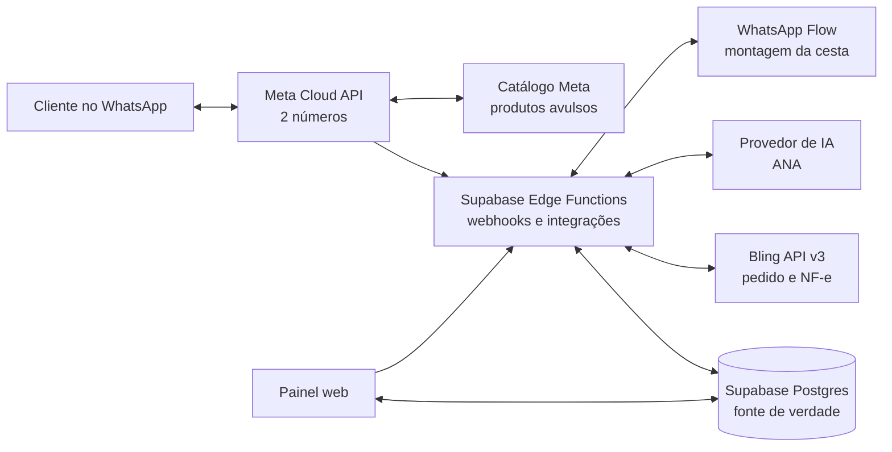

# Pesquisa e plano profissional — Admin WhatsApp da Sucedoan

**Data de referência:** 26 de outubro de 2026
**Status:** pesquisa e planejamento encerrados para a primeira base; implementação greenfield em andamento na branch `codex/whatsapp-admin-greenfield-20261026`
**Prontidão:** a programação greenfield começou em branch isolada, conforme a autorização mais recente do proprietário. A base local e a interface avançam sem escrever em Meta, Bling ou Supabase de produção. Antes de conectar cada serviço, concluir os gates correspondentes do [caderno técnico](caderno-tecnico.md): mapear referências sem expor segredos, reler produtos/fotos após a carga, validar Meta nas duas linhas, confirmar OAuth Bling em leitura e congelar os contratos finais.
**Diretriz de implementação:** sistema novo, sem reaproveitar código histórico. O histórico do repositório serve apenas para recuperar decisões, requisitos e referências de conexão.

**Anotações detalhadas para a programação:** [Caderno técnico de fluxos, clientes, catálogo Meta e Bling](caderno-tecnico.md), incluindo inventário seguro do Vault, histórico GitHub, contratos de integração e casos de homologação.

**Ordem de implementação:** [Plano de execução por tarefas](plano-execucao.md), com arquivos previstos, limites de cada entrega e gates de integração.

## 1. Recomendação executiva

Construir um painel web responsivo, pequeno e direto, para uma única empresa, com **Supabase como fonte oficial dos dados**, **Meta WhatsApp Cloud API como canal oficial** e **Bling API v3 como ERP e etapa fiscal**. A experiência visual deve aproveitar padrões de clareza observados na Loja Integrada: navegação curta, formulários divididos em blocos, nomes simples, filtros fáceis, ações evidentes e ajuda curta no próprio campo. Isso significa usar os mesmos princípios de facilidade, sem copiar marca, telas ou ativos proprietários.

O desenho recomendado é:

- **Painel:** Next.js App Router com React e TypeScript, adaptado para desktop e celular, hospedado na Vercel com prévias por branch/PR.
- **Dados e acesso:** Supabase Postgres, Auth, Storage, Realtime e Edge Functions.
- **Mensagens:** integração direta com a Meta Cloud API, sem colocar Make/BSP no caminho principal, já que os dois números já estão na API oficial.
- **IA ANA:** assistente com identidade e instruções da empresa, conectado a dados e ações restritas. Não treinar um modelo próprio do zero no MVP; isso aumentaria custo e manutenção sem ser necessário para atender ao caso.
- **Produtos avulsos:** catálogo nativo do WhatsApp como vitrine e carrinho para itens padronizados; cada carrinho é um pedido independente da cesta, mesmo na mesma conversa.
- **Cestas configuráveis:** WhatsApp Flow por componente, depois pagamento e confirmação/cadastro de cliente/endereço. Preço e disponibilidade são recalculados no servidor; a conversa mostra produtos/quantidades e total geral, sem preço individual por item.
- **Pedidos e faturamento:** o painel controla NOVO, PRODUÇÃO — Separação, EXPEDIÇÃO e ENTREGUE. Pedido válido confirmado pelo cliente entra em Separação; ao mover de PRODUÇÃO para EXPEDIÇÃO, grava uma tarefa única e durável para integração com o Bling. Pedido, geração da NF-e, envio à SEFAZ e autorização fiscal são estados diferentes.

O produto deve ser pequeno no que o funcionário vê e rigoroso por trás: duplicidade de webhooks, repetição de pedidos, falhas de rede e erro fiscal precisam ser recuperáveis sem duplicar vendas ou notas.

## 2. O que já sabemos e o que a pesquisa conclui

- Os **dois números já usam a API oficial da Meta**.
- O banco correto é **Dona Antônia - NOVO**, ref `wvpzudjujtmyspluwhvx`, URL `https://wvpzudjujtmyspluwhvx.supabase.co`, região `sa-east-1` (São Paulo). A inspeção read-only mais recente confirmou Postgres 17.11, estado `ACTIVE_HEALTHY`, duas migrations e nenhuma Edge Function. Há 1.928 produtos (todos inativos/`needs_review`), 574 clientes, 578 contatos e 336 endereços. As fotos seguem em processamento: `product_images` está vazio, sem bucket, com 1.798 itens pendentes. Há 0 usuários Auth/perfis staff e 17 tabelas RLS sem policies (fail-closed); nenhuma integração Meta/Bling está ativada. Recontar fotos/policies antes de qualquer migração. Detalhes em `caderno-tecnico.md`.
- A base já tem a **estrutura de tabelas** para produtos, identificadores/imagens, modelos/itens de cesta, clientes/contatos/endereços, equipe, pedidos/itens, reservas de estoque, vínculos externos e auditoria. Isso descreve schema, não afirma que todos os registros já foram carregados. O projeto deve evoluir essa base com migrações incrementais; não recriar esses cadastros em tabelas paralelas.
- Contatos novos podem chegar sem telefone quando usam username. A Meta documenta BSUID no `user_id`, vinculado ao portfólio empresarial, e exige suporte por integrações diretas; a conversa continua separada por identidade do remetente + `phone_number_id`. Telefone E.164 é contato opcional quando compartilhado/verificado. Para ligar clientes entre os dois números, primeiro conferir se os WABAs pertencem ao mesmo portfólio e testar envio/retorno por BSUID na versão Graph ativa; não mesclar por nome ou suposição.
- O repositório `osvaldosereia/SUCEDOAN12` foi limpo intencionalmente. O código das branches antigas não será usado nem copiado.
- Foi feita auditoria comparativa do Flow legado contra materiais oficiais da Meta. Um bug histórico enviava `indice` sem declará-lo no schema da ação; outro commit derivava HMAC de sessão do App Secret. O plano novo corrige o primeiro com contratos/schema gerados juntos e descarta a derivação: usa token aleatório apenas como correlator e protocolo Meta RSA/AES-GCM. A página oficial de componentes ficou rate-limited nesta consulta, por isso suporte/limites de imagens e versão só serão congelados após validação do Flow nas duas WABAs; todas as alternativas continuam obrigadas a exibir foto. Detalhes, evidências e decisão: [comparação Meta x histórico no caderno técnico](caderno-tecnico.md#comparação-do-histórico-com-o-protocolo-oficial-da-meta--26102026).
- O histórico tem requisitos e decisões úteis. Há, porém, uma regra fiscal antiga que dizia esperar entrega e pagamento antes da NF-e. Para este projeto, a instrução mais recente é que a ida para EXPEDIÇÃO dispare o processo do Bling; isso passa a ser a regra de desenho, sujeito à validação fiscal antes de ativar emissão real.
- A inspeção somente leitura dos metadados seguros no Supabase encontrou os dois `phone_number_id` em **WABAs diferentes**. Portanto, o Admin deve tratar cada linha como uma configuração de canal independente, com catálogo, Flow, templates, webhooks, permissões e health check próprios. Não planejar migração para uma WABA comum: isso não é requisito do produto e pode criar risco operacional.
- A plataforma tem listas, botões de resposta, mídia, mensagens de produto único/múltiplos produtos e Flows. A disponibilidade de carrossel e os limites de itens variam conforme tipo de mensagem/conta/API; por isso, carrossel fica como formato complementar, não dependência do fluxo de compra.
- O catálogo registra produtos e quantidade; a documentação consultada não mostra modificadores livres para montar uma cesta com substituições arbitrárias. A personalização precisa ser tratada pelo Flow ou por um fluxo guiado e validada pelo backend.

## 3. Princípios de produto e interface

### Navegação principal

1. **Visão geral** — fila do que precisa de ação e atalhos operacionais, sem virar BI.
2. **Atendimento** — conversas dos dois números, fila, atribuição e transferência ANA/atendente.
3. **Pedidos** — quadro com NOVO, PRODUÇÃO, EXPEDIÇÃO e ENTREGUE.
4. **Cestas** — montagem de modelos, alternativas, preço e Flow por componente.
5. **Produtos** — cadastro e sincronização para o catálogo Meta.
6. **Clientes** — contatos, endereços, histórico de conversa e pedidos.
7. **ANA** — comportamento, conhecimento aprovado, limites, teste e ativação.
8. **Configurações** — equipe, números, integrações Meta/Supabase/Bling e políticas operacionais.

A especificação completa de listas, telas de detalhe, formulários, campos, ações, estados vazios/erro e papéis fica no [caderno técnico, seções 21–23](caderno-tecnico.md).

### Tela de atendimento

Usar o padrão de três áreas já compreendido por ferramentas de atendimento: lista de conversas, conversa ativa e contexto do cliente/pedido. No topo, filtro do número, estado da fila e busca. A ação para assumir a conversa deve ser evidente. Quando uma pessoa assumir, a ANA pausa naquela conversa; ao devolver à automação, mostrar a confirmação de que ela voltou a responder. Manter notas internas separadas das mensagens enviadas ao cliente.

### Produtos, cestas e pedidos

- Listagens com busca, filtros curtos e estado ativo/inativo.
- Formulários em blocos curtos, com rótulos claros e exemplo do formato esperado.
- Detalhe do pedido aberto ao clicar na linha: cliente, itens, quantidades, total, histórico e notas internas.
- Mostrar os quatro estados pedidos como fluxo principal. Guardar cancelamento como ação separada com motivo; pagamento, sincronização Bling e situação fiscal aparecem como indicadores auxiliares, sem criar novas colunas no quadro principal.
- Em cada transição, explicar o que acontecerá. A ida para EXPEDIÇÃO deve avisar que iniciará envio ao Bling e apresentar eventual problema de cadastro/fiscal.

### Inspiração visual

A Loja Integrada ensina bem por meio de formulários por seção, filtros combináveis, busca visível e detalhes claros de produto/pedido. O Manychat mostra uma inbox com conversas, chat e perfil do cliente em áreas previsíveis. Da referência histórica interna de Vitrine Admin e das práticas atuais da Loja Integrada, adotar navegação lateral persistente e compactável, título com propósito e ação principal, listas que ajudam a localizar e agir sem abrir cada registro, filtros preservados ao voltar, estado visível por texto e cor e histórico legível no detalhe. No celular, a navegação recolhe e as tabelas têm rolagem própria sem esconder a ação principal. Usar identidade visual própria, espaço em branco, poucos ícones e português cotidiano; não copiar marca, tela ou ativo proprietário. Não fazer um “ERP completo” nem expor termos como webhook, OAuth ou payload no uso normal.

## 4. Arquitetura funcional

**Supabase guarda o estado do negócio.** Meta entrega mensagens e experiências no WhatsApp; Bling mantém registros do ERP/fiscal; ambos são sistemas externos. A interface deve reconciliar dados pelo banco, não assumir que um webhook ou uma resposta HTTP chegou uma única vez.

## 5. Modelagem funcional mínima

Modelo conceitual adaptado à base real: reutilizar `staff_profiles`, `products`, `product_images`, `product_identifiers`, `basket_templates`, `customers`, `customer_contacts`, `customer_addresses`, `orders`, `order_items`, `inventory_reservations`, `external_entity_links` e `audit_events`. A composição antiga `basket_items` permanece apenas até o preflight e não será estrutura do Flow novo; a migration local já criou versões, slots e opções por cesta. Completar ainda identidade/conversas/mensagens, rascunhos, sessões Flow/lotes de catálogo, histórico de status, configurações versionadas da ANA e outbox. O caderno registra aderência e restrições por tabela; não apagar ou substituir dados remotos antes de revisar a base em execução.

Não criar arquitetura multiempresa no primeiro lançamento. Usuários são funcionários da única empresa; clientes do WhatsApp não precisam de login. RLS e permissões explícitas protegem o painel. Credenciais nunca entram no navegador, em prompts, em commits ou no conteúdo do histórico. Tokens de Meta/Bling ficam nos segredos do servidor.

## 6. Regras do combo e do “valor extra oculto”

Cada cesta tem componentes/slots e, por slot, alternativas autorizadas com preço comercial por unidade na versão da cesta. Em cada tela do Flow o cliente escolhe uma alternativa e uma quantidade inteira de 0 a 6 e pressiona Próximo. Quantidade começa sem escolha; 0 retira qualquer slot; quantidade positiva exige alternativa; a cesta precisa ter pelo menos um slot positivo. A tela seguinte mostra o próximo componente; o servidor recalcula o total a cada avanço.

Subtotal da cesta = extra interno incorporado uma vez + soma de (quantidade escolhida × preço comercial da alternativa na versão). Não há produto nem quantidade pré-selecionados. O preço da alternativa da cesta não é o preço avulso de catálogo nem custo de compra; mudar o preço avulso não altera uma cesta publicada. A alteração de preço de cesta cria nova versão. O servidor recalcula; Flow não é autoridade para impor preço ou total.

Interpretação profissional do valor extra oculto: tratá-lo como **componente interno de precificação/margem**, disponível somente a pessoas autorizadas e incorporado no total da cesta uma vez. O cliente vê a composição, valores aplicáveis e total final antes de confirmar; o extra não surge como taxa separada. Se for uma taxa real cobrada à parte, precisa ser descrita claramente antes do aceite. O custo/margem internos não aparecem para ANA/cliente.

Ao confirmar, gravar um snapshot dos itens, opções, preço calculado, total, canal/número, versão da cesta e consentimento relevante. Mudanças futuras de preços não alteram pedidos confirmados.

## 7. Integração Meta — escopo e sequência

1. Inventariar portfolio, WABA, os dois `phone_number_id`, nome de exibição, status, permissões, qualidade, templates e cobrança. Confirmar se os números estão na mesma WABA e se os webhooks já chegam a um servidor atual.
2. Recuperar somente identificadores e configurações não secretas do histórico. Validar credenciais no painel Meta; credenciais antigas encontradas em arquivos ou commits não devem ser copiadas para o código novo. Se algum token secreto foi exposto no Git, tratar como comprometido e substituir.
3. Configurar aplicativo, permissões necessárias, token de produção mantido no servidor, callback HTTPS, verificação do webhook e assinatura à WABA. Registrar pelo `phone_number_id` qual número recebeu cada mensagem.
4. Construir inbox e suporte de texto/mídia primeiro. Persistir mensagem inbound e status antes de atualizar interface. Deduplicar IDs Meta e lidar com eventos fora de ordem por timestamps/estado.
5. Criar/validar templates aprovados, opt-in/opt-out e trilha de consentimento. Fora da janela de atendimento de 24 horas, só iniciar contato por template aprovado. A automação deve ter uma forma direta de escalar para humano.
6. Vincular/validar o catálogo. Sincronizar produtos avulsos e variantes fixas por identificador estável; acompanhar preço, ativo e disponibilidade para evitar oferta divergente.
7. Construir Flow de cesta com rascunho e token próprios. Cada tela mostra um componente, todas as alternativas com foto própria, quantidade de 0 a 6 e Próximo. Depois dos produtos, o Flow coleta pagamento, procura o cliente pela identidade WhatsApp e confirma endereço existente ou cadastra os dados faltantes. A conversa envia resumo com produtos/quantidades, endereço, pagamento e total geral, sem preço individual; botão Confirmar pedido cria a venda no Admin e a encaminha para PRODUÇÃO — Separação. Cada carrinho do Catálogo é sempre outro pedido, com resumo, confirmação e nota fiscal próprios, sem janela temporal de associação.
8. Antes de desenvolver o Flow completo, comprovar na conta Meta que a lista de alternativas carrega imagem e texto alternativo para cada produto em ambas as WABAs; só então fechar limites de payload e publicar. Botões, listas e carrossel fora da escolha de produto são melhorias, não parte do caminho crítico.
9. Testar separadamente cada número, respostas, mídia, templates, pedidos do catálogo e resultado do Flow, incluindo aparelhos/versões de WhatsApp diferentes.

A Meta cobra por mensagem entregue segundo categoria e mercado. A FAQ oficial informa que desde 1º de outubro de 2026 cobra também mensagens de atendimento após 1.000 mensagens gratuitas por número a cada mês; a página geral de preço ainda exibe texto que diz que mensagens de serviço são gratuitas. Há divergência entre páginas oficiais. Orçar pelo rate card/gerenciador de cobrança vigente no Brasil e pelo consumo medido de cada número antes de lançar. API direta não cobra uma taxa adicional de acesso à plataforma, mas pode haver custos de hospedagem, provedor de IA e serviços externos.

## 8. Integração Supabase — escopo e segurança

- Auth somente para funcionários e administradores. Criar convites/provisionamento controlado; impedir autoinscrição pública no painel.
- Aplicar RLS a tabelas acessíveis pelo cliente web. A partir de 30/10/2026, projetos Supabase existentes deixam de expor automaticamente tabelas novas de `public` pela Data API; cada migração deve declarar GRANTs mínimos, RLS e políticas na mesma entrega. A regra oficial e a data foram reconfirmadas em 26/10/2026.
- Na base selecionada, RLS está ligado nas 19 tabelas, mas há somente duas políticas de leitura para o catálogo aprovado (`products` e `product_images`); nenhuma API role recebeu GRANT nas tabelas. As outras 17 não têm policy. Isso mantém a base em negação por padrão, mas o painel ainda não pode consultar nem alterar dados até uma migração definir permissões explícitas. `authenticated` sozinho não significa administrador.
- Supabase Pro, região São Paulo e Postgres 17.11 foram confirmados. Conferir changelog, limites, grants e políticas vigentes novamente antes da implementação.
- Nunca distribuir `service_role`/secret key no navegador; essas chaves ignoram RLS. Funções Edge são a fronteira para chamadas Meta, Bling e IA.
- Edge Function pública de webhook não usa JWT de usuário, mas valida a assinatura/autenticação do provedor no servidor, com corpo bruto quando requerido.
- Banco como fonte de verdade; transações/funções para criar pedido e gravar status/outbox atomicamente. Chamadas de rede fora de triggers SQL.
- Reutilizar `app_private.outbox_jobs`, já existente no projeto, como única fila durável. Completar chave idempotente única, claim/lease atômico, backoff, erro seguro e estado de reconciliação; primeira tentativa é imediata e Cron recupera pendências. Não criar outra outbox nem tratar `pg_net` como fila.
- Realtime para refrescar inbox/quadro. Após reconexão, consultar estado do banco, pois notificação em tempo real não substitui leitura persistente.
- Storage público só para imagem que possa ser pública; mídia de conversa privada com regras de acesso e URL temporária. Backups de banco não cobrem automaticamente arquivos do Storage; prever cópia/exportação de mídia importante.
- O projeto correto já está no plano Pro. Manter esse projeto como destino; rever cotas, retenção e backup do plano vigente antes do lançamento e configurar cópia do banco/Storage conforme criticidade dos dados.

## 9. Integração Bling — sincronização e validação fiscal

A base atual da API v3 é `https://api.bling.com.br/Api/v3`. OAuth Authorization Code deve ser concluído no servidor, com `state` contra CSRF; manter Client Secret e refresh token fora do frontend. A autenticação por token opaco foi descontinuada: pedir JWT com `enable-jwt: 1` na autorização/renovação e manter esse cabeçalho em cada chamada autenticada. Usar `expires_in` retornado para renovar access token; a documentação indica janela de um minuto para o authorization code e validade de 30 dias para o refresh token. O limite é compartilhado pela conta: 3 requisições por segundo e 120 mil por dia; usar limitador central com teto inicial de 2 req/s. A API exige app de visibilidade pública e processo de homologação, com testes de 30 dias segundo o FAQ atual; confirmar com o Bling e iniciar em paralelo ao desenvolvimento local. Selecionar somente escopos necessários.

### Transição EXPEDIÇÃO

1. Funcionário move o pedido de PRODUÇÃO para EXPEDIÇÃO.
2. Em uma transação, o Supabase grava a nova etapa e uma tarefa única `order_dispatched` na outbox.
3. Worker consulta/cria o contato Bling e cria uma venda própria para cada pedido Admin confirmado, guardando o ID externo. Pedidos de cesta e do Catálogo nunca são misturados.
4. Geração da NF-e, envio à SEFAZ e confirmação são operações separadas. Ativar emissão automática somente após validar com o contador a regra que conflita com uma decisão fiscal histórica do repositório.
5. Webhook/consulta do Bling atualiza status fiscal. Só mostrar “NF-e autorizada” quando a API confirmar autorização. Falha/rejeição aparece como pendência; não reverte o estado físico EXPEDIÇÃO.
6. Entrega é marcada no painel quando confirmada pela operação. Bling pode ter situações próprias; mapear IDs da conta, nunca presumir IDs fixos.

Criar venda não é o mesmo que autorizar nota. Gerar NF-e e enviar à SEFAZ são chamadas diferentes. Se uma chamada expirar sem resposta, consultar Bling e reconciliar antes de repetir para evitar pedido/nota duplicada. Webhooks do Bling têm assinatura `X-Bling-Signature-256`, ID de evento, ordem potencialmente variável e janela de entrega/retry; validar assinatura, deduplicar e responder rápido.

**Bloqueio profissional para emissão real:** antes de habilitar geração/envio automático, confirmar com contador e conta Bling: credenciamento SEFAZ, certificado, inscrição estadual, natureza de operação/CFOP, regime, NCM/tributação por item, dados mínimos do destinatário, frete e condições de pagamento. Na EXPEDIÇÃO, sincronizar a venda e preparar a etapa fiscal. A regra histórica dizia aguardar entrega e pagamento; a orientação atual pede iniciar Bling na expedição. Manter a política explícita e emissão real desativada até essa validação. Se faltar dado, deixar pedido em expedição com status fiscal “precisa de revisão”.

## 10. ANA — assistente de atendimento

Configuração simples em três blocos:

1. **Sobre a empresa:** produtos, cestas, horários, entrega, retirada e políticas aprovadas.
2. **Como atender:** voz da marca, saudação, perguntas que deve fazer e forma de confirmar a cesta.
3. **Limites e transferência:** nunca inventar preço/estoque/prazo, não prometer exceções, não emitir NF ou mudar estágio físico, transferir quando cliente pede pessoa ou a confiança é baixa.

A ANA consulta ferramentas limitadas para buscar produto/preço/estoque permitido, montar uma cesta e preparar um pedido aguardando confirmação explícita. O cálculo é determinístico no backend. Ao assumir conversa, humano suspende a IA naquele chat; registrar atribuição, pausa e retorno. A configuração fica pequena, mas editável: saudação/tom, conteúdo aprovado, linhas em que pode responder, ações permitidas, horários e situações de transferência humana. Salvar como rascunho, testar no simulador e publicar explicitamente; não exigir edição de prompt bruto.

Decisão inicial da ANA: usar a API OpenAI no servidor, seguindo o histórico de Vitrine Admin que já referencia OPENAI_API_KEY e ANA_OPENAI_MODEL. A identidade “ANA” será própria da empresa — instruções, conhecimento aprovado e ações restritas — sem treinar um modelo-base próprio. Usar Responses API com function calling para consultas/ações permitidas; o servidor executa e valida cada chamada, e só a regra determinística cria cotação ou pedido. Enviar contexto mínimo e manter o histórico do negócio no Supabase, sem usar estado persistente do provedor por padrão. Antes de implementar, validar a credencial no ambiente autorizado e revalidar modelo, preço, latência e retenção da API vigente; não copiar chave ou código legado.

## 11. Privacidade, consumidor e operação

Telefone, endereço, conversas e pedidos são dados pessoais. Coletar somente o necessário, informar finalidade, restringir acesso, definir retenção e forma de exclusão/atendimento de solicitações. Guardar opt-in e opt-out e respeitar o pedido para parar contatos. Publicar uma política de privacidade e não pedir dados sensíveis ou números completos de cartão pelo WhatsApp.

O valor total do combo, composição e quantidades devem estar claros antes de confirmar. Ativos internos como margem e custo de compra são para equipe; a cobrança final não pode surgir como taxa surpresa.

## 12. Plano de execução por fases (para depois da pesquisa)

### Fase 0 — Pré-flight do repositório e dados de conexão (sem escrita de produção)

- Confirmar quais conexões existentes ainda estão válidas; mapear IDs dos ativos Meta e Bling e localização segura dos segredos.
- Fazer inventário apenas de nomes de variáveis, origem/commit, serviço dono, data de validação e situação das credenciais. Não copiar valores secretos do Git para esta documentação. Credenciais que já estiveram em histórico público são candidatas a exposição e devem ser validadas/rotacionadas no provedor antes de produção.
- Verificar os dois `phone_number_id`, WABA, tipo de identificador recebido do cliente e possibilidade de resposta por BSUID; no Bling, verificar OAuth, conta e escopos. Registrar credenciais diretamente no cofre do servidor, nunca no navegador ou no repositório.
- Conferir os dois números, WABA(s), webhook, catálogo, templates, templates/cobrança, Flow e elegibilidade de formatos.
- Confirmar cadastro real de produtos, SKUs, unidade de venda e campos fiscais no Bling.
- Revalidar snapshot/contagem/schema do Supabase imediatamente antes da primeira migração; desenvolver no Supabase local/branch e manter produção sem escrita manual.
- Usar a especificação completa das oito áreas e o mapa/wireframe do caderno como base visual; revisar telas enquanto constrói o shell, sem exigir protótipo separado para começar a base.
- Registrar dados de negócio ainda pendentes (SKUs, preços, cestas, pagamento, entrega, opt-in, cancelamento e retenção) como entrada de configuração/importação, não como decisão de arquitetura.
- Confirmar com contador o gatilho e os campos fiscais antes de ativar Bling/NF-e real; testar primeiro com adaptador mock/sandbox.

**Saída:** branch e ambiente local seguros, baseline revisado, stack fixada e lista de gates externos. O esqueleto pode ser construído sem tokens reais.

### Fase 1 — Base verde do projeto

- Criar estrutura nova no repositório, ambiente local/produção, configuração segura e pipeline de deploy.
- Criar app, navegação e layout responsivo; Supabase Auth e papéis básicos.
- Criar migrations, constraints, RLS e GRANTs; armazenamento de imagens.
- Criar log operacional e outbox.

**Saída:** equipe entra com acesso controlado e painel vazio funciona em ambiente de teste.

### Fase 2 — Produtos e cestas

- CRUD pequeno de produto, imagem, SKU e status. Toda alternativa habilitada para Flow exige foto verificada e miniatura Flow pronta; sem foto permanece como rascunho e não publica na cesta.
- Editor de cesta com slots, opções, limites, quantidades e diferença de preço.
- Preview de total com componente de margem interno e preço final explícito.
- Snapshot do modelo de cesta e cálculo do servidor.
- Sincronização inicial e verificação de catálogo Meta, sem enviar mensagens reais.

**Saída:** operador monta/testa uma cesta e o servidor sempre calcula o mesmo total para a mesma configuração.

### Fase 3 — Inbox dos dois números

- Webhooks de entrada e status, validação, deduplicação e persistência.
- Lista, busca, filtro por número, conversa, perfil do cliente, histórico, envio de texto/mídia.
- Atribuição humana, notas privadas, pausa e retorno da ANA.
- Visibilidade de janela 24h e uso de template aprovado fora da janela.

**Saída:** equipe consegue atender manualmente nos dois números sem perder mensagens.

### Fase 4 — Cliente, catálogo e pedidos

- Pedido de cesta via Flow: componentes, pagamento, identificação/cadastro do cliente, confirmação de endereço e revisão.
- Pedido do Catálogo Meta sempre independente, mesmo na mesma conversa ou imediatamente após o Flow; cada compra tem resumo, aceite e pedido próprios.
- Enviar produtos/quantidades, pagamento, endereço e total geral sem preço individual por item.
- Toda alternativa exibida em tela de cesta no Flow inclui a foto do próprio produto e texto alternativo; uma alternativa sem imagem bloqueia a publicação daquela versão.
- Aceite válido cria o pedido no Admin e o encaminha diretamente para PRODUÇÃO — Separação. Se preço, estoque ou dado obrigatório mudar, manter rascunho, corrigir e solicitar novo aceite; não registrar como pedido confirmado em NOVO.
- Quadro NOVO → PRODUÇÃO (Separação) → EXPEDIÇÃO → ENTREGUE; NOVO atende pedido manual ou retido por decisão operacional explícita; cancelamento com motivo.

**Saída:** cliente conclui pedido e o funcionário acompanha o ciclo de ponta a ponta, ainda sem emissão automática.

### Fase 5 — Bling e nota

- OAuth, leitura de contato/produto/estoque conforme necessidade e mapeamento de IDs.
- Criar uma venda Bling própria para cada pedido Admin; cesta e carrinho têm venda/NF-e separadas.
- Webhooks assinados, consulta de reconciliação, retries e tela de falhas.
- Simular rejeição, timeout e dados incompletos antes de produção; ativar emissão real só após aprovação contábil e conta validada.

**Saída:** pedido não duplica no Bling; emissão mostra separadamente pendente, autorizada e rejeitada.

### Fase 6 — ANA controlada

- Serviço IA server-side e instruções editáveis em linguagem simples.
- Busca de fatos da empresa e chamadas de ferramenta com permissão mínima.
- Confirmação humana/cliente antes de gravar o pedido definitivo; transbordo para operador.
- Simulador e trilha de auditoria; ativação por número e/ou fila, inicialmente gradual.

**Saída:** ANA faz atendimento dentro dos limites e deixa humano assumir sem disputa de respostas.

### Fase 7 — Preparação e lançamento

- Capacitação rápida dos operadores com tarefas reais e instruções curtas.
- Revisar acessos, backups, retenção, mensagens de erro, uso/custo, monitoramento e contatos de suporte.
- Piloto com um número e grupo pequeno; acompanhar falhas e qualidade; depois ativar o segundo número.
- Revisar métricas: conversas resolvidas, transferências, cesta iniciada/confirmada, erro de integração e falhas fiscais.

**Saída:** operação assistida, custo observado, recuperação testada e critérios de suporte acordados.

## 13. Critérios de aceite do MVP

- Os dois números chegam à inbox e cada conversa mostra com clareza o número utilizado.
- Mensagem inbound não se duplica após webhook repetido; status não volta de lido para entregue por evento atrasado.
- Produtos avulsos mostram informações coerentes com catálogo/Supabase.
- Cada alternativa mostrada no Flow tem foto própria legível e texto alternativo; uma opção sem foto bloqueia a publicação da cesta.
- Cesta permite trocar opções e quantidades autorizadas; preço é recalculado no servidor e o total aparece antes de confirmar.
- Flow conclui um pedido de cesta; cada carrinho do Catálogo cria outro pedido, inclusive quando chega logo depois ou na mesma conversa. Nenhum deles expira automaticamente por inatividade.
- Cada confirmação manda produtos/quantidades, pagamento, endereço e total geral sem valores individuais; aceite válido cria o pedido em PRODUÇÃO — Separação. Pendência de cotação/dados antes do aceite mantém só o rascunho até correção e novo aceite.
- Pedido guarda fotografia das escolhas e valores e mostra os quatro estados principais; cada pedido tem venda Bling e NF-e separadas.
- Mover para EXPEDIÇÃO cria uma única tarefa Bling. Repetir clique, webhook ou retry não duplica venda/NF.
- Estado de produção/expedição é independente do resultado fiscal; rejeição é visível e tratável.
- Humano pode assumir, interromper a ANA e devolver atendimento à IA sem mensagens concorrentes.
- Apenas usuários internos aprovados entram no painel; segredos não aparecem no cliente web.
- Erros de Meta/Bling/IA aparecem em linguagem útil e uma ação clara para resolver ou reprocessar.

## 14. Riscos e decisões técnicas já tomadas

| Tema | Decisão profissional | Motivo/controle |
|---|---|---|
| Código legado | Começar limpo; usar histórico só para requisitos/conexões | Evita herdar dependências e regras contraditórias |
| Arquitetura | Meta Cloud API direta + Supabase + Bling | Menos intermediários para uma operação pequena |
| Estado do negócio | Supabase Postgres | Preços, conversas, pedidos e status consistentes |
| Cestas | Flow primeiro; listas/web como reserva | Catálogo não representa modificadores arbitrários de forma suficiente |
| IA | ANA com ferramentas restritas e backend determinístico | Evita preço, estoque e ações fiscais inventados |
| Faturamento | EXPEDIÇÃO sincroniza a venda; NF-e é operação separada até validação do contador | Atende o fluxo pedido sem confundir envio ao Bling com autorização SEFAZ |
| Carrossel | Formato opcional após validação | Recurso/limites podem variar; não bloqueia compra |
| Valor interno oculto | Margem/ajuste interno entra no preço total claro | Não criar uma cobrança surpresa |
| Custos Meta | Prever cobrança por mensagem e confirmar rate card atual | A documentação oficial consultada diverge sobre cobrança de atendimento em out/2026 |
| Números | Preferir WABA comum se a conta atual permitir | Simplifica ativos e webhooks, mas não forçar migração |

## 15. Estratégia de pesquisa e validação contínua

Antes de cada fase de implementação, confirmar fontes primárias atuais e registrar data/versão. Para Meta, usar política, FAQ, rate card, Cloud API/Flows Postman oficial e estado real do WhatsApp Manager. Para Bling, usar API v3, limites, OAuth, webhooks e a conta conectada. Para Supabase, usar RLS, grants, funções, Edge Functions, Realtime, quotas e backups. Para legislação, usar Planalto e validar interpretação fiscal com contador/assessoria competente.

Durante a implementação, manter uma matriz simples: requisito → fonte/decisão → tela/serviço responsável → como validar → dono da decisão. Reconsultar a documentação quando mudar Graph API version, versão da API Bling, plano Supabase, preço Meta ou regra fiscal. A pesquisa pública não substitui validação de elegibilidade e permissões na conta real.

## 16. Fontes consultadas

### Meta / WhatsApp

- [Meta — Política de mensagens WhatsApp Business (atualizada em 23/09/2026)](https://whatsappbusiness.com/policy/)
- [Meta — FAQ da Plataforma do WhatsApp Business e cobrança de out/2026](https://whatsappbusiness.com/pt-br/resources/faq/)
- [Meta — preços da Business Platform](https://whatsappbusiness.com/products/platform-pricing/)
- [Meta — recursos da plataforma: listas, botões, mídia e mensagens de produto](https://whatsappbusiness.com/products/business-platform-features/)
- [Meta — WhatsApp Flows](https://whatsappbusiness.com/products/whatsapp-flows/)
- [Meta — coleção oficial Cloud API, Webhooks e Flows no Postman](https://www.postman.com/meta/whatsapp-business-platform/overview)
- [Meta — referência oficial dos componentes WhatsApp Flow](https://developers.facebook.com/docs/whatsapp/flows/reference/components)
- [Meta — usernames e identificadores BSUID](https://developers.facebook.com/documentation/business-messaging/whatsapp/business-scoped-user-ids/)
- [Meta — exemplo oficial de webhook de pedido do Catálogo](https://www.postman.com/meta/whatsapp-business-platform/documentation/wlk6lh4/whatsapp-cloud-api?entity=request-13382743-ba924e99-3d98-4954-b4e3-73a519939c33)
- [Meta — envio de mensagem de vários produtos](https://www.postman.com/meta/whatsapp-business-platform/request/j1w5o6p/send-multi-product-message)
- [Meta — configuração de catálogo/comércio](https://www.postman.com/meta/whatsapp-business-platform/request/30lrpw8/set-or-update-commerce-settings)
- [Next.js — App Router e instalação](https://nextjs.org/docs/app/getting-started/installation)
- [Next.js — opções de implantação](https://nextjs.org/docs/app/getting-started/deploying)
- [Vercel — implantação Next.js](https://vercel.com/docs/frameworks/full-stack/nextjs)
- [Vercel — ambientes Local, Preview e Production](https://vercel.com/docs/deployments/environments)
- [Supabase — Edge Functions](https://supabase.com/docs/guides/functions)
- [Supabase — segredos das Edge Functions](https://supabase.com/docs/guides/functions/secrets)
- [shadcn/ui — instalação em Next.js](https://ui.shadcn.com/docs/installation)

### Supabase

- [Supabase — RLS](https://supabase.com/docs/guides/database/postgres/row-level-security)
- [Supabase — mudança de exposição/grants do schema public](https://supabase.com/changelog/45329-breaking-change-tables-not-exposed-to-data-and-graphql-api-automatically)
- [Supabase — Database Functions](https://supabase.com/docs/guides/database/functions)
- [Supabase — autenticação em Edge Functions](https://supabase.com/docs/guides/functions/auth)
- [Supabase — limites Edge Functions](https://supabase.com/docs/guides/functions/limits)
- [Supabase — Cron](https://supabase.com/docs/guides/cron)
- [Supabase — Realtime](https://supabase.com/docs/guides/realtime/subscribing-to-database-changes)
- [Supabase — planos e quotas](https://supabase.com/docs/guides/platform/billing-on-supabase)
- [Supabase — backups](https://supabase.com/docs/guides/platform/backups)

### Bling

- [Bling — referência API v3](https://developer.bling.com.br/referencia)
- [Bling — aplicativos e OAuth](https://developer.bling.com.br/aplicativos)
- [Bling — migração para autenticação JWT](https://developer.bling.com.br/migracao-jwt)
- [Bling — limites de API](https://developer.bling.com.br/limites)
- [Bling — FAQ de limites e homologação do aplicativo](https://developer.bling.com.br/perguntas-frequentes)
- [Bling — webhooks](https://developer.bling.com.br/webhooks)
- [Bling — migração de URL](https://developer.bling.com.br/migracao-url)
- [Bling — emitir NF-e](https://ajuda.bling.com.br/hc/pt-br/articles/360035829513-Emitir-uma-Nota-Fiscal-Eletr%C3%B4nica-NFe)
- [Bling — gerar NF-e a partir de pedido de venda](https://ajuda.bling.com.br/hc/pt-br/articles/360036450634-Como-gerar-nota-NF-e-a-partir-do-pedido)

### Experiência e operação

- [Loja Integrada — visualizar detalhes dos pedidos](https://ajuda.lojaintegrada.com.br/pt-BR/articles/931795-visualizando-detalhes-dos-pedidos)
- [Loja Integrada — gerenciamento de pedidos e informações da listagem](https://ajuda.lojaintegrada.com.br/pt-BR/articles/931793-gerenciando-pedidos-da-loja)
- [Loja Integrada — filtrar pedidos](https://ajuda.lojaintegrada.com.br/pt-BR/articles/3329687-como-filtrar-pedidos-para-encontrar-vendas-especificas)
- [Loja Integrada — filtros de produtos](https://ajuda.lojaintegrada.com.br/pt-BR/articles/8539003-filtrar-os-produtos-no-painel)
- [Loja Integrada — cadastro e histórico de clientes](https://ajuda.lojaintegrada.com.br/pt-BR/articles/931784-como-gerenciar-o-cadastro-dos-clientes)
- [Loja Integrada — relatórios centralizados da Visão de Negócios](https://ajuda.lojaintegrada.com.br/pt-BR/articles/931794-como-acessar-relatorios-na-nova-visao-de-negocios)
- [Loja Integrada — produtos com variações](https://ajuda.lojaintegrada.com.br/pt-BR/articles/5195150-como-cadastrar-um-produto-com-variacoes)
- [Manychat — organização da Inbox](https://help.manychat.com/hc/en-us/articles/14281070478748-Manychat-Inbox)
- [Shopify — pesquisar e visualizar pedidos](https://help.shopify.com/en/manual/fulfillment/managing-orders/viewing-orders/searching-orders)
- [Blip — criar, validar, pré-visualizar, testar e publicar WhatsApp Flows](https://help.blip.ai/hc/pt-br/articles/18613541808151--Extens%C3%A3o-Como-usar-a-extens%C3%A3o-WhatsApp-Flows-no-Blip)
- [Infobip — construir e gerenciar WhatsApp Flows](https://www.infobip.com/docs/whatsapp/whatsapp-flows/build-whatsapp-flows)
- [Twilio — enviar WhatsApp Flows](https://www.twilio.com/docs/content/whatsapp-flows)
- [OpenAI — function calling para conectar a ANA às ferramentas do sistema](https://developers.openai.com/api/docs/guides/function-calling)
- [OpenAI — Responses API](https://developers.openai.com/api/reference/responses/overview)
- [OpenAI — controles e retenção de dados da API](https://developers.openai.com/api/docs/guides/your-data)
- [WhatsApp — privacidade do telefone ao falar com empresas](https://faq.whatsapp.com/2420735651780574)
- [WhatsApp — FAQ oficial sobre usernames](https://www.whatsapp.com/usernames-faq/)

### Legislação brasileira

- [Código de Defesa do Consumidor — Lei 8.078/1990, art. 31](https://planalto.gov.br/ccivil_03/leis/l8078compilado.htm)
- [Decreto 7.962/2013 — comércio eletrônico, art. 2](https://planalto.gov.br/ccivil_03/_ato2011-2014/2013/decreto/d7962.htm)
- [LGPD — Lei 13.709/2018](https://www.planalto.gov.br/ccivil_03/_ato2015-2018/2018/lei/l13709.htm)
