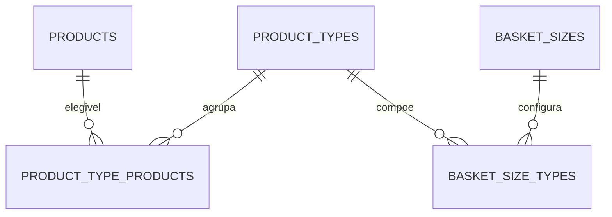
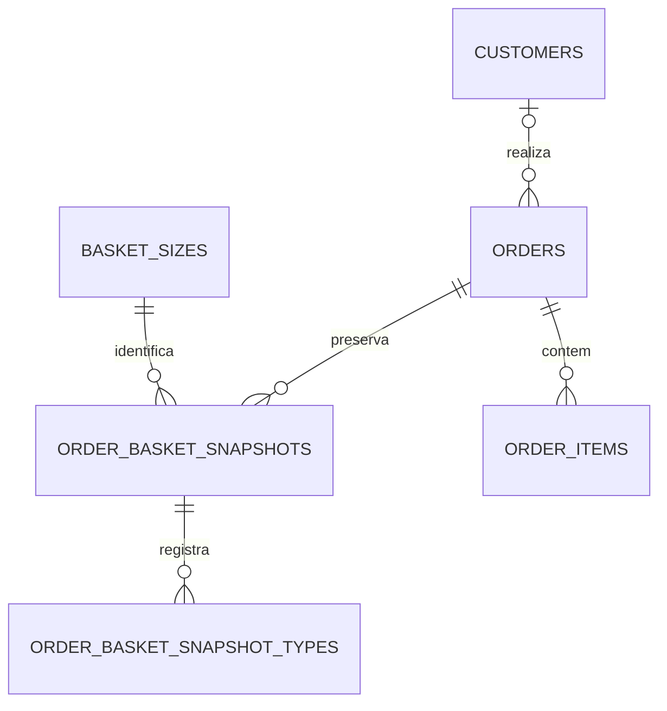
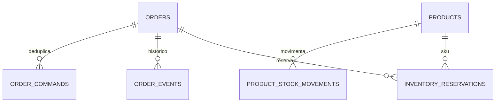
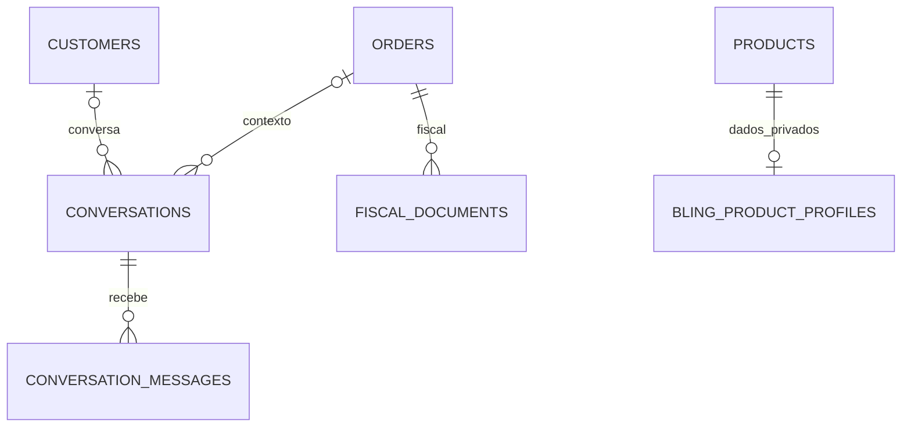

# ERD — schema privado `da_next`

Diagrama lógico da cadeia R02; representa chaves e fronteiras, não implica conexão a um banco remoto. Tipos auxiliares e índices estão no SQL versionado.

## Catálogo e composição de cestas

`products` representa um SKU por apresentação/sabor. `product_types` são grupos de alternativas; não são categorias comerciais. `basket_sizes` mantém um ajuste privado em centavos, sem expor esse detalhe na vitrine.

## Pedido e snapshots

Endereço, nome, telefone, preço, composição, nome do SKU e tipo são preservados no pedido. `order_items` associa componente a snapshot e tipo por chaves compostas. Componente da cesta não possui preço unitário/linha; extra possui ambos.

## Estoque e comandos

Reservas são consolidadas por produto e pedido. Movimentos e comandos têm chaves de idempotência; eventos têm versão e tipo. As constraints do banco não executam por si sós a lógica transacional do adaptador futuro.

## Atendimento, fiscal e integração

`audit_log` registra metadados de alteração; `integration_outbox` guarda eventos para consumidores futuros. Nenhuma integração, worker ou mensagem é acionada pelas migrações.
